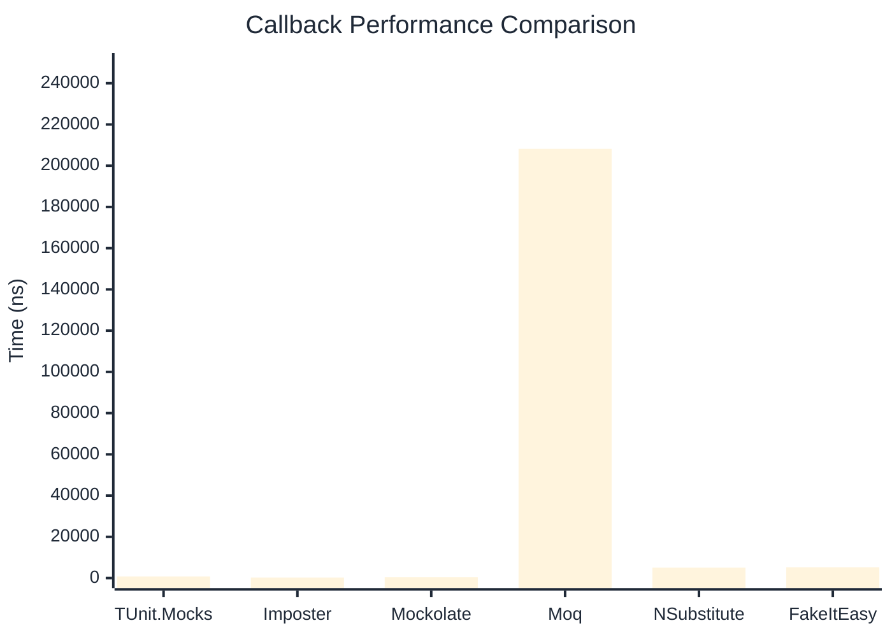

# Callback Benchmark

> Callback registration and execution — comparing **TUnit.Mocks** (source-generated) against runtime proxy-based mocking libraries.

:::info Last Updated
This benchmark was automatically generated on **2026-11-18** from the latest CI run.

**Environment:** Ubuntu Latest • .NET SDK 11.0.100
:::

## 📊 Results

Callback registration and execution:

| Library | Mean | Error | StdDev | Allocated |
|---------|------|-------|--------|-----------|
| **TUnit.Mocks** | 765.6 ns | 9.70 ns | 9.07 ns | 3200 B |
| Imposter | 276.7 ns | 4.25 ns | 3.97 ns | 848 B |
| Mockolate | 400.7 ns | 6.70 ns | 6.27 ns | 1744 B |
| Moq | 208,191.9 ns | 476.19 ns | 445.43 ns | 13519 B |
| NSubstitute | 5,081.8 ns | 12.82 ns | 12.00 ns | 8008 B |
| FakeItEasy | 5,258.3 ns | 46.98 ns | 41.65 ns | 7549 B |

---

### with args

| Library | Mean | Error | StdDev | Allocated |
|---------|------|-------|--------|-----------|
| **TUnit.Mocks** | 883.8 ns | 7.72 ns | 6.84 ns | 3296 B |
| Imposter | 305.6 ns | 3.36 ns | 3.14 ns | 896 B |
| Mockolate | 443.1 ns | 7.31 ns | 6.48 ns | 1744 B |
| Moq | 214,220.5 ns | 1,003.75 ns | 838.18 ns | 13982 B |
| NSubstitute | 5,726.2 ns | 20.71 ns | 19.37 ns | 8584 B |
| FakeItEasy | 6,467.7 ns | 53.22 ns | 47.18 ns | 9624 B |

## 🎯 Key Insights

This benchmark compares **TUnit.Mocks** (source-generated) against runtime proxy-based mocking libraries for callback registration and execution.

---

:::note Methodology
View the [mock benchmarks overview](/docs/benchmarks/mocks) for methodology details and environment information.
:::

*Last generated: 2026-11-18T02:25:26.946Z*
