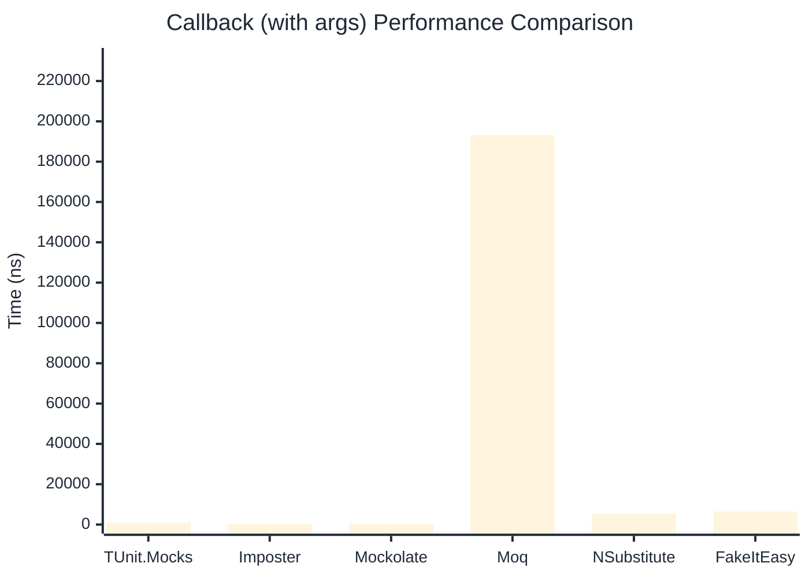

# Callback Benchmark

> Callback registration and execution — comparing **TUnit.Mocks** (source-generated) against runtime proxy-based mocking libraries.

:::info Last Updated
This benchmark was automatically generated on **2026-11-08** from the latest CI run.

**Environment:** Ubuntu Latest • .NET SDK 10.0.403
:::

## 📊 Results

Callback registration and execution:

| Library | Mean | Error | StdDev | Allocated |
|---------|------|-------|--------|-----------|
| **TUnit.Mocks** | 666.8 ns | 6.09 ns | 5.39 ns | 3208 B |
| Imposter | 247.4 ns | 0.65 ns | 0.55 ns | 856 B |
| Mockolate | 347.3 ns | 3.73 ns | 3.49 ns | 1840 B |
| Moq | 186,331.0 ns | 853.67 ns | 712.85 ns | 13455 B |
| NSubstitute | 4,812.7 ns | 17.60 ns | 14.70 ns | 8040 B |
| FakeItEasy | 5,247.2 ns | 28.96 ns | 25.67 ns | 7621 B |

---

### with args

| Library | Mean | Error | StdDev | Allocated |
|---------|------|-------|--------|-----------|
| **TUnit.Mocks** | 941.4 ns | 5.83 ns | 5.45 ns | 3304 B |
| Imposter | 273.3 ns | 1.33 ns | 1.18 ns | 904 B |
| Mockolate | 410.1 ns | 1.90 ns | 1.58 ns | 1888 B |
| Moq | 193,208.2 ns | 989.79 ns | 772.77 ns | 14024 B |
| NSubstitute | 5,438.4 ns | 31.51 ns | 29.48 ns | 8616 B |
| FakeItEasy | 6,443.9 ns | 66.43 ns | 58.89 ns | 9625 B |

## 🎯 Key Insights

This benchmark compares **TUnit.Mocks** (source-generated) against runtime proxy-based mocking libraries for callback registration and execution.

---

:::note Methodology
View the [mock benchmarks overview](/docs/benchmarks/mocks) for methodology details and environment information.
:::

*Last generated: 2026-11-08T02:26:36.812Z*
