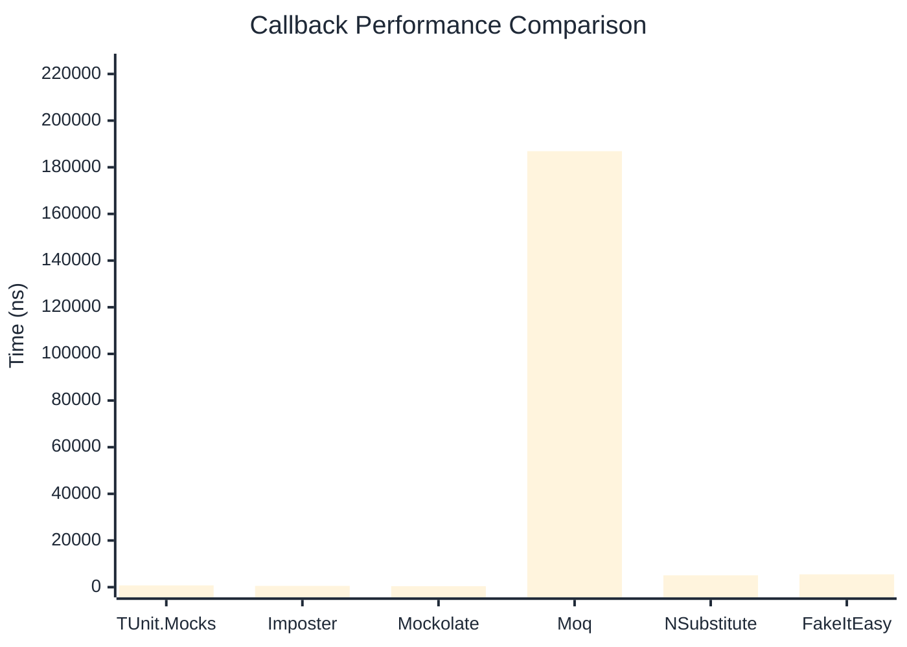
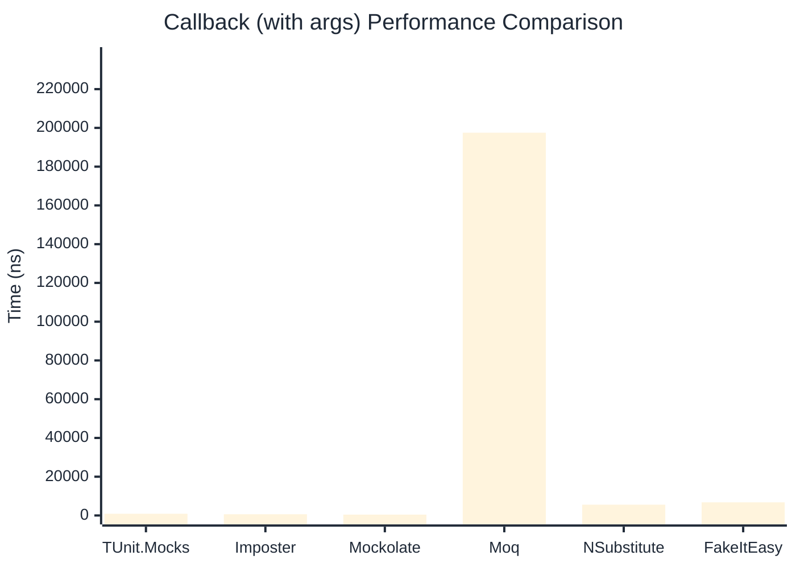

# Callback Benchmark

> Callback registration and execution — comparing **TUnit.Mocks** (source-generated) against runtime proxy-based mocking libraries.

:::info Last Updated
This benchmark was automatically generated on **2026-10-25** from the latest CI run.

**Environment:** Ubuntu Latest • .NET SDK 10.0.402
:::

## 📊 Results

Callback registration and execution:

| Library | Mean | Error | StdDev | Allocated |
|---------|------|-------|--------|-----------|
| **TUnit.Mocks** | 751.0 ns | 12.37 ns | 11.57 ns | 3.13 KB |
| Imposter | 545.8 ns | 3.44 ns | 2.69 ns | 2.61 KB |
| Mockolate | 403.0 ns | 7.95 ns | 7.44 ns | 1.8 KB |
| Moq | 186,906.9 ns | 1,525.93 ns | 1,427.36 ns | 13.14 KB |
| NSubstitute | 5,060.9 ns | 29.23 ns | 25.92 ns | 7.85 KB |
| FakeItEasy | 5,498.9 ns | 54.79 ns | 51.25 ns | 7.44 KB |

---

### with args

| Library | Mean | Error | StdDev | Allocated |
|---------|------|-------|--------|-----------|
| **TUnit.Mocks** | 875.3 ns | 6.93 ns | 6.14 ns | 3.23 KB |
| Imposter | 624.8 ns | 7.00 ns | 6.21 ns | 2.77 KB |
| Mockolate | 443.8 ns | 4.64 ns | 4.11 ns | 1.84 KB |
| Moq | 197,515.8 ns | 1,506.03 ns | 1,408.74 ns | 13.85 KB |
| NSubstitute | 5,571.0 ns | 32.20 ns | 28.54 ns | 8.41 KB |
| FakeItEasy | 6,783.1 ns | 85.08 ns | 79.59 ns | 9.26 KB |

## 🎯 Key Insights

This benchmark compares **TUnit.Mocks** (source-generated) against runtime proxy-based mocking libraries for callback registration and execution.

---

:::note Methodology
View the [mock benchmarks overview](/docs/benchmarks/mocks) for methodology details and environment information.
:::

*Last generated: 2026-10-25T02:33:24.276Z*
