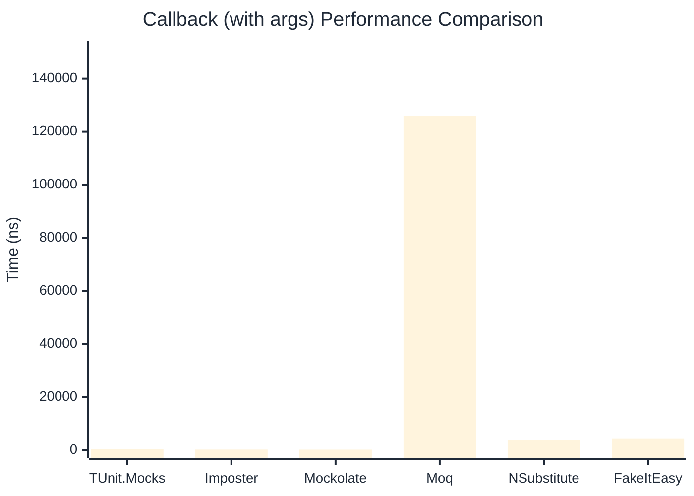

# Callback Benchmark

> Callback registration and execution — comparing **TUnit.Mocks** (source-generated) against other source-generated and runtime proxy-based mocking libraries.

:::info Last Updated
This benchmark was automatically generated on **2026-11-23** from the latest CI run.

**Environment:** Ubuntu Latest • .NET SDK 11.0.100
:::

## 📊 Results

Callback registration and execution:

| Library | Mean | Error | StdDev | Allocated |
|---------|------|-------|--------|-----------|
| **TUnit.Mocks** | 277.7 ns | 1.19 ns | 0.93 ns | 1216 B |
| Imposter | 195.6 ns | 0.77 ns | 0.64 ns | 848 B |
| Mockolate | 169.9 ns | 1.36 ns | 1.28 ns | 832 B |
| Moq | 118,595.2 ns | 550.58 ns | 488.08 ns | 13573 B |
| NSubstitute | 3,401.8 ns | 61.41 ns | 57.44 ns | 8008 B |
| FakeItEasy | 3,383.1 ns | 11.49 ns | 10.75 ns | 7549 B |

---

### with args

| Library | Mean | Error | StdDev | Allocated |
|---------|------|-------|--------|-----------|
| **TUnit.Mocks** | 360.1 ns | 1.51 ns | 1.34 ns | 1400 B |
| Imposter | 219.0 ns | 0.96 ns | 0.90 ns | 896 B |
| Mockolate | 198.8 ns | 0.72 ns | 0.60 ns | 896 B |
| Moq | 125,981.8 ns | 1,268.36 ns | 1,186.42 ns | 13982 B |
| NSubstitute | 3,768.8 ns | 13.58 ns | 12.04 ns | 8584 B |
| FakeItEasy | 4,265.8 ns | 15.93 ns | 14.12 ns | 9624 B |

## 🎯 Key Insights

This benchmark compares **TUnit.Mocks** (source-generated) against other source-generated and runtime proxy-based mocking libraries for callback registration and execution.

---

:::note Methodology
View the [mock benchmarks overview](/docs/benchmarks/mocks) for methodology details and environment information.
:::

*Last generated: 2026-11-23T02:22:45.286Z*
