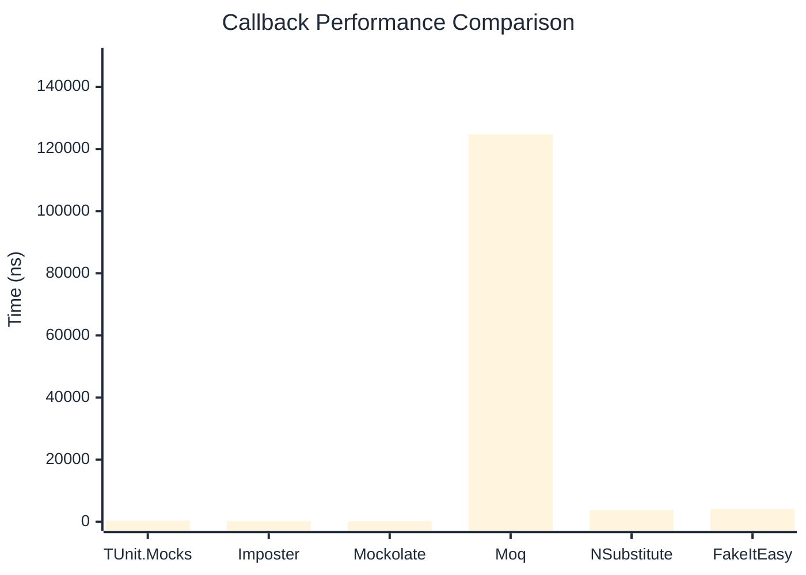

# Callback Benchmark

> Callback registration and execution — comparing **TUnit.Mocks** (source-generated) against other source-generated and runtime proxy-based mocking libraries.

:::info Last Updated
This benchmark was automatically generated on **2026-11-21** from the latest CI run.

**Environment:** Ubuntu Latest • .NET SDK 11.0.100
:::

## 📊 Results

Callback registration and execution:

| Library | Mean | Error | StdDev | Allocated |
|---------|------|-------|--------|-----------|
| **TUnit.Mocks** | 368.7 ns | 7.23 ns | 9.40 ns | 1496 B |
| Imposter | 218.7 ns | 2.64 ns | 2.34 ns | 848 B |
| Mockolate | 194.5 ns | 3.78 ns | 3.53 ns | 832 B |
| Moq | 124,729.4 ns | 1,193.16 ns | 1,116.08 ns | 13438 B |
| NSubstitute | 3,813.3 ns | 40.53 ns | 37.91 ns | 8008 B |
| FakeItEasy | 4,134.0 ns | 42.51 ns | 39.76 ns | 7549 B |

---

### with args

| Library | Mean | Error | StdDev | Allocated |
|---------|------|-------|--------|-----------|
| **TUnit.Mocks** | 473.6 ns | 3.08 ns | 2.88 ns | 1592 B |
| Imposter | 250.6 ns | 3.22 ns | 3.02 ns | 896 B |
| Mockolate | 229.6 ns | 3.77 ns | 3.53 ns | 896 B |
| Moq | 129,192.9 ns | 1,159.63 ns | 1,084.72 ns | 13990 B |
| NSubstitute | 4,308.3 ns | 26.14 ns | 23.17 ns | 8584 B |
| FakeItEasy | 4,833.6 ns | 86.14 ns | 80.58 ns | 9624 B |

## 🎯 Key Insights

This benchmark compares **TUnit.Mocks** (source-generated) against other source-generated and runtime proxy-based mocking libraries for callback registration and execution.

---

:::note Methodology
View the [mock benchmarks overview](/docs/benchmarks/mocks) for methodology details and environment information.
:::

*Last generated: 2026-11-21T02:20:26.016Z*
