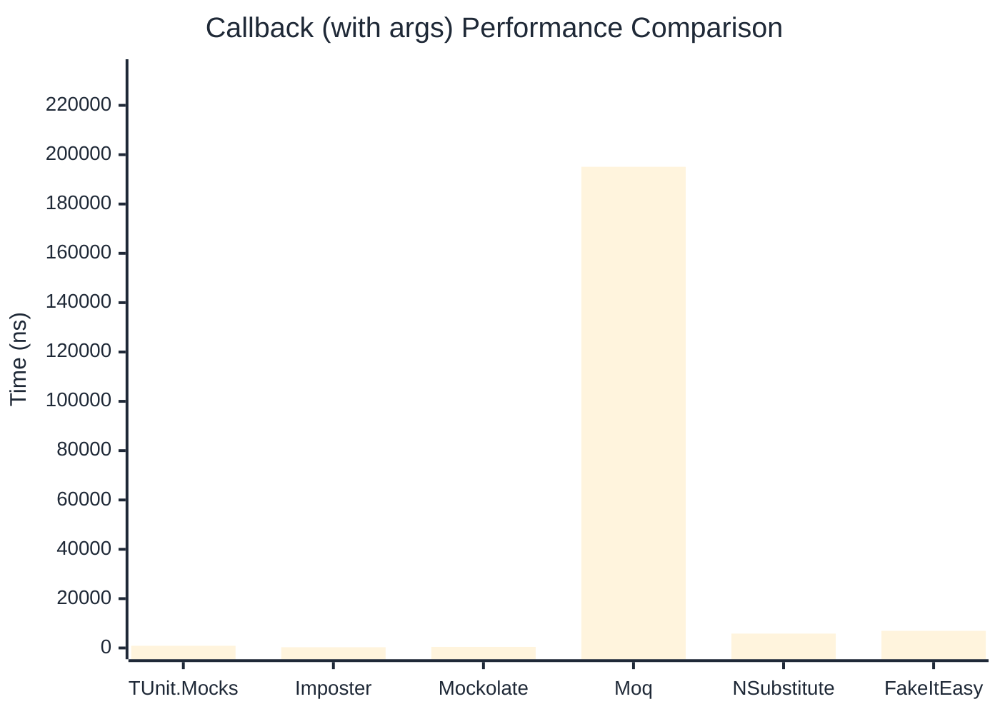

# Callback Benchmark

> Callback registration and execution — comparing **TUnit.Mocks** (source-generated) against runtime proxy-based mocking libraries.

:::info Last Updated
This benchmark was automatically generated on **2026-11-10** from the latest CI run.

**Environment:** Ubuntu Latest • .NET SDK 10.0.403
:::

## 📊 Results

Callback registration and execution:

| Library | Mean | Error | StdDev | Allocated |
|---------|------|-------|--------|-----------|
| **TUnit.Mocks** | 716.1 ns | 13.46 ns | 12.59 ns | 3208 B |
| Imposter | 259.6 ns | 4.09 ns | 3.62 ns | 856 B |
| Mockolate | 374.9 ns | 7.42 ns | 6.94 ns | 1840 B |
| Moq | 185,516.6 ns | 1,265.82 ns | 1,184.05 ns | 13455 B |
| NSubstitute | 5,115.4 ns | 20.54 ns | 19.21 ns | 8040 B |
| FakeItEasy | 5,340.0 ns | 25.15 ns | 21.00 ns | 7621 B |

---

### with args

| Library | Mean | Error | StdDev | Allocated |
|---------|------|-------|--------|-----------|
| **TUnit.Mocks** | 879.7 ns | 5.81 ns | 5.15 ns | 3304 B |
| Imposter | 301.0 ns | 1.97 ns | 1.75 ns | 904 B |
| Mockolate | 444.5 ns | 6.61 ns | 5.86 ns | 1888 B |
| Moq | 195,080.0 ns | 738.05 ns | 616.30 ns | 14024 B |
| NSubstitute | 5,817.9 ns | 70.81 ns | 66.23 ns | 8616 B |
| FakeItEasy | 6,946.7 ns | 30.17 ns | 26.74 ns | 9624 B |

## 🎯 Key Insights

This benchmark compares **TUnit.Mocks** (source-generated) against runtime proxy-based mocking libraries for callback registration and execution.

---

:::note Methodology
View the [mock benchmarks overview](/docs/benchmarks/mocks) for methodology details and environment information.
:::

*Last generated: 2026-11-10T02:26:34.876Z*
