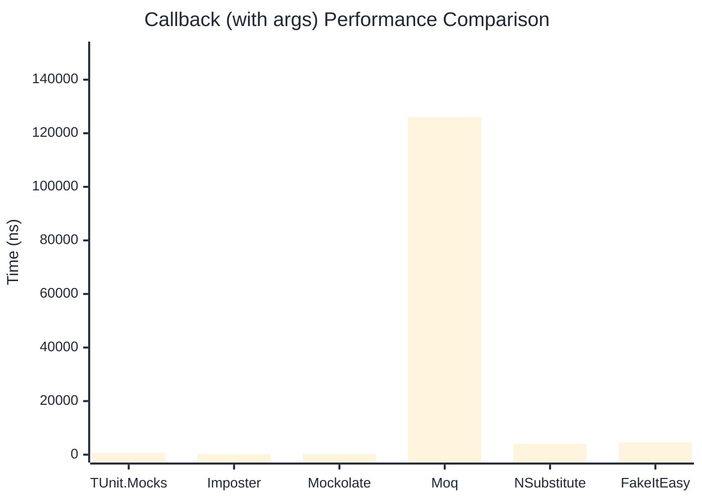

# Callback Benchmark

> Callback registration and execution — comparing **TUnit.Mocks** (source-generated) against runtime proxy-based mocking libraries.

:::info Last Updated
This benchmark was automatically generated on **2026-11-12** from the latest CI run.

**Environment:** Ubuntu Latest • .NET SDK 11.0.100
:::

## 📊 Results

Callback registration and execution:

| Library | Mean | Error | StdDev | Allocated |
|---------|------|-------|--------|-----------|
| **TUnit.Mocks** | 522.6 ns | 10.14 ns | 15.78 ns | 3200 B |
| Imposter | 198.6 ns | 1.72 ns | 1.53 ns | 848 B |
| Mockolate | 251.8 ns | 1.63 ns | 1.45 ns | 1824 B |
| Moq | 118,998.2 ns | 407.08 ns | 339.93 ns | 13573 B |
| NSubstitute | 3,597.3 ns | 39.23 ns | 30.63 ns | 8008 B |
| FakeItEasy | 3,748.9 ns | 41.48 ns | 36.77 ns | 7549 B |

---

### with args

| Library | Mean | Error | StdDev | Allocated |
|---------|------|-------|--------|-----------|
| **TUnit.Mocks** | 636.3 ns | 9.62 ns | 9.00 ns | 3296 B |
| Imposter | 233.1 ns | 1.82 ns | 1.71 ns | 896 B |
| Mockolate | 290.2 ns | 3.09 ns | 2.89 ns | 1872 B |
| Moq | 126,053.1 ns | 522.00 ns | 407.54 ns | 13987 B |
| NSubstitute | 4,043.3 ns | 44.31 ns | 41.45 ns | 8584 B |
| FakeItEasy | 4,623.8 ns | 89.45 ns | 91.86 ns | 9624 B |

## 🎯 Key Insights

This benchmark compares **TUnit.Mocks** (source-generated) against runtime proxy-based mocking libraries for callback registration and execution.

---

:::note Methodology
View the [mock benchmarks overview](/docs/benchmarks/mocks) for methodology details and environment information.
:::

*Last generated: 2026-11-12T02:21:42.541Z*
