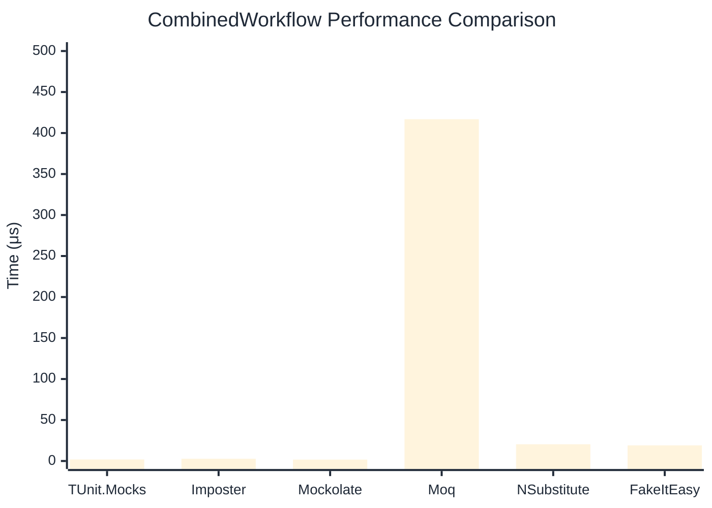

# CombinedWorkflow Benchmark

> Full workflow: create → setup → invoke → verify — comparing **TUnit.Mocks** (source-generated) against runtime proxy-based mocking libraries.

:::info Last Updated
This benchmark was automatically generated on **2026-10-22** from the latest CI run.

**Environment:** Ubuntu Latest • .NET SDK 10.0.402
:::

## 📊 Results

Full workflow: create → setup → invoke → verify:

| Library | Mean | Error | StdDev | Allocated |
|---------|------|-------|--------|-----------|
| **TUnit.Mocks** | 1.922 μs | 0.0380 μs | 0.0373 μs | 6.31 KB |
| Imposter | 2.784 μs | 0.0552 μs | 0.0756 μs | 15.27 KB |
| Mockolate | 1.740 μs | 0.0341 μs | 0.0335 μs | 7.36 KB |
| Moq | 416.898 μs | 3.3951 μs | 3.1758 μs | 36.68 KB |
| NSubstitute | 20.403 μs | 0.3843 μs | 0.3595 μs | 26.72 KB |
| FakeItEasy | 19.073 μs | 0.3286 μs | 0.3073 μs | 25.52 KB |

## 🎯 Key Insights

This benchmark compares **TUnit.Mocks** (source-generated) against runtime proxy-based mocking libraries for full workflow: create → setup → invoke → verify.

---

:::note Methodology
View the [mock benchmarks overview](/docs/benchmarks/mocks) for methodology details and environment information.
:::

*Last generated: 2026-10-22T02:34:37.393Z*
