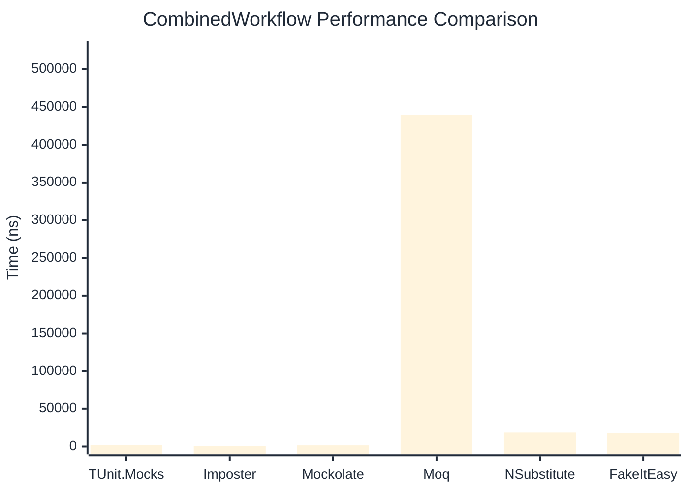

# CombinedWorkflow Benchmark

> Full workflow: create → setup → invoke → verify — comparing **TUnit.Mocks** (source-generated) against runtime proxy-based mocking libraries.

:::info Last Updated
This benchmark was automatically generated on **2026-11-14** from the latest CI run.

**Environment:** Ubuntu Latest • .NET SDK 11.0.100
:::

## 📊 Results

Full workflow: create → setup → invoke → verify:

| Library | Mean | Error | StdDev | Allocated |
|---------|------|-------|--------|-----------|
| **TUnit.Mocks** | 1,810.6 ns | 17.72 ns | 16.57 ns | 6.31 KB |
| Imposter | 901.2 ns | 11.60 ns | 9.69 ns | 3.45 KB |
| Mockolate | 1,559.9 ns | 20.36 ns | 19.04 ns | 7.21 KB |
| Moq | 439,558.4 ns | 2,281.21 ns | 2,133.85 ns | 36.39 KB |
| NSubstitute | 18,353.9 ns | 94.54 ns | 88.43 ns | 26.51 KB |
| FakeItEasy | 17,659.1 ns | 154.09 ns | 144.14 ns | 24.8 KB |

## 🎯 Key Insights

This benchmark compares **TUnit.Mocks** (source-generated) against runtime proxy-based mocking libraries for full workflow: create → setup → invoke → verify.

---

:::note Methodology
View the [mock benchmarks overview](/docs/benchmarks/mocks) for methodology details and environment information.
:::

*Last generated: 2026-11-14T02:21:36.343Z*
