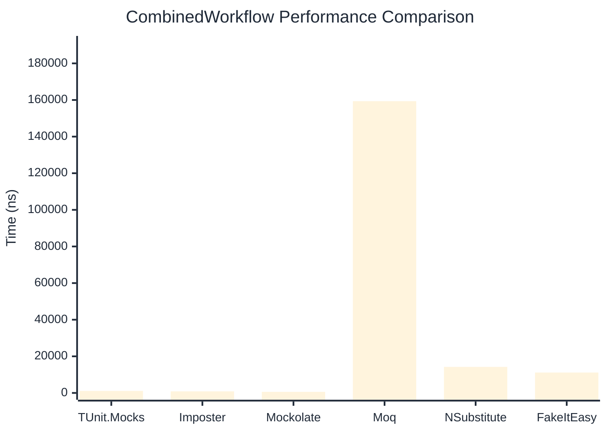

# CombinedWorkflow Benchmark

> Full workflow: create → setup → invoke → verify — comparing **TUnit.Mocks** (source-generated) against other source-generated and runtime proxy-based mocking libraries.

:::info Last Updated
This benchmark was automatically generated on **2026-11-26** from the latest CI run.

**Environment:** Ubuntu Latest • .NET SDK 11.0.100
:::

## 📊 Results

Full workflow: create → setup → invoke → verify:

| Library | Mean | Error | StdDev | Allocated |
|---------|------|-------|--------|-----------|
| **TUnit.Mocks** | 1,115.7 ns | 4.19 ns | 3.92 ns | 3.7 KB |
| Imposter | 880.6 ns | 4.33 ns | 4.05 ns | 3.45 KB |
| Mockolate | 602.7 ns | 3.73 ns | 3.49 ns | 1.96 KB |
| Moq | 159,361.5 ns | 711.63 ns | 630.85 ns | 36.53 KB |
| NSubstitute | 14,231.6 ns | 48.65 ns | 43.13 ns | 26.51 KB |
| FakeItEasy | 11,146.4 ns | 55.86 ns | 49.52 ns | 24.79 KB |

## 🎯 Key Insights

This benchmark compares **TUnit.Mocks** (source-generated) against other source-generated and runtime proxy-based mocking libraries for full workflow: create → setup → invoke → verify.

---

:::note Methodology
View the [mock benchmarks overview](/docs/benchmarks/mocks) for methodology details and environment information.
:::

*Last generated: 2026-11-26T02:21:09.958Z*
