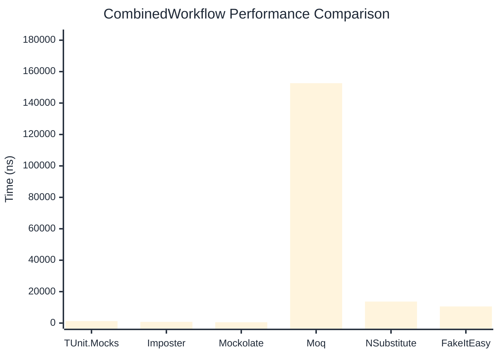

# CombinedWorkflow Benchmark

> Full workflow: create → setup → invoke → verify — comparing **TUnit.Mocks** (source-generated) against other source-generated and runtime proxy-based mocking libraries.

:::info Last Updated
This benchmark was automatically generated on **2026-11-21** from the latest CI run.

**Environment:** Ubuntu Latest • .NET SDK 11.0.100
:::

## 📊 Results

Full workflow: create → setup → invoke → verify:

| Library | Mean | Error | StdDev | Allocated |
|---------|------|-------|--------|-----------|
| **TUnit.Mocks** | 1,274.3 ns | 17.56 ns | 16.43 ns | 4.8 KB |
| Imposter | 772.1 ns | 13.46 ns | 12.59 ns | 3.45 KB |
| Mockolate | 545.9 ns | 4.42 ns | 3.92 ns | 1.96 KB |
| Moq | 152,648.7 ns | 468.68 ns | 415.47 ns | 36.31 KB |
| NSubstitute | 13,681.6 ns | 272.91 ns | 280.25 ns | 26.51 KB |
| FakeItEasy | 10,588.8 ns | 204.36 ns | 299.55 ns | 24.91 KB |

## 🎯 Key Insights

This benchmark compares **TUnit.Mocks** (source-generated) against other source-generated and runtime proxy-based mocking libraries for full workflow: create → setup → invoke → verify.

---

:::note Methodology
View the [mock benchmarks overview](/docs/benchmarks/mocks) for methodology details and environment information.
:::

*Last generated: 2026-11-21T02:20:26.016Z*
