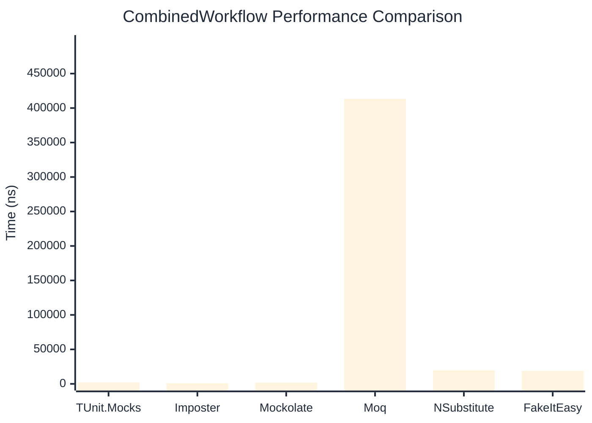

# CombinedWorkflow Benchmark

> Full workflow: create → setup → invoke → verify — comparing **TUnit.Mocks** (source-generated) against runtime proxy-based mocking libraries.

:::info Last Updated
This benchmark was automatically generated on **2026-11-06** from the latest CI run.

**Environment:** Ubuntu Latest • .NET SDK 10.0.403
:::

## 📊 Results

Full workflow: create → setup → invoke → verify:

| Library | Mean | Error | StdDev | Allocated |
|---------|------|-------|--------|-----------|
| **TUnit.Mocks** | 2,018.7 ns | 18.06 ns | 16.90 ns | 6.31 KB |
| Imposter | 953.0 ns | 6.56 ns | 6.13 ns | 3.47 KB |
| Mockolate | 1,722.7 ns | 14.35 ns | 13.42 ns | 7.36 KB |
| Moq | 413,388.3 ns | 1,674.69 ns | 1,398.44 ns | 36.16 KB |
| NSubstitute | 19,484.9 ns | 71.95 ns | 67.31 ns | 26.72 KB |
| FakeItEasy | 18,764.6 ns | 44.29 ns | 41.43 ns | 25.66 KB |

## 🎯 Key Insights

This benchmark compares **TUnit.Mocks** (source-generated) against runtime proxy-based mocking libraries for full workflow: create → setup → invoke → verify.

---

:::note Methodology
View the [mock benchmarks overview](/docs/benchmarks/mocks) for methodology details and environment information.
:::

*Last generated: 2026-11-06T02:27:23.366Z*
