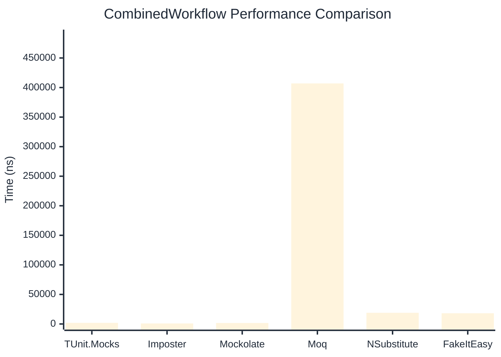

# CombinedWorkflow Benchmark

> Full workflow: create → setup → invoke → verify — comparing **TUnit.Mocks** (source-generated) against runtime proxy-based mocking libraries.

:::info Last Updated
This benchmark was automatically generated on **2026-11-08** from the latest CI run.

**Environment:** Ubuntu Latest • .NET SDK 10.0.403
:::

## 📊 Results

Full workflow: create → setup → invoke → verify:

| Library | Mean | Error | StdDev | Allocated |
|---------|------|-------|--------|-----------|
| **TUnit.Mocks** | 1,928.5 ns | 16.23 ns | 15.18 ns | 6.31 KB |
| Imposter | 909.1 ns | 5.67 ns | 5.31 ns | 3.47 KB |
| Mockolate | 1,660.2 ns | 16.67 ns | 13.92 ns | 7.36 KB |
| Moq | 406,997.5 ns | 2,949.38 ns | 2,758.85 ns | 36.35 KB |
| NSubstitute | 18,940.9 ns | 258.78 ns | 229.40 ns | 26.72 KB |
| FakeItEasy | 18,132.8 ns | 156.13 ns | 130.38 ns | 25.52 KB |

## 🎯 Key Insights

This benchmark compares **TUnit.Mocks** (source-generated) against runtime proxy-based mocking libraries for full workflow: create → setup → invoke → verify.

---

:::note Methodology
View the [mock benchmarks overview](/docs/benchmarks/mocks) for methodology details and environment information.
:::

*Last generated: 2026-11-08T02:26:36.812Z*
