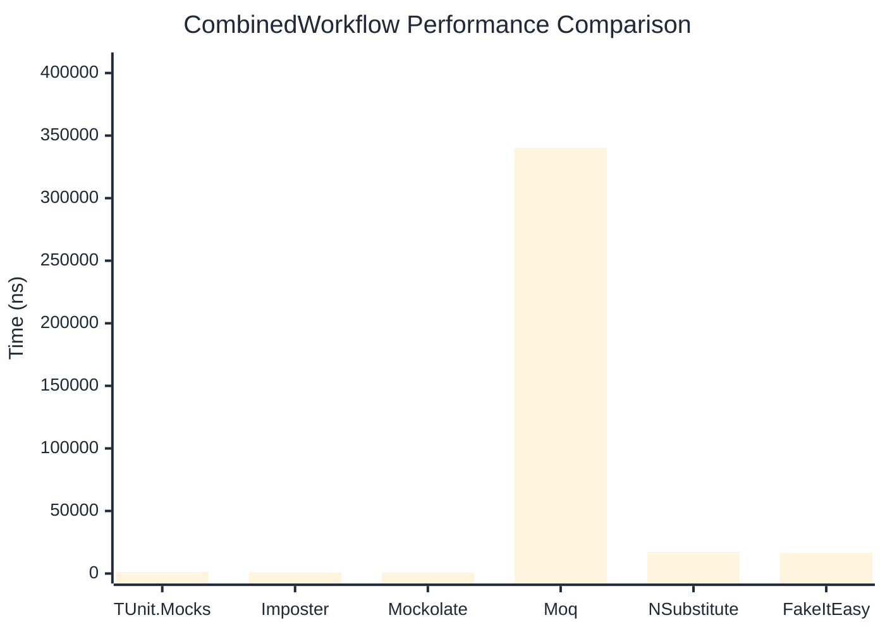

# CombinedWorkflow Benchmark

> Full workflow: create → setup → invoke → verify — comparing **TUnit.Mocks** (source-generated) against other source-generated and runtime proxy-based mocking libraries.

:::info Last Updated
This benchmark was automatically generated on **2026-11-23** from the latest CI run.

**Environment:** Ubuntu Latest • .NET SDK 11.0.100
:::

## 📊 Results

Full workflow: create → setup → invoke → verify:

| Library | Mean | Error | StdDev | Allocated |
|---------|------|-------|--------|-----------|
| **TUnit.Mocks** | 1,198.9 ns | 13.14 ns | 12.29 ns | 3.7 KB |
| Imposter | 900.3 ns | 15.85 ns | 14.82 ns | 3.45 KB |
| Mockolate | 709.5 ns | 9.67 ns | 8.08 ns | 1.96 KB |
| Moq | 340,360.4 ns | 2,465.95 ns | 2,306.65 ns | 36.57 KB |
| NSubstitute | 17,417.7 ns | 331.44 ns | 354.64 ns | 26.51 KB |
| FakeItEasy | 16,478.2 ns | 197.96 ns | 185.17 ns | 24.96 KB |

## 🎯 Key Insights

This benchmark compares **TUnit.Mocks** (source-generated) against other source-generated and runtime proxy-based mocking libraries for full workflow: create → setup → invoke → verify.

---

:::note Methodology
View the [mock benchmarks overview](/docs/benchmarks/mocks) for methodology details and environment information.
:::

*Last generated: 2026-11-23T02:22:45.286Z*
