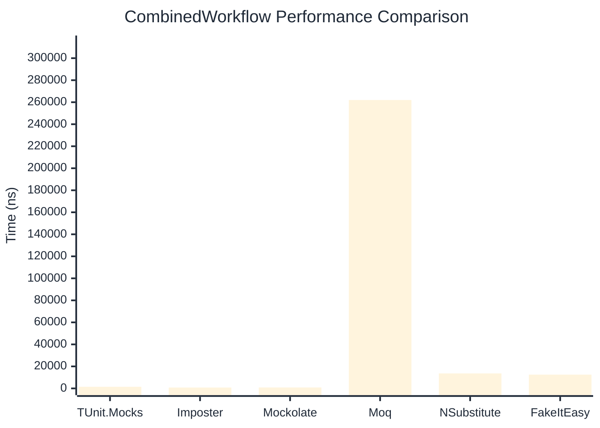

# CombinedWorkflow Benchmark

> Full workflow: create → setup → invoke → verify — comparing **TUnit.Mocks** (source-generated) against runtime proxy-based mocking libraries.

:::info Last Updated
This benchmark was automatically generated on **2026-11-19** from the latest CI run.

**Environment:** Ubuntu Latest • .NET SDK 11.0.100
:::

## 📊 Results

Full workflow: create → setup → invoke → verify:

| Library | Mean | Error | StdDev | Allocated |
|---------|------|-------|--------|-----------|
| **TUnit.Mocks** | 1,481.5 ns | 28.25 ns | 29.01 ns | 6.31 KB |
| Imposter | 790.6 ns | 8.81 ns | 7.81 ns | 3.45 KB |
| Mockolate | 857.9 ns | 16.66 ns | 14.76 ns | 3.9 KB |
| Moq | 262,011.8 ns | 1,783.68 ns | 1,668.45 ns | 36.31 KB |
| NSubstitute | 13,616.3 ns | 193.01 ns | 180.54 ns | 26.62 KB |
| FakeItEasy | 12,512.9 ns | 136.13 ns | 127.34 ns | 25.02 KB |

## 🎯 Key Insights

This benchmark compares **TUnit.Mocks** (source-generated) against runtime proxy-based mocking libraries for full workflow: create → setup → invoke → verify.

---

:::note Methodology
View the [mock benchmarks overview](/docs/benchmarks/mocks) for methodology details and environment information.
:::

*Last generated: 2026-11-19T02:23:19.275Z*
