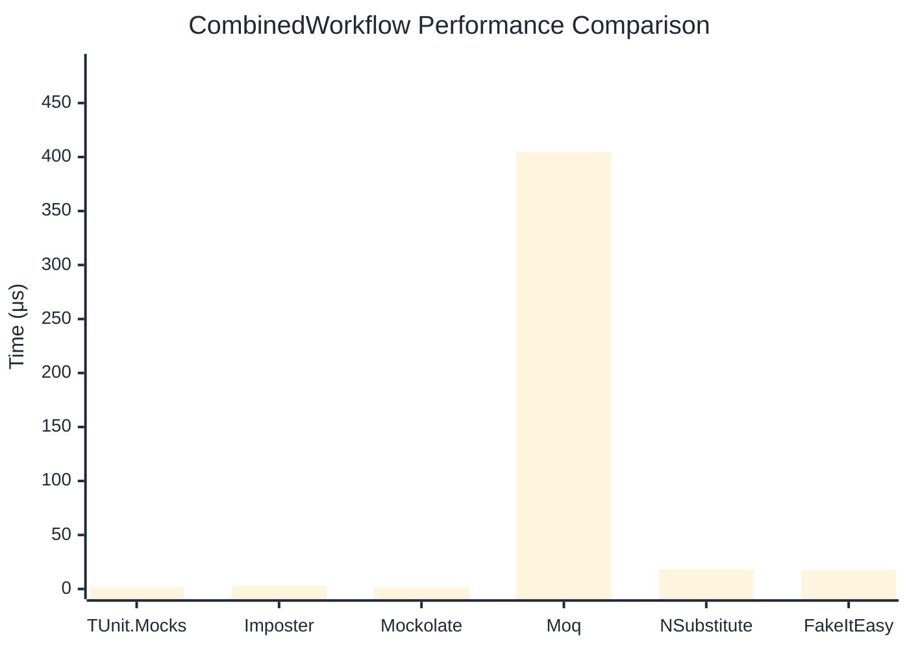

# CombinedWorkflow Benchmark

> Full workflow: create → setup → invoke → verify — comparing **TUnit.Mocks** (source-generated) against runtime proxy-based mocking libraries.

:::info Last Updated
This benchmark was automatically generated on **2026-10-11** from the latest CI run.

**Environment:** Ubuntu Latest • .NET SDK 10.0.401
:::

## 📊 Results

Full workflow: create → setup → invoke → verify:

| Library | Mean | Error | StdDev | Allocated |
|---------|------|-------|--------|-----------|
| **TUnit.Mocks** | 1.940 μs | 0.0386 μs | 0.0474 μs | 6.28 KB |
| Imposter | 2.604 μs | 0.0507 μs | 0.0584 μs | 15.64 KB |
| Mockolate | 1.615 μs | 0.0317 μs | 0.0297 μs | 7.36 KB |
| Moq | 404.907 μs | 4.0163 μs | 3.7569 μs | 36.27 KB |
| NSubstitute | 18.500 μs | 0.1229 μs | 0.1149 μs | 26.72 KB |
| FakeItEasy | 17.699 μs | 0.2099 μs | 0.1752 μs | 25.52 KB |

## 🎯 Key Insights

This benchmark compares **TUnit.Mocks** (source-generated) against runtime proxy-based mocking libraries for full workflow: create → setup → invoke → verify.

---

:::note Methodology
View the [mock benchmarks overview](/docs/benchmarks/mocks) for methodology details and environment information.
:::

*Last generated: 2026-10-11T02:43:35.245Z*
