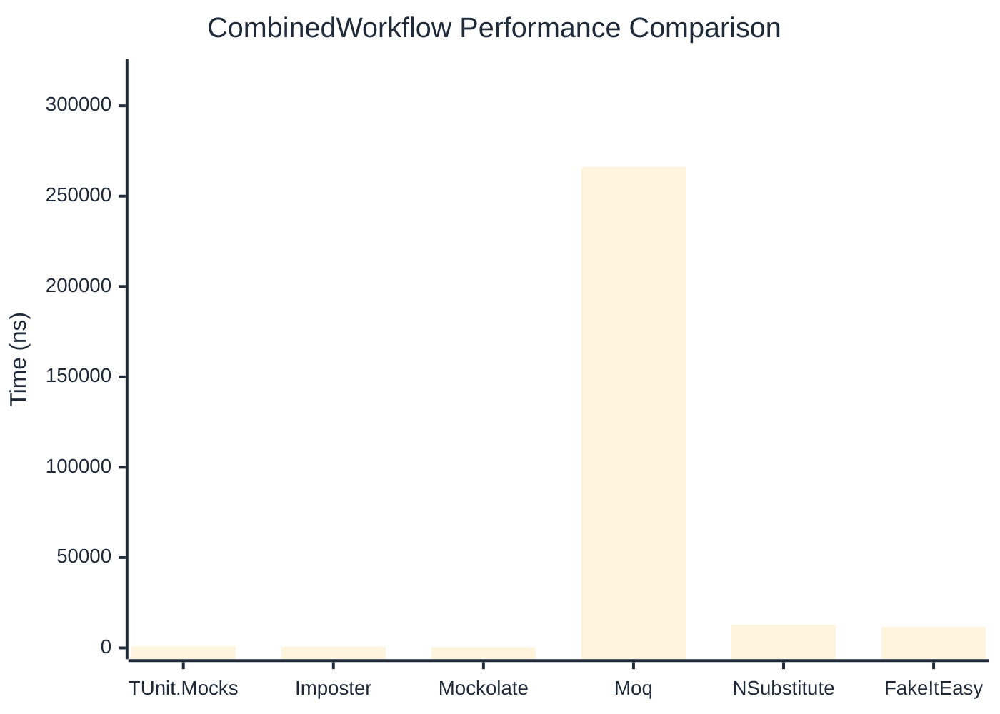

# CombinedWorkflow Benchmark

> Full workflow: create → setup → invoke → verify — comparing **TUnit.Mocks** (source-generated) against other source-generated and runtime proxy-based mocking libraries.

:::info Last Updated
This benchmark was automatically generated on **2026-11-22** from the latest CI run.

**Environment:** Ubuntu Latest • .NET SDK 11.0.100
:::

## 📊 Results

Full workflow: create → setup → invoke → verify:

| Library | Mean | Error | StdDev | Allocated |
|---------|------|-------|--------|-----------|
| **TUnit.Mocks** | 942.0 ns | 16.52 ns | 15.45 ns | 3.7 KB |
| Imposter | 696.8 ns | 4.11 ns | 3.43 ns | 3.45 KB |
| Mockolate | 491.6 ns | 2.33 ns | 2.06 ns | 1.96 KB |
| Moq | 266,234.1 ns | 1,580.83 ns | 1,478.71 ns | 36.17 KB |
| NSubstitute | 12,753.1 ns | 93.80 ns | 87.74 ns | 26.51 KB |
| FakeItEasy | 11,632.5 ns | 228.40 ns | 224.32 ns | 24.8 KB |

## 🎯 Key Insights

This benchmark compares **TUnit.Mocks** (source-generated) against other source-generated and runtime proxy-based mocking libraries for full workflow: create → setup → invoke → verify.

---

:::note Methodology
View the [mock benchmarks overview](/docs/benchmarks/mocks) for methodology details and environment information.
:::

*Last generated: 2026-11-22T02:21:53.323Z*
