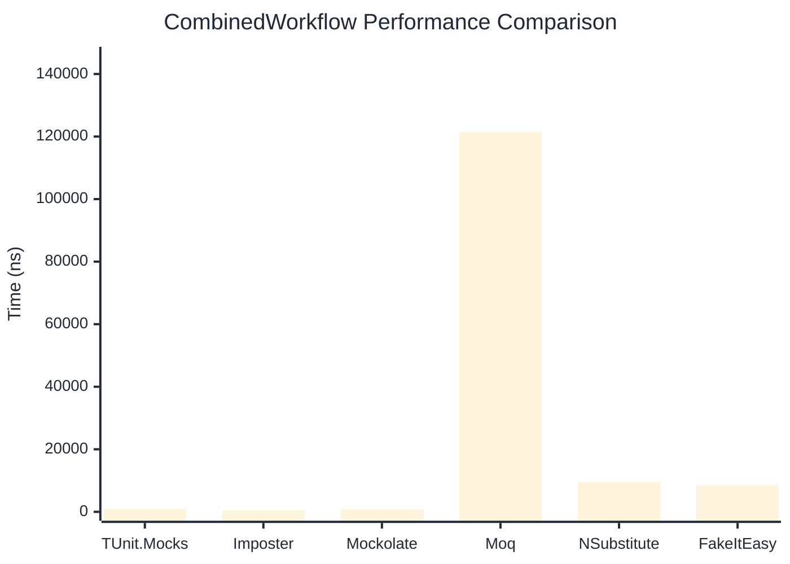

# CombinedWorkflow Benchmark

> Full workflow: create → setup → invoke → verify — comparing **TUnit.Mocks** (source-generated) against runtime proxy-based mocking libraries.

:::info Last Updated
This benchmark was automatically generated on **2026-11-11** from the latest CI run.

**Environment:** Ubuntu Latest • .NET SDK 11.0.100
:::

## 📊 Results

Full workflow: create → setup → invoke → verify:

| Library | Mean | Error | StdDev | Allocated |
|---------|------|-------|--------|-----------|
| **TUnit.Mocks** | 1,014.7 ns | 8.94 ns | 7.93 ns | 6.31 KB |
| Imposter | 492.2 ns | 9.62 ns | 10.29 ns | 3.45 KB |
| Mockolate | 848.3 ns | 16.66 ns | 31.71 ns | 7.21 KB |
| Moq | 121,527.5 ns | 1,846.72 ns | 1,727.42 ns | 36.61 KB |
| NSubstitute | 9,571.4 ns | 145.46 ns | 128.95 ns | 26.51 KB |
| FakeItEasy | 8,469.4 ns | 155.64 ns | 145.59 ns | 24.8 KB |

## 🎯 Key Insights

This benchmark compares **TUnit.Mocks** (source-generated) against runtime proxy-based mocking libraries for full workflow: create → setup → invoke → verify.

---

:::note Methodology
View the [mock benchmarks overview](/docs/benchmarks/mocks) for methodology details and environment information.
:::

*Last generated: 2026-11-11T02:20:11.802Z*
