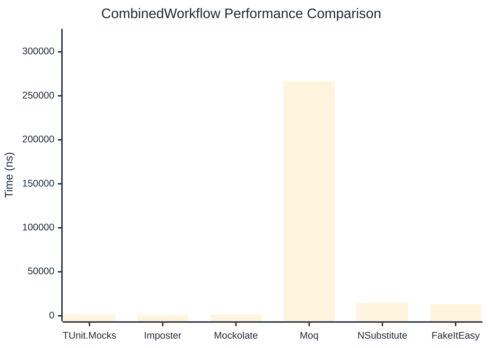

# CombinedWorkflow Benchmark

> Full workflow: create → setup → invoke → verify — comparing **TUnit.Mocks** (source-generated) against runtime proxy-based mocking libraries.

:::info Last Updated
This benchmark was automatically generated on **2026-11-12** from the latest CI run.

**Environment:** Ubuntu Latest • .NET SDK 11.0.100
:::

## 📊 Results

Full workflow: create → setup → invoke → verify:

| Library | Mean | Error | StdDev | Allocated |
|---------|------|-------|--------|-----------|
| **TUnit.Mocks** | 1,640.6 ns | 30.59 ns | 27.12 ns | 6.31 KB |
| Imposter | 807.1 ns | 14.07 ns | 13.16 ns | 3.45 KB |
| Mockolate | 1,468.7 ns | 28.69 ns | 31.89 ns | 7.21 KB |
| Moq | 266,507.0 ns | 5,270.77 ns | 6,665.84 ns | 36.31 KB |
| NSubstitute | 14,869.2 ns | 295.60 ns | 328.56 ns | 26.51 KB |
| FakeItEasy | 12,944.3 ns | 150.39 ns | 140.67 ns | 24.8 KB |

## 🎯 Key Insights

This benchmark compares **TUnit.Mocks** (source-generated) against runtime proxy-based mocking libraries for full workflow: create → setup → invoke → verify.

---

:::note Methodology
View the [mock benchmarks overview](/docs/benchmarks/mocks) for methodology details and environment information.
:::

*Last generated: 2026-11-12T02:21:42.541Z*
