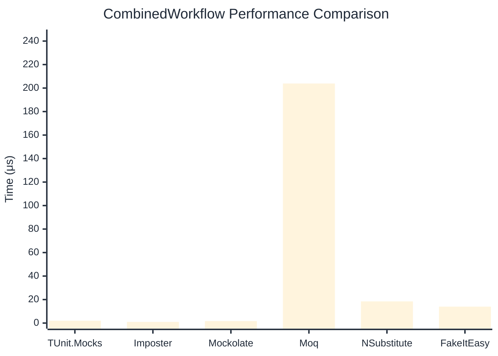

# CombinedWorkflow Benchmark

> Full workflow: create → setup → invoke → verify — comparing **TUnit.Mocks** (source-generated) against runtime proxy-based mocking libraries.

:::info Last Updated
This benchmark was automatically generated on **2026-11-15** from the latest CI run.

**Environment:** Ubuntu Latest • .NET SDK 11.0.100
:::

## 📊 Results

Full workflow: create → setup → invoke → verify:

| Library | Mean | Error | StdDev | Allocated |
|---------|------|-------|--------|-----------|
| **TUnit.Mocks** | 2.007 μs | 0.0242 μs | 0.0226 μs | 6.31 KB |
| Imposter | 1.007 μs | 0.0089 μs | 0.0084 μs | 3.45 KB |
| Mockolate | 1.712 μs | 0.0219 μs | 0.0205 μs | 7.27 KB |
| Moq | 203.887 μs | 0.9982 μs | 0.8848 μs | 36.47 KB |
| NSubstitute | 18.454 μs | 0.1616 μs | 0.1512 μs | 26.51 KB |
| FakeItEasy | 14.002 μs | 0.1744 μs | 0.1631 μs | 24.79 KB |

## 🎯 Key Insights

This benchmark compares **TUnit.Mocks** (source-generated) against runtime proxy-based mocking libraries for full workflow: create → setup → invoke → verify.

---

:::note Methodology
View the [mock benchmarks overview](/docs/benchmarks/mocks) for methodology details and environment information.
:::

*Last generated: 2026-11-15T02:24:17.223Z*
