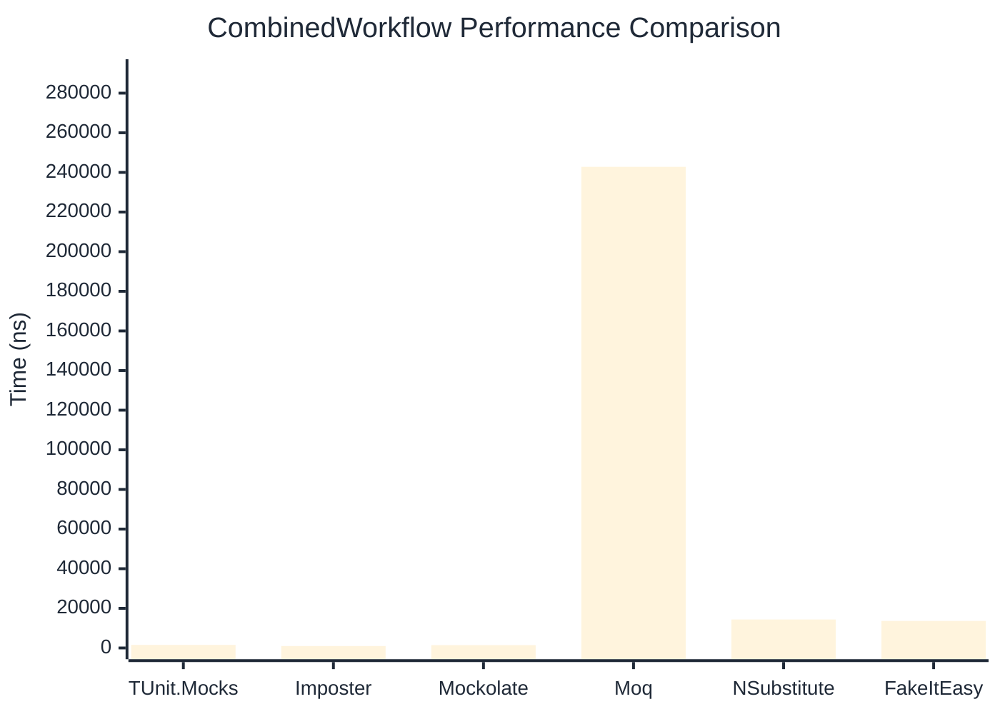

# CombinedWorkflow Benchmark

> Full workflow: create → setup → invoke → verify — comparing **TUnit.Mocks** (source-generated) against runtime proxy-based mocking libraries.

:::info Last Updated
This benchmark was automatically generated on **2026-11-01** from the latest CI run.

**Environment:** Ubuntu Latest • .NET SDK 10.0.403
:::

## 📊 Results

Full workflow: create → setup → invoke → verify:

| Library | Mean | Error | StdDev | Allocated |
|---------|------|-------|--------|-----------|
| **TUnit.Mocks** | 1,539.1 ns | 20.49 ns | 16.00 ns | 6.31 KB |
| Imposter | 977.2 ns | 8.62 ns | 7.65 ns | 4.13 KB |
| Mockolate | 1,418.8 ns | 28.17 ns | 56.26 ns | 7.36 KB |
| Moq | 242,821.2 ns | 1,026.80 ns | 857.43 ns | 36.16 KB |
| NSubstitute | 14,373.7 ns | 160.03 ns | 149.69 ns | 26.72 KB |
| FakeItEasy | 13,641.0 ns | 227.77 ns | 213.06 ns | 25.52 KB |

## 🎯 Key Insights

This benchmark compares **TUnit.Mocks** (source-generated) against runtime proxy-based mocking libraries for full workflow: create → setup → invoke → verify.

---

:::note Methodology
View the [mock benchmarks overview](/docs/benchmarks/mocks) for methodology details and environment information.
:::

*Last generated: 2026-11-01T02:27:32.250Z*
