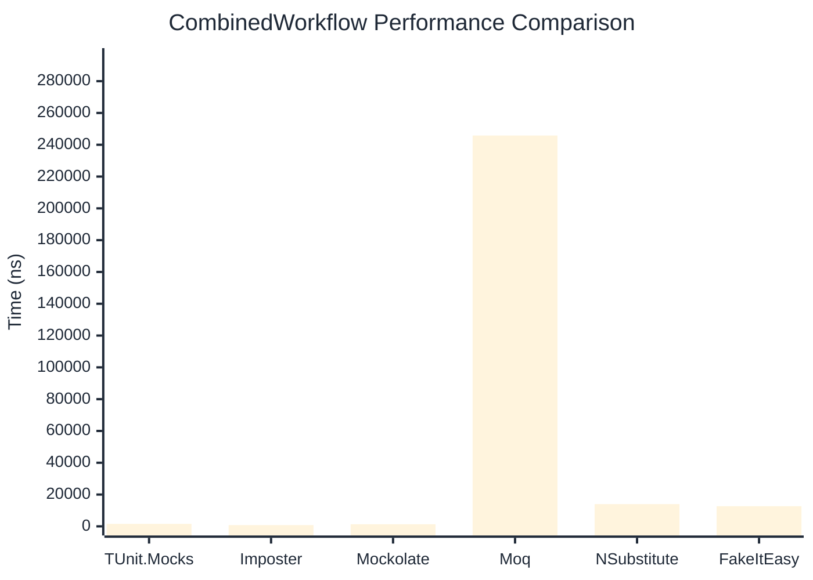

# CombinedWorkflow Benchmark

> Full workflow: create → setup → invoke → verify — comparing **TUnit.Mocks** (source-generated) against runtime proxy-based mocking libraries.

:::info Last Updated
This benchmark was automatically generated on **2026-11-10** from the latest CI run.

**Environment:** Ubuntu Latest • .NET SDK 10.0.403
:::

## 📊 Results

Full workflow: create → setup → invoke → verify:

| Library | Mean | Error | StdDev | Allocated |
|---------|------|-------|--------|-----------|
| **TUnit.Mocks** | 1,574.4 ns | 23.79 ns | 22.26 ns | 6.31 KB |
| Imposter | 789.3 ns | 7.60 ns | 5.93 ns | 3.47 KB |
| Mockolate | 1,318.8 ns | 20.70 ns | 19.37 ns | 7.36 KB |
| Moq | 245,822.9 ns | 1,888.85 ns | 1,766.83 ns | 36.16 KB |
| NSubstitute | 13,990.3 ns | 135.37 ns | 126.62 ns | 26.72 KB |
| FakeItEasy | 12,675.2 ns | 73.04 ns | 60.99 ns | 25.52 KB |

## 🎯 Key Insights

This benchmark compares **TUnit.Mocks** (source-generated) against runtime proxy-based mocking libraries for full workflow: create → setup → invoke → verify.

---

:::note Methodology
View the [mock benchmarks overview](/docs/benchmarks/mocks) for methodology details and environment information.
:::

*Last generated: 2026-11-10T02:26:34.876Z*
