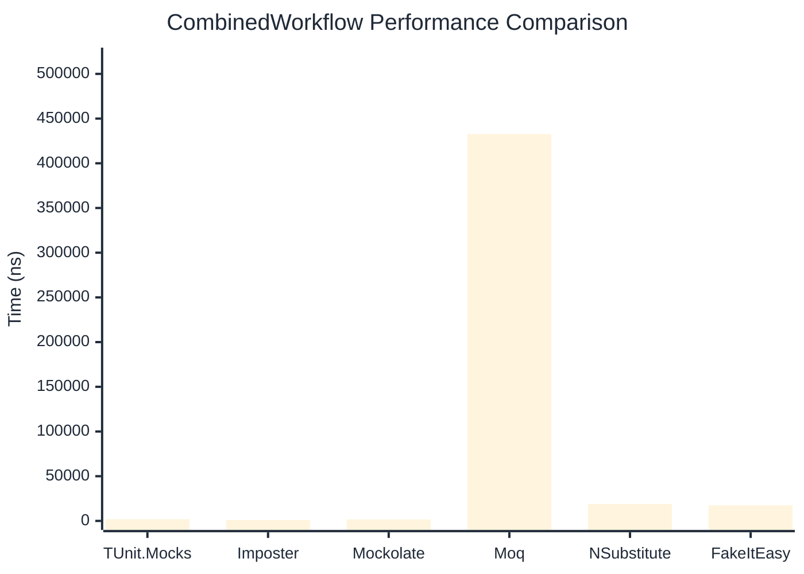

# CombinedWorkflow Benchmark

> Full workflow: create → setup → invoke → verify — comparing **TUnit.Mocks** (source-generated) against runtime proxy-based mocking libraries.

:::info Last Updated
This benchmark was automatically generated on **2026-11-13** from the latest CI run.

**Environment:** Ubuntu Latest • .NET SDK 11.0.100
:::

## 📊 Results

Full workflow: create → setup → invoke → verify:

| Library | Mean | Error | StdDev | Allocated |
|---------|------|-------|--------|-----------|
| **TUnit.Mocks** | 1,902.9 ns | 9.62 ns | 8.52 ns | 6.31 KB |
| Imposter | 886.3 ns | 15.64 ns | 13.87 ns | 3.45 KB |
| Mockolate | 1,626.5 ns | 32.43 ns | 50.49 ns | 7.21 KB |
| Moq | 432,644.3 ns | 1,967.07 ns | 1,642.59 ns | 36.41 KB |
| NSubstitute | 18,987.6 ns | 171.76 ns | 143.42 ns | 26.51 KB |
| FakeItEasy | 17,472.6 ns | 220.91 ns | 206.64 ns | 24.8 KB |

## 🎯 Key Insights

This benchmark compares **TUnit.Mocks** (source-generated) against runtime proxy-based mocking libraries for full workflow: create → setup → invoke → verify.

---

:::note Methodology
View the [mock benchmarks overview](/docs/benchmarks/mocks) for methodology details and environment information.
:::

*Last generated: 2026-11-13T02:20:37.421Z*
