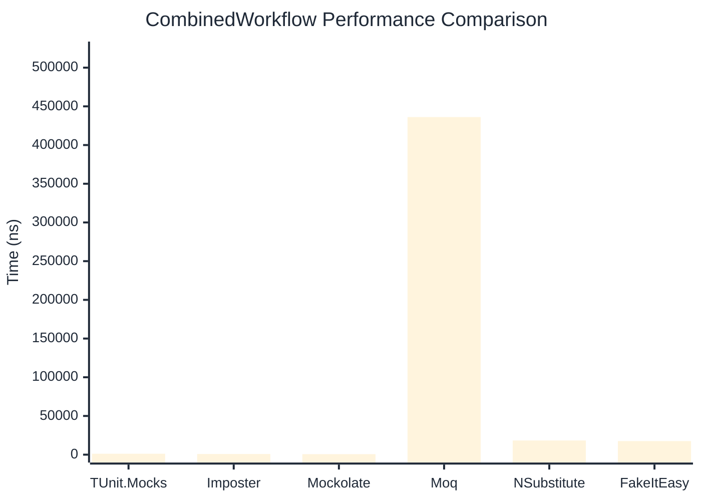

# CombinedWorkflow Benchmark

> Full workflow: create → setup → invoke → verify — comparing **TUnit.Mocks** (source-generated) against other source-generated and runtime proxy-based mocking libraries.

:::info Last Updated
This benchmark was automatically generated on **2026-11-24** from the latest CI run.

**Environment:** Ubuntu Latest • .NET SDK 11.0.100
:::

## 📊 Results

Full workflow: create → setup → invoke → verify:

| Library | Mean | Error | StdDev | Allocated |
|---------|------|-------|--------|-----------|
| **TUnit.Mocks** | 1,210.4 ns | 15.77 ns | 13.98 ns | 3.7 KB |
| Imposter | 872.1 ns | 7.52 ns | 6.67 ns | 3.45 KB |
| Mockolate | 652.5 ns | 7.20 ns | 6.39 ns | 1.96 KB |
| Moq | 436,174.6 ns | 1,827.65 ns | 1,620.16 ns | 36.44 KB |
| NSubstitute | 18,332.5 ns | 172.68 ns | 153.08 ns | 26.51 KB |
| FakeItEasy | 17,566.2 ns | 177.27 ns | 165.82 ns | 24.95 KB |

## 🎯 Key Insights

This benchmark compares **TUnit.Mocks** (source-generated) against other source-generated and runtime proxy-based mocking libraries for full workflow: create → setup → invoke → verify.

---

:::note Methodology
View the [mock benchmarks overview](/docs/benchmarks/mocks) for methodology details and environment information.
:::

*Last generated: 2026-11-24T02:20:52.556Z*
