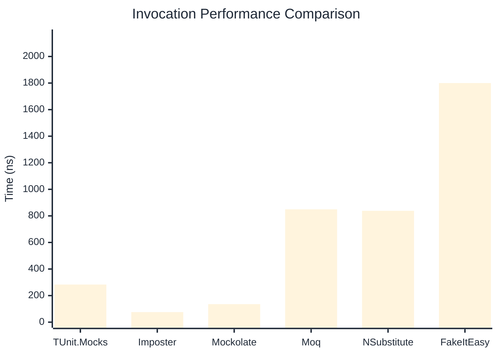
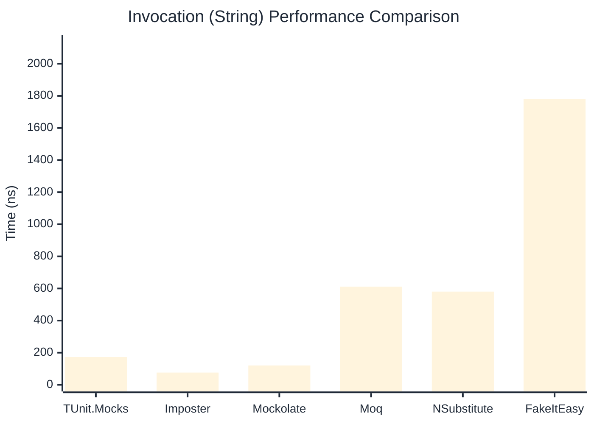

# Invocation Benchmark

> Calling methods on mock objects — comparing **TUnit.Mocks** (source-generated) against runtime proxy-based mocking libraries.

:::info Last Updated
This benchmark was automatically generated on **2026-11-13** from the latest CI run.

**Environment:** Ubuntu Latest • .NET SDK 11.0.100
:::

## 📊 Results

Calling methods on mock objects:

| Library | Mean | Error | StdDev | Allocated |
|---------|------|-------|--------|-----------|
| **TUnit.Mocks** | 283.21 ns | 395.77 ns | 21.694 ns | 128 B |
| Imposter | 75.71 ns | 36.19 ns | 1.984 ns | 48 B |
| Mockolate | 135.61 ns | 384.10 ns | 21.054 ns | 84 B |
| Moq | 849.51 ns | 626.76 ns | 34.355 ns | 376 B |
| NSubstitute | 838.22 ns | 1,087.19 ns | 59.593 ns | 360 B |
| FakeItEasy | 1,800.03 ns | 1,196.79 ns | 65.600 ns | 960 B |

---

### String

| Library | Mean | Error | StdDev | Allocated |
|---------|------|-------|--------|-----------|
| **TUnit.Mocks** | 172.93 ns | 251.08 ns | 13.763 ns | 96 B |
| Imposter | 76.20 ns | 10.12 ns | 0.554 ns | 48 B |
| Mockolate | 120.23 ns | 168.02 ns | 9.210 ns | 60 B |
| Moq | 611.61 ns | 948.65 ns | 51.999 ns | 296 B |
| NSubstitute | 580.59 ns | 120.29 ns | 6.593 ns | 272 B |
| FakeItEasy | 1,779.42 ns | 1,223.70 ns | 67.075 ns | 800 B |

---

### 100 calls

| Library | Mean | Error | StdDev | Allocated |
|---------|------|-------|--------|-----------|
| **TUnit.Mocks** | 25,860.66 ns | 42,501.85 ns | 2,329.670 ns | 12736 B |
| Imposter | 7,145.11 ns | 3,745.57 ns | 205.307 ns | 4800 B |
| Mockolate | 12,829.60 ns | 3,527.88 ns | 193.375 ns | 8400 B |
| Moq | 78,507.94 ns | 22,563.33 ns | 1,236.772 ns | 37600 B |
| NSubstitute | 82,545.90 ns | 74,542.40 ns | 4,085.921 ns | 36448 B |
| FakeItEasy | 193,034.17 ns | 287,196.45 ns | 15,742.207 ns | 96000 B |

## 🎯 Key Insights

This benchmark compares **TUnit.Mocks** (source-generated) against runtime proxy-based mocking libraries for calling methods on mock objects.

---

:::note Methodology
View the [mock benchmarks overview](/docs/benchmarks/mocks) for methodology details and environment information.
:::

*Last generated: 2026-11-13T02:20:37.421Z*
