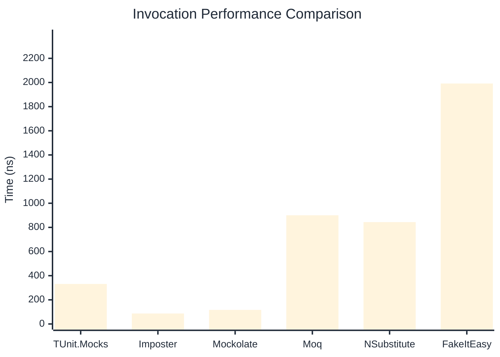
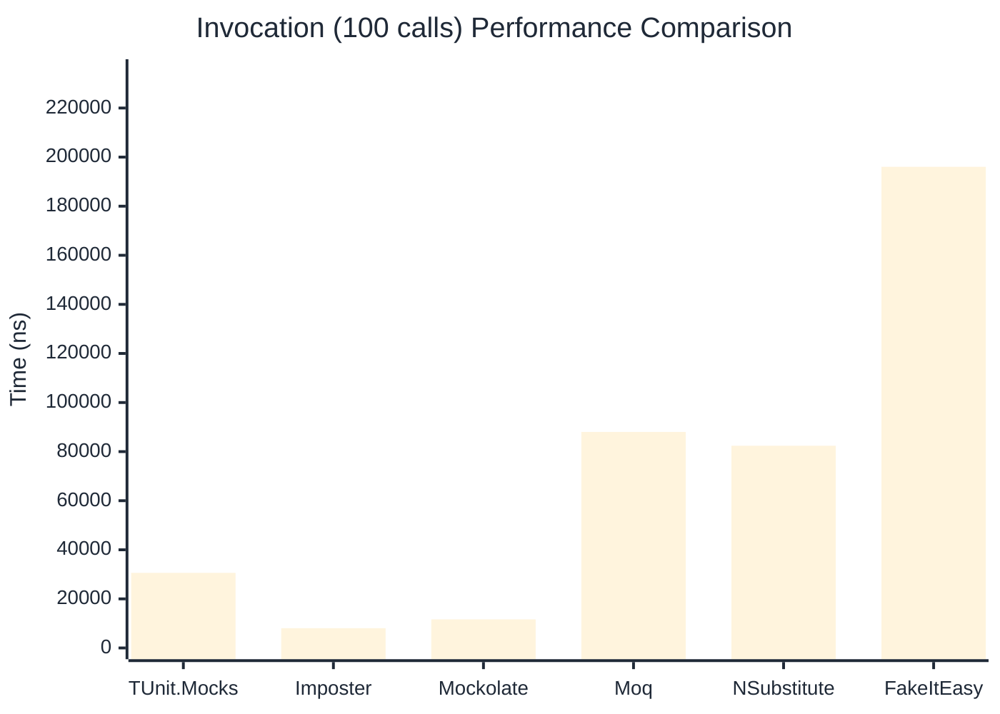

# Invocation Benchmark

> Calling methods on mock objects — comparing **TUnit.Mocks** (source-generated) against runtime proxy-based mocking libraries.

:::info Last Updated
This benchmark was automatically generated on **2026-11-12** from the latest CI run.

**Environment:** Ubuntu Latest • .NET SDK 11.0.100
:::

## 📊 Results

Calling methods on mock objects:

| Library | Mean | Error | StdDev | Allocated |
|---------|------|-------|--------|-----------|
| **TUnit.Mocks** | 331.57 ns | 366.08 ns | 20.066 ns | 128 B |
| Imposter | 86.76 ns | 22.36 ns | 1.226 ns | 48 B |
| Mockolate | 116.39 ns | 52.23 ns | 2.863 ns | 84 B |
| Moq | 900.01 ns | 475.61 ns | 26.070 ns | 376 B |
| NSubstitute | 843.79 ns | 253.17 ns | 13.877 ns | 360 B |
| FakeItEasy | 1,991.85 ns | 952.96 ns | 52.235 ns | 960 B |

---

### String

| Library | Mean | Error | StdDev | Allocated |
|---------|------|-------|--------|-----------|
| **TUnit.Mocks** | 197.72 ns | 293.04 ns | 16.063 ns | 96 B |
| Imposter | 81.72 ns | 26.61 ns | 1.459 ns | 48 B |
| Mockolate | 107.60 ns | 40.21 ns | 2.204 ns | 60 B |
| Moq | 614.21 ns | 333.28 ns | 18.268 ns | 296 B |
| NSubstitute | 676.13 ns | 158.76 ns | 8.702 ns | 272 B |
| FakeItEasy | 1,693.80 ns | 691.18 ns | 37.886 ns | 800 B |

---

### 100 calls

| Library | Mean | Error | StdDev | Allocated |
|---------|------|-------|--------|-----------|
| **TUnit.Mocks** | 30,601.72 ns | 35,263.05 ns | 1,932.887 ns | 12736 B |
| Imposter | 8,052.79 ns | 6,946.33 ns | 380.752 ns | 4800 B |
| Mockolate | 11,651.27 ns | 7,231.21 ns | 396.367 ns | 8400 B |
| Moq | 88,012.05 ns | 17,191.96 ns | 942.349 ns | 37600 B |
| NSubstitute | 82,398.20 ns | 13,759.41 ns | 754.200 ns | 36448 B |
| FakeItEasy | 196,044.94 ns | 19,945.01 ns | 1,093.253 ns | 96000 B |

## 🎯 Key Insights

This benchmark compares **TUnit.Mocks** (source-generated) against runtime proxy-based mocking libraries for calling methods on mock objects.

---

:::note Methodology
View the [mock benchmarks overview](/docs/benchmarks/mocks) for methodology details and environment information.
:::

*Last generated: 2026-11-12T02:21:42.541Z*
