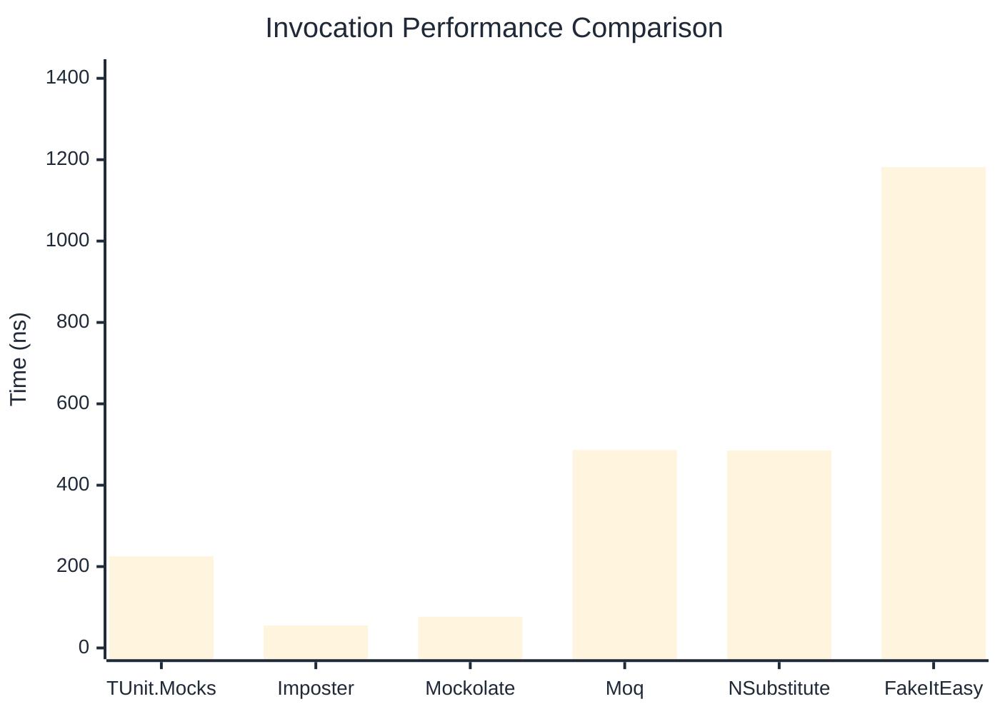
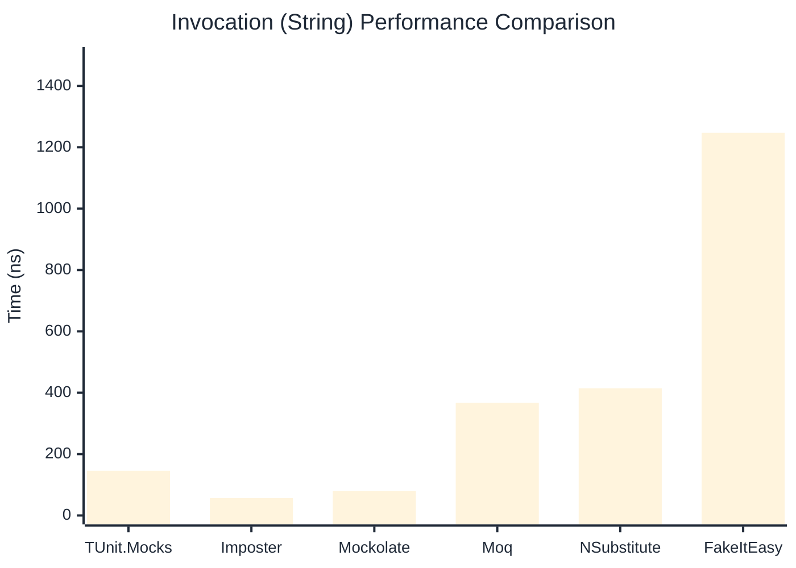

# Invocation Benchmark

> Calling methods on mock objects — comparing **TUnit.Mocks** (source-generated) against runtime proxy-based mocking libraries.

:::info Last Updated
This benchmark was automatically generated on **2026-11-10** from the latest CI run.

**Environment:** Ubuntu Latest • .NET SDK 10.0.403
:::

## 📊 Results

Calling methods on mock objects:

| Library | Mean | Error | StdDev | Allocated |
|---------|------|-------|--------|-----------|
| **TUnit.Mocks** | 225.29 ns | 215.07 ns | 11.789 ns | 128 B |
| Imposter | 54.98 ns | 31.97 ns | 1.752 ns | 48 B |
| Mockolate | 76.81 ns | 75.39 ns | 4.132 ns | 84 B |
| Moq | 486.43 ns | 322.40 ns | 17.672 ns | 376 B |
| NSubstitute | 485.10 ns | 656.80 ns | 36.002 ns | 304 B |
| FakeItEasy | 1,181.87 ns | 592.14 ns | 32.457 ns | 944 B |

---

### String

| Library | Mean | Error | StdDev | Allocated |
|---------|------|-------|--------|-----------|
| **TUnit.Mocks** | 145.73 ns | 456.82 ns | 25.040 ns | 96 B |
| Imposter | 56.65 ns | 41.26 ns | 2.261 ns | 48 B |
| Mockolate | 80.40 ns | 68.07 ns | 3.731 ns | 60 B |
| Moq | 367.57 ns | 476.48 ns | 26.118 ns | 296 B |
| NSubstitute | 414.62 ns | 58.84 ns | 3.225 ns | 272 B |
| FakeItEasy | 1,247.28 ns | 885.96 ns | 48.562 ns | 776 B |

---

### 100 calls

| Library | Mean | Error | StdDev | Allocated |
|---------|------|-------|--------|-----------|
| **TUnit.Mocks** | 21,117.16 ns | 20,410.60 ns | 1,118.774 ns | 12736 B |
| Imposter | 5,954.30 ns | 682.91 ns | 37.433 ns | 4800 B |
| Mockolate | 9,040.48 ns | 15,076.15 ns | 826.375 ns | 8400 B |
| Moq | 51,754.75 ns | 20,265.73 ns | 1,110.833 ns | 37600 B |
| NSubstitute | 51,543.91 ns | 129,005.66 ns | 7,071.235 ns | 30848 B |
| FakeItEasy | 138,981.71 ns | 166,899.80 ns | 9,148.341 ns | 94400 B |

## 🎯 Key Insights

This benchmark compares **TUnit.Mocks** (source-generated) against runtime proxy-based mocking libraries for calling methods on mock objects.

---

:::note Methodology
View the [mock benchmarks overview](/docs/benchmarks/mocks) for methodology details and environment information.
:::

*Last generated: 2026-11-10T02:26:34.876Z*
