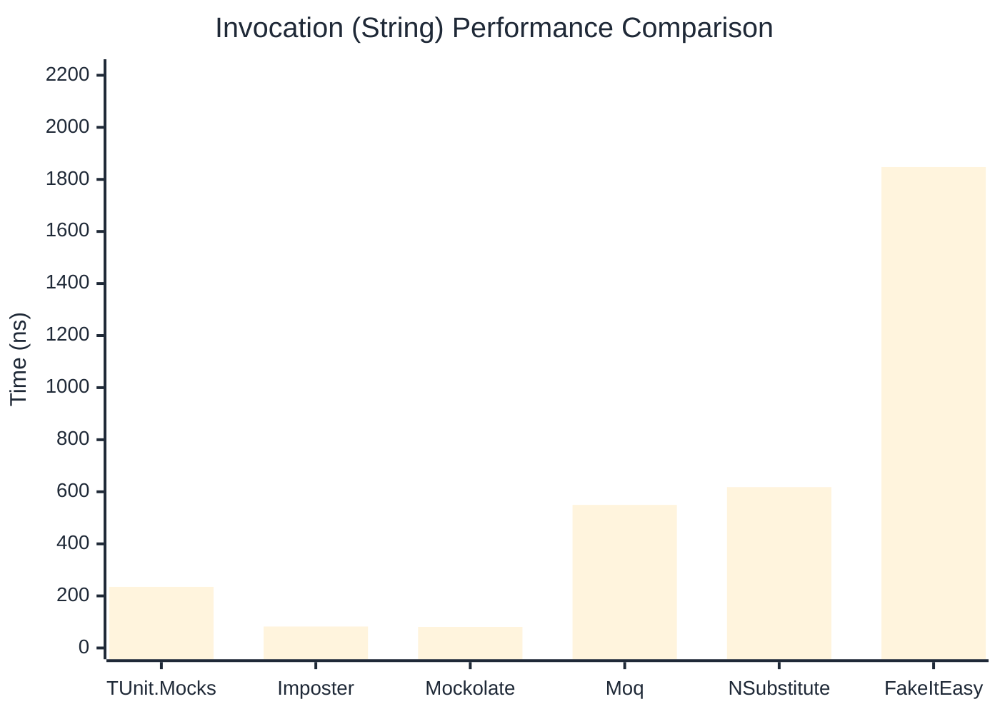
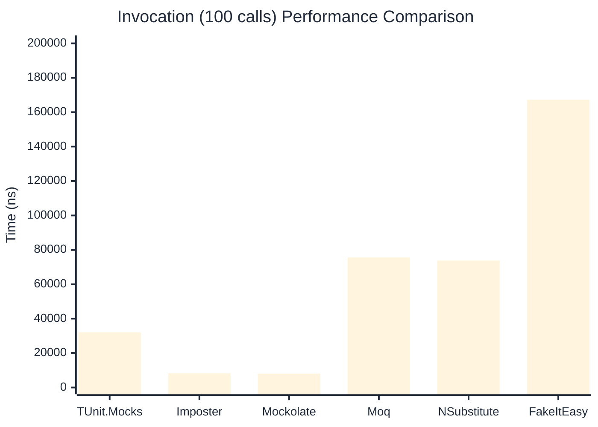

# Invocation Benchmark

> Calling methods on mock objects — comparing **TUnit.Mocks** (source-generated) against runtime proxy-based mocking libraries.

:::info Last Updated
This benchmark was automatically generated on **2026-11-17** from the latest CI run.

**Environment:** Ubuntu Latest • .NET SDK 11.0.100
:::

## 📊 Results

Calling methods on mock objects:

| Library | Mean | Error | StdDev | Allocated |
|---------|------|-------|--------|-----------|
| **TUnit.Mocks** | 282.52 ns | 356.22 ns | 19.525 ns | 128 B |
| Imposter | 79.14 ns | 96.07 ns | 5.266 ns | 48 B |
| Mockolate | 78.49 ns | 72.72 ns | 3.986 ns | 34 B |
| Moq | 909.17 ns | 1,080.10 ns | 59.204 ns | 376 B |
| NSubstitute | 688.53 ns | 1,382.90 ns | 75.801 ns | 304 B |
| FakeItEasy | 2,014.70 ns | 4,130.23 ns | 226.392 ns | 960 B |

---

### String

| Library | Mean | Error | StdDev | Allocated |
|---------|------|-------|--------|-----------|
| **TUnit.Mocks** | 234.71 ns | 633.65 ns | 34.733 ns | 96 B |
| Imposter | 82.36 ns | 139.28 ns | 7.634 ns | 48 B |
| Mockolate | 80.92 ns | 55.19 ns | 3.025 ns | 34 B |
| Moq | 549.62 ns | 706.66 ns | 38.734 ns | 296 B |
| NSubstitute | 617.85 ns | 1,553.11 ns | 85.131 ns | 272 B |
| FakeItEasy | 1,847.52 ns | 2,773.30 ns | 152.014 ns | 800 B |

---

### 100 calls

| Library | Mean | Error | StdDev | Allocated |
|---------|------|-------|--------|-----------|
| **TUnit.Mocks** | 32,078.44 ns | 108,424.39 ns | 5,943.107 ns | 13248 B |
| Imposter | 8,244.86 ns | 11,372.95 ns | 623.390 ns | 4800 B |
| Mockolate | 8,023.81 ns | 6,286.24 ns | 344.570 ns | 3350 B |
| Moq | 75,615.50 ns | 138,442.52 ns | 7,588.502 ns | 37600 B |
| NSubstitute | 73,780.07 ns | 183,594.87 ns | 10,063.455 ns | 36448 B |
| FakeItEasy | 167,226.67 ns | 342,072.19 ns | 18,750.131 ns | 96000 B |

## 🎯 Key Insights

This benchmark compares **TUnit.Mocks** (source-generated) against runtime proxy-based mocking libraries for calling methods on mock objects.

---

:::note Methodology
View the [mock benchmarks overview](/docs/benchmarks/mocks) for methodology details and environment information.
:::

*Last generated: 2026-11-17T02:23:59.645Z*
