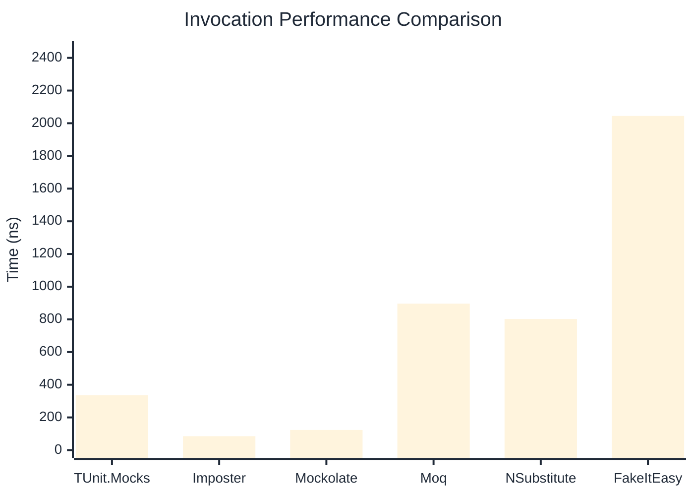
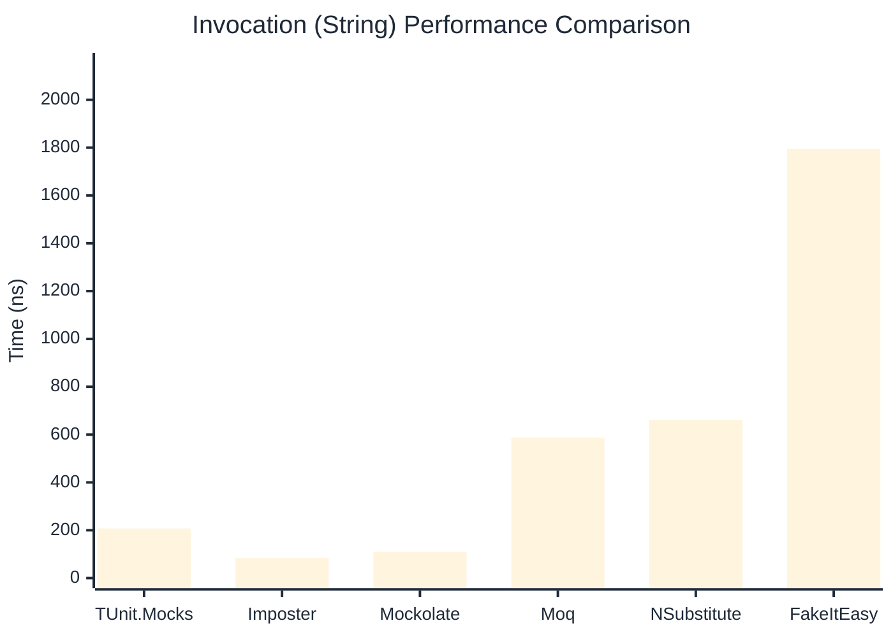
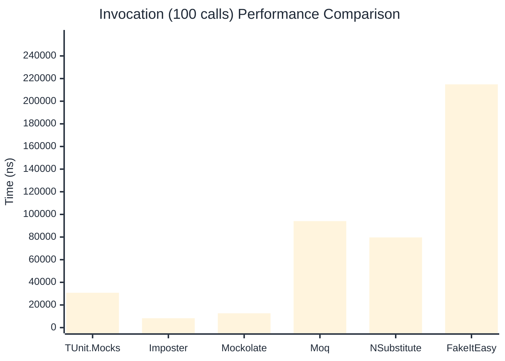

# Invocation Benchmark

> Calling methods on mock objects — comparing **TUnit.Mocks** (source-generated) against runtime proxy-based mocking libraries.

:::info Last Updated
This benchmark was automatically generated on **2026-11-15** from the latest CI run.

**Environment:** Ubuntu Latest • .NET SDK 11.0.100
:::

## 📊 Results

Calling methods on mock objects:

| Library | Mean | Error | StdDev | Allocated |
|---------|------|-------|--------|-----------|
| **TUnit.Mocks** | 335.55 ns | 392.23 ns | 21.500 ns | 128 B |
| Imposter | 85.32 ns | 21.36 ns | 1.171 ns | 48 B |
| Mockolate | 123.28 ns | 30.24 ns | 1.657 ns | 84 B |
| Moq | 896.08 ns | 182.34 ns | 9.995 ns | 376 B |
| NSubstitute | 802.33 ns | 555.11 ns | 30.428 ns | 304 B |
| FakeItEasy | 2,044.73 ns | 950.65 ns | 52.108 ns | 960 B |

---

### String

| Library | Mean | Error | StdDev | Allocated |
|---------|------|-------|--------|-----------|
| **TUnit.Mocks** | 207.40 ns | 307.67 ns | 16.865 ns | 96 B |
| Imposter | 83.43 ns | 80.71 ns | 4.424 ns | 48 B |
| Mockolate | 109.87 ns | 85.77 ns | 4.701 ns | 60 B |
| Moq | 587.53 ns | 231.62 ns | 12.696 ns | 296 B |
| NSubstitute | 661.64 ns | 123.22 ns | 6.754 ns | 272 B |
| FakeItEasy | 1,794.79 ns | 255.51 ns | 14.006 ns | 800 B |

---

### 100 calls

| Library | Mean | Error | StdDev | Allocated |
|---------|------|-------|--------|-----------|
| **TUnit.Mocks** | 30,799.31 ns | 35,245.55 ns | 1,931.928 ns | 13248 B |
| Imposter | 8,293.29 ns | 6,767.39 ns | 370.943 ns | 4800 B |
| Mockolate | 12,660.12 ns | 4,712.93 ns | 258.332 ns | 8400 B |
| Moq | 94,085.25 ns | 8,945.60 ns | 490.339 ns | 37600 B |
| NSubstitute | 79,687.79 ns | 7,839.89 ns | 429.731 ns | 30848 B |
| FakeItEasy | 214,896.90 ns | 87,848.46 ns | 4,815.271 ns | 96000 B |

## 🎯 Key Insights

This benchmark compares **TUnit.Mocks** (source-generated) against runtime proxy-based mocking libraries for calling methods on mock objects.

---

:::note Methodology
View the [mock benchmarks overview](/docs/benchmarks/mocks) for methodology details and environment information.
:::

*Last generated: 2026-11-15T02:24:17.223Z*
