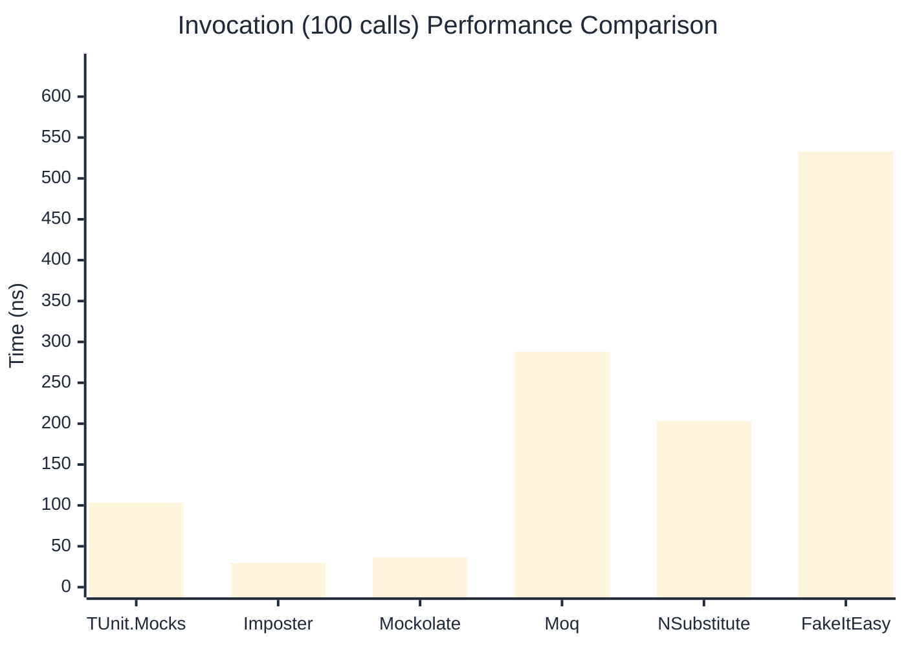
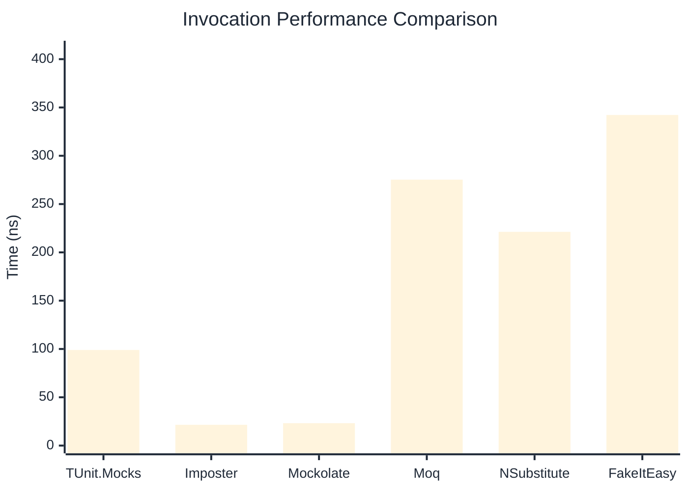
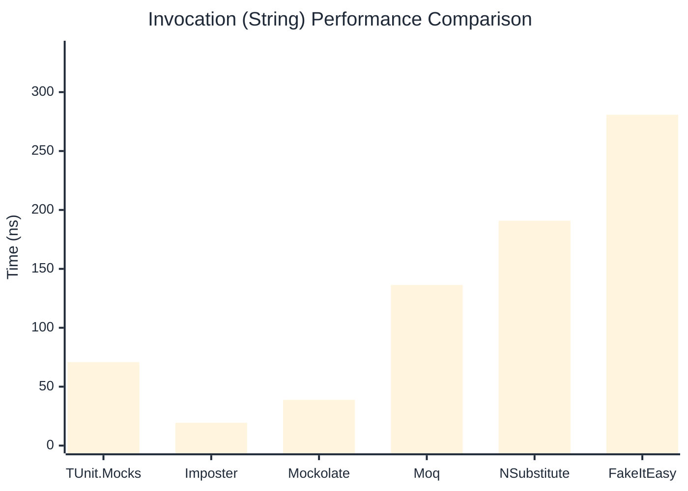

# Invocation Benchmark

> Calling methods on mock objects with bounded history; time and allocation are reported per call — comparing **TUnit.Mocks** (source-generated) against other source-generated and runtime proxy-based mocking libraries.

:::info Last Updated
This benchmark was automatically generated on **2026-11-21** from the latest CI run.

**Environment:** Ubuntu Latest • .NET SDK 11.0.100
:::

## 📊 Results

Calling methods on mock objects with bounded history; time and allocation are reported per call:

### 100 calls

| Library | Mean | Error | StdDev | Allocated |
|---------|------|-------|--------|-----------|
| **TUnit.Mocks** | 103.21 ns | 271.529 ns | 14.883 ns | 129 B |
| Imposter | 29.60 ns | 17.281 ns | 0.947 ns | 48 B |
| Mockolate | 36.13 ns | 38.925 ns | 2.134 ns | 56 B |
| Moq | 288.12 ns | 53.376 ns | 2.926 ns | 396 B |
| NSubstitute | 203.39 ns | 44.893 ns | 2.461 ns | 309 B |
| FakeItEasy | 532.94 ns | 113.860 ns | 6.241 ns | 981 B |

---

| Library | Mean | Error | StdDev | Allocated |
|---------|------|-------|--------|-----------|
| **TUnit.Mocks** | 98.99 ns | 228.702 ns | 12.536 ns | 136 B |
| Imposter | 21.51 ns | 25.541 ns | 1.400 ns | 48 B |
| Mockolate | 23.21 ns | 3.274 ns | 0.179 ns | 56 B |
| Moq | 275.30 ns | 108.140 ns | 5.928 ns | 392 B |
| NSubstitute | 221.23 ns | 89.194 ns | 4.889 ns | 320 B |
| FakeItEasy | 342.21 ns | 44.507 ns | 2.440 ns | 992 B |

---

### String

| Library | Mean | Error | StdDev | Allocated |
|---------|------|-------|--------|-----------|
| **TUnit.Mocks** | 70.85 ns | 19.479 ns | 1.068 ns | 120 B |
| Imposter | 19.38 ns | 3.992 ns | 0.219 ns | 48 B |
| Mockolate | 38.78 ns | 15.255 ns | 0.836 ns | 56 B |
| Moq | 136.30 ns | 106.755 ns | 5.852 ns | 312 B |
| NSubstitute | 190.91 ns | 80.030 ns | 4.387 ns | 288 B |
| FakeItEasy | 280.81 ns | 233.396 ns | 12.793 ns | 832 B |

## 🎯 Key Insights

This benchmark compares **TUnit.Mocks** (source-generated) against other source-generated and runtime proxy-based mocking libraries for calling methods on mock objects with bounded history; time and allocation are reported per call.

---

:::note Methodology
View the [mock benchmarks overview](/docs/benchmarks/mocks) for methodology details and environment information.
:::

*Last generated: 2026-11-21T02:20:26.016Z*
