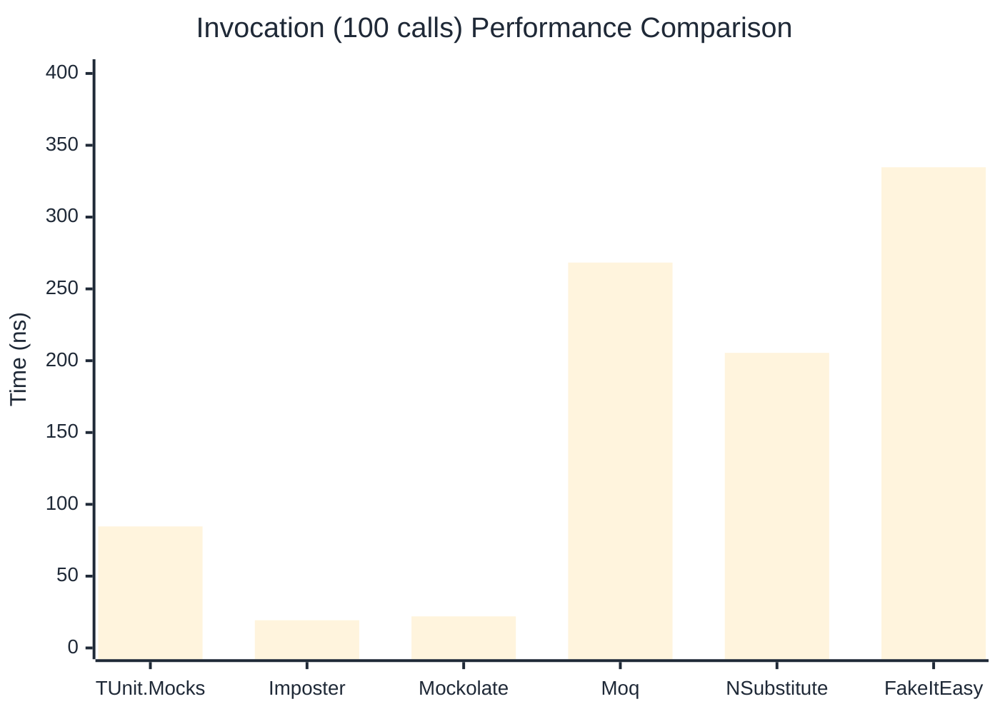
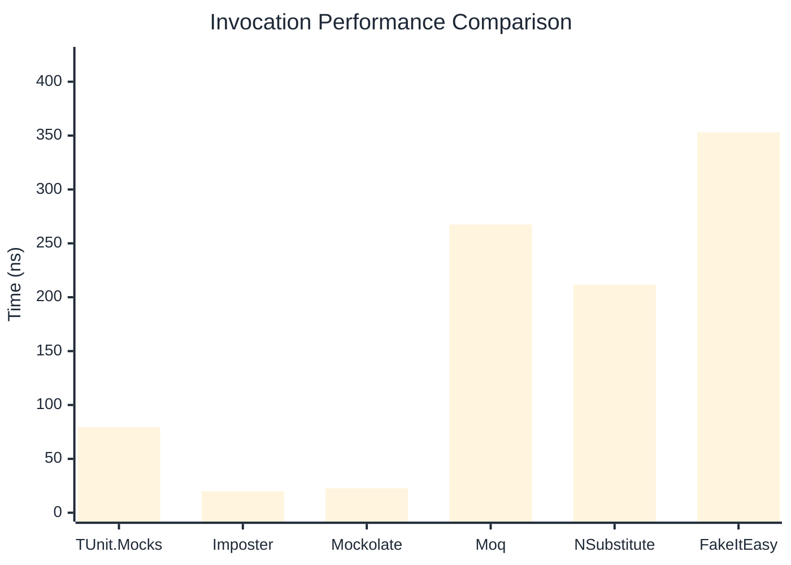
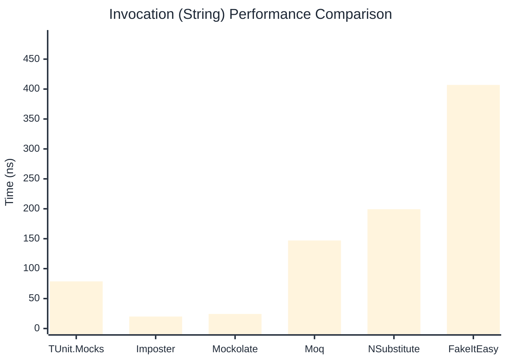

# Invocation Benchmark

> Calling methods on mock objects with bounded history; time and allocation are reported per call — comparing **TUnit.Mocks** (source-generated) against other source-generated and runtime proxy-based mocking libraries.

:::info Last Updated
This benchmark was automatically generated on **2026-11-22** from the latest CI run.

**Environment:** Ubuntu Latest • .NET SDK 11.0.100
:::

## 📊 Results

Calling methods on mock objects with bounded history; time and allocation are reported per call:

### 100 calls

| Library | Mean | Error | StdDev | Allocated |
|---------|------|-------|--------|-----------|
| **TUnit.Mocks** | 84.63 ns | 55.040 ns | 3.017 ns | 101 B |
| Imposter | 19.30 ns | 0.702 ns | 0.038 ns | 48 B |
| Mockolate | 21.99 ns | 3.363 ns | 0.184 ns | 56 B |
| Moq | 268.34 ns | 107.500 ns | 5.892 ns | 396 B |
| NSubstitute | 205.47 ns | 37.333 ns | 2.046 ns | 309 B |
| FakeItEasy | 334.68 ns | 156.115 ns | 8.557 ns | 981 B |

---

| Library | Mean | Error | StdDev | Allocated |
|---------|------|-------|--------|-----------|
| **TUnit.Mocks** | 79.53 ns | 4.274 ns | 0.234 ns | 108 B |
| Imposter | 19.81 ns | 2.586 ns | 0.142 ns | 48 B |
| Mockolate | 22.65 ns | 9.830 ns | 0.539 ns | 56 B |
| Moq | 267.49 ns | 74.985 ns | 4.110 ns | 392 B |
| NSubstitute | 211.58 ns | 88.148 ns | 4.832 ns | 320 B |
| FakeItEasy | 353.01 ns | 76.314 ns | 4.183 ns | 992 B |

---

### String

| Library | Mean | Error | StdDev | Allocated |
|---------|------|-------|--------|-----------|
| **TUnit.Mocks** | 78.71 ns | 193.465 ns | 10.604 ns | 98 B |
| Imposter | 20.03 ns | 13.650 ns | 0.748 ns | 48 B |
| Mockolate | 24.32 ns | 21.160 ns | 1.160 ns | 56 B |
| Moq | 147.04 ns | 335.685 ns | 18.400 ns | 312 B |
| NSubstitute | 199.26 ns | 22.217 ns | 1.218 ns | 344 B |
| FakeItEasy | 406.96 ns | 95.176 ns | 5.217 ns | 832 B |

## 🎯 Key Insights

This benchmark compares **TUnit.Mocks** (source-generated) against other source-generated and runtime proxy-based mocking libraries for calling methods on mock objects with bounded history; time and allocation are reported per call.

---

:::note Methodology
View the [mock benchmarks overview](/docs/benchmarks/mocks) for methodology details and environment information.
:::

*Last generated: 2026-11-22T02:21:53.323Z*
