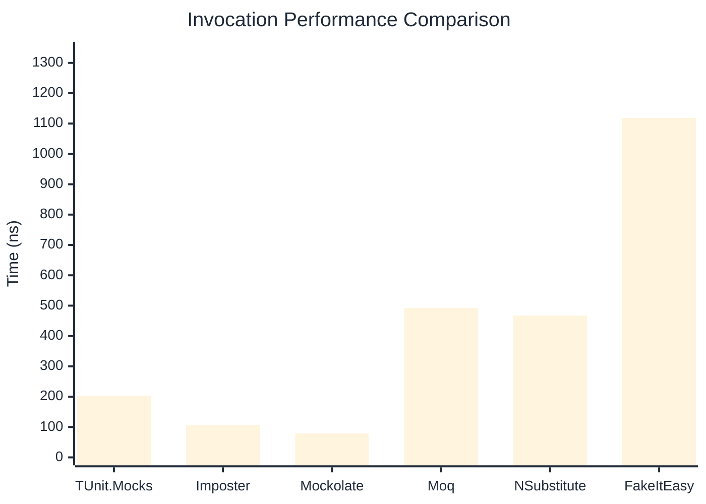
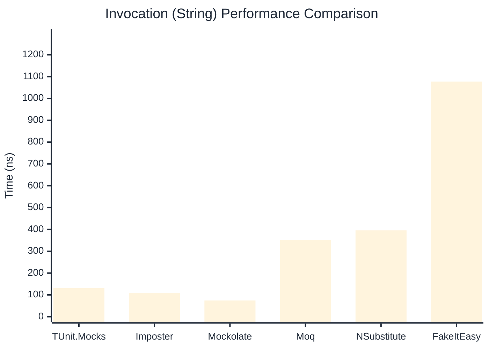
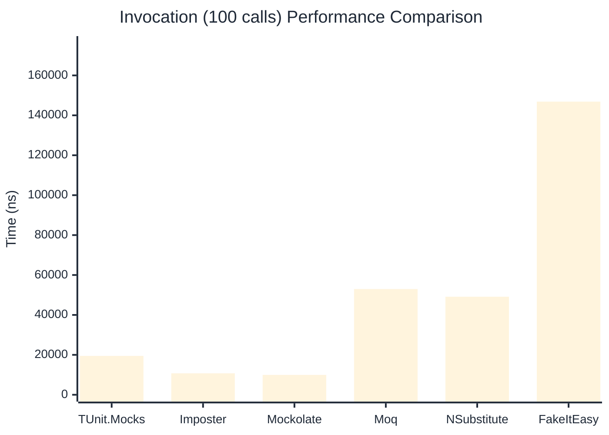

# Invocation Benchmark

> Calling methods on mock objects — comparing **TUnit.Mocks** (source-generated) against runtime proxy-based mocking libraries.

:::info Last Updated
This benchmark was automatically generated on **2026-10-25** from the latest CI run.

**Environment:** Ubuntu Latest • .NET SDK 10.0.402
:::

## 📊 Results

Calling methods on mock objects:

| Library | Mean | Error | StdDev | Allocated |
|---------|------|-------|--------|-----------|
| **TUnit.Mocks** | 203.20 ns | 77.026 ns | 4.222 ns | 128 B |
| Imposter | 106.96 ns | 8.150 ns | 0.447 ns | 96 B |
| Mockolate | 79.01 ns | 70.328 ns | 3.855 ns | 84 B |
| Moq | 492.77 ns | 163.789 ns | 8.978 ns | 376 B |
| NSubstitute | 467.04 ns | 267.489 ns | 14.662 ns | 304 B |
| FakeItEasy | 1,118.82 ns | 42.451 ns | 2.327 ns | 944 B |

---

### String

| Library | Mean | Error | StdDev | Allocated |
|---------|------|-------|--------|-----------|
| **TUnit.Mocks** | 130.42 ns | 58.297 ns | 3.195 ns | 96 B |
| Imposter | 109.74 ns | 99.687 ns | 5.464 ns | 96 B |
| Mockolate | 74.40 ns | 18.862 ns | 1.034 ns | 60 B |
| Moq | 352.69 ns | 149.589 ns | 8.199 ns | 296 B |
| NSubstitute | 395.49 ns | 68.291 ns | 3.743 ns | 272 B |
| FakeItEasy | 1,077.43 ns | 539.697 ns | 29.583 ns | 776 B |

---

### 100 calls

| Library | Mean | Error | StdDev | Allocated |
|---------|------|-------|--------|-----------|
| **TUnit.Mocks** | 19,478.61 ns | 8,527.037 ns | 467.396 ns | 12736 B |
| Imposter | 10,747.53 ns | 3,999.058 ns | 219.202 ns | 9600 B |
| Mockolate | 9,955.23 ns | 4,185.765 ns | 229.436 ns | 8400 B |
| Moq | 52,975.08 ns | 17,134.893 ns | 939.221 ns | 37600 B |
| NSubstitute | 49,125.56 ns | 14,446.272 ns | 791.849 ns | 30848 B |
| FakeItEasy | 146,862.14 ns | 48,506.495 ns | 2,658.805 ns | 94400 B |

## 🎯 Key Insights

This benchmark compares **TUnit.Mocks** (source-generated) against runtime proxy-based mocking libraries for calling methods on mock objects.

---

:::note Methodology
View the [mock benchmarks overview](/docs/benchmarks/mocks) for methodology details and environment information.
:::

*Last generated: 2026-10-25T02:33:24.276Z*
