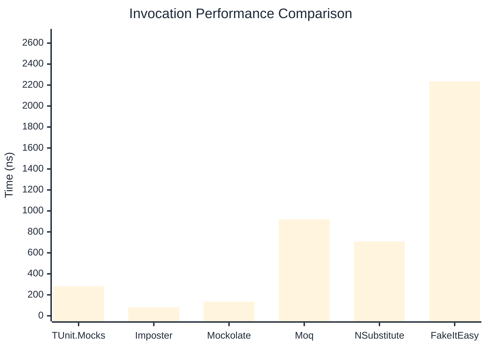
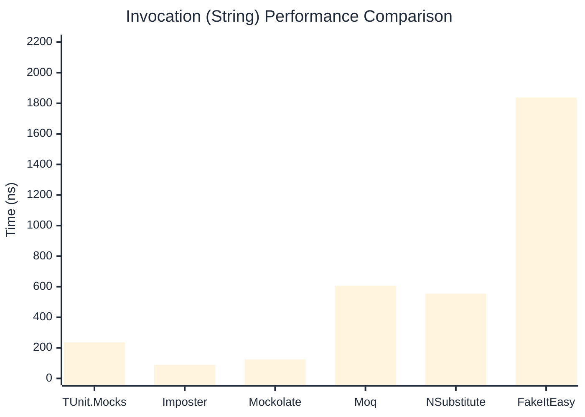
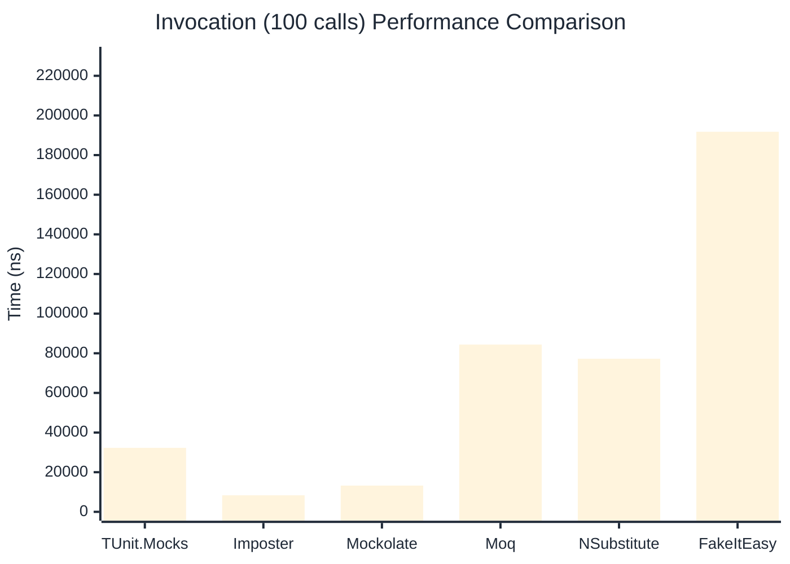

# Invocation Benchmark

> Calling methods on mock objects — comparing **TUnit.Mocks** (source-generated) against runtime proxy-based mocking libraries.

:::info Last Updated
This benchmark was automatically generated on **2026-11-16** from the latest CI run.

**Environment:** Ubuntu Latest • .NET SDK 11.0.100
:::

## 📊 Results

Calling methods on mock objects:

| Library | Mean | Error | StdDev | Allocated |
|---------|------|-------|--------|-----------|
| **TUnit.Mocks** | 281.88 ns | 376.02 ns | 20.611 ns | 128 B |
| Imposter | 81.41 ns | 84.95 ns | 4.657 ns | 48 B |
| Mockolate | 134.01 ns | 110.70 ns | 6.068 ns | 84 B |
| Moq | 919.86 ns | 483.28 ns | 26.490 ns | 376 B |
| NSubstitute | 707.60 ns | 1,587.99 ns | 87.043 ns | 304 B |
| FakeItEasy | 2,235.24 ns | 2,538.10 ns | 139.122 ns | 960 B |

---

### String

| Library | Mean | Error | StdDev | Allocated |
|---------|------|-------|--------|-----------|
| **TUnit.Mocks** | 236.16 ns | 516.34 ns | 28.303 ns | 96 B |
| Imposter | 89.09 ns | 109.64 ns | 6.010 ns | 48 B |
| Mockolate | 124.35 ns | 147.82 ns | 8.102 ns | 60 B |
| Moq | 606.46 ns | 1,494.03 ns | 81.893 ns | 296 B |
| NSubstitute | 555.68 ns | 1,608.88 ns | 88.188 ns | 272 B |
| FakeItEasy | 1,837.95 ns | 234.94 ns | 12.878 ns | 800 B |

---

### 100 calls

| Library | Mean | Error | StdDev | Allocated |
|---------|------|-------|--------|-----------|
| **TUnit.Mocks** | 32,283.28 ns | 93,897.96 ns | 5,146.864 ns | 13248 B |
| Imposter | 8,344.06 ns | 6,713.62 ns | 367.996 ns | 4800 B |
| Mockolate | 13,252.88 ns | 9,800.23 ns | 537.183 ns | 8400 B |
| Moq | 84,411.47 ns | 125,852.53 ns | 6,898.402 ns | 37600 B |
| NSubstitute | 77,250.14 ns | 43,425.68 ns | 2,380.308 ns | 30848 B |
| FakeItEasy | 191,764.03 ns | 38,543.57 ns | 2,112.703 ns | 96000 B |

## 🎯 Key Insights

This benchmark compares **TUnit.Mocks** (source-generated) against runtime proxy-based mocking libraries for calling methods on mock objects.

---

:::note Methodology
View the [mock benchmarks overview](/docs/benchmarks/mocks) for methodology details and environment information.
:::

*Last generated: 2026-11-16T02:25:25.447Z*
