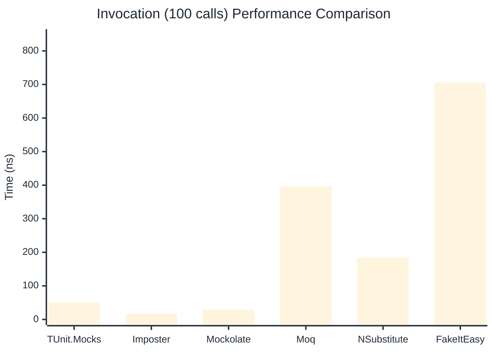
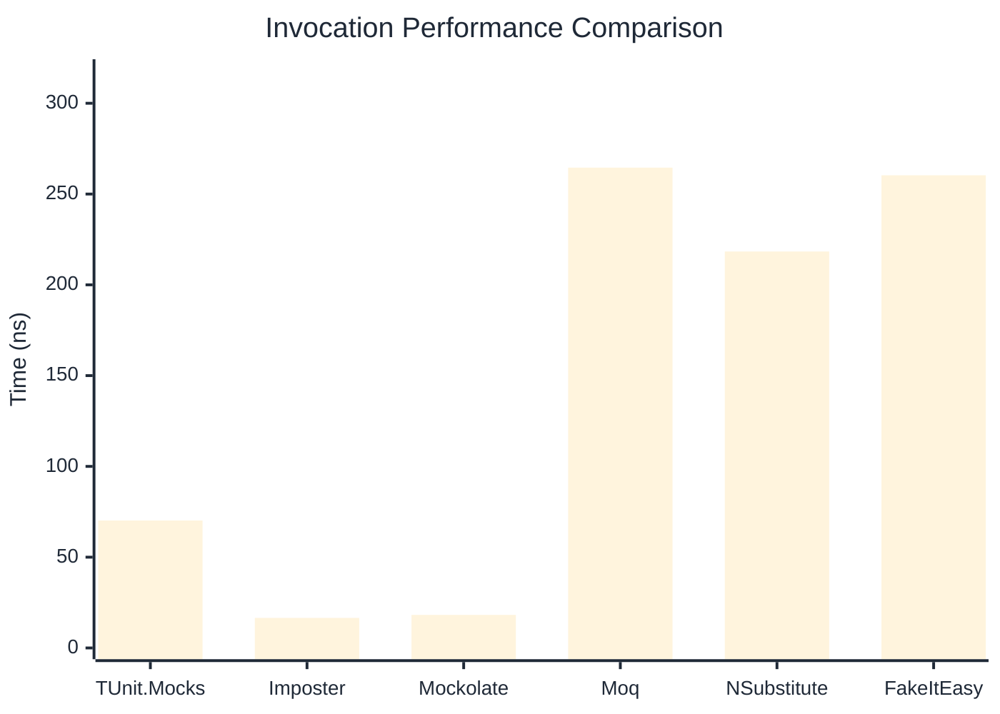
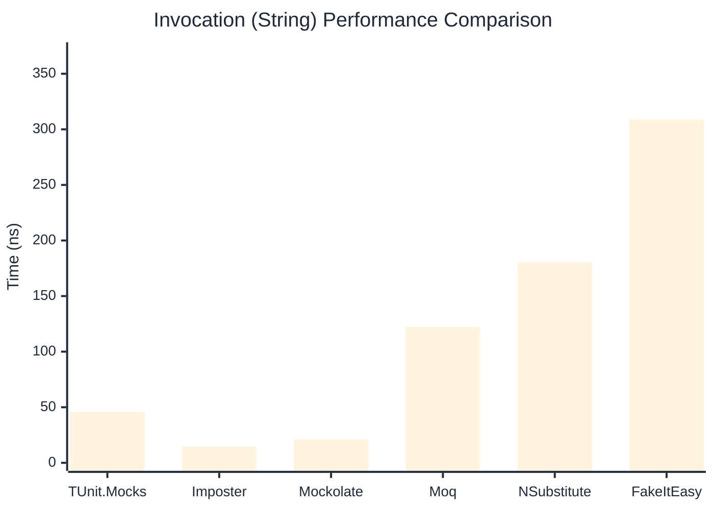

# Invocation Benchmark

> Calling methods on mock objects with bounded history; time and allocation are reported per call — comparing **TUnit.Mocks** (source-generated) against other source-generated and runtime proxy-based mocking libraries.

:::info Last Updated
This benchmark was automatically generated on **2026-11-20** from the latest CI run.

**Environment:** Ubuntu Latest • .NET SDK 11.0.100
:::

## 📊 Results

Calling methods on mock objects with bounded history; time and allocation are reported per call:

### 100 calls

| Library | Mean | Error | StdDev | Allocated |
|---------|------|-------|--------|-----------|
| **TUnit.Mocks** | 50.59 ns | 9.069 ns | 0.497 ns | 129 B |
| Imposter | 16.35 ns | 9.114 ns | 0.500 ns | 48 B |
| Mockolate | 29.04 ns | 8.409 ns | 0.461 ns | 56 B |
| Moq | 395.97 ns | 14.631 ns | 0.802 ns | 396 B |
| NSubstitute | 184.03 ns | 85.282 ns | 4.675 ns | 309 B |
| FakeItEasy | 705.85 ns | 411.181 ns | 22.538 ns | 981 B |

---

| Library | Mean | Error | StdDev | Allocated |
|---------|------|-------|--------|-----------|
| **TUnit.Mocks** | 70.19 ns | 40.440 ns | 2.217 ns | 136 B |
| Imposter | 16.55 ns | 8.758 ns | 0.480 ns | 48 B |
| Mockolate | 18.20 ns | 12.311 ns | 0.675 ns | 56 B |
| Moq | 264.54 ns | 86.598 ns | 4.747 ns | 392 B |
| NSubstitute | 218.37 ns | 85.189 ns | 4.670 ns | 376 B |
| FakeItEasy | 260.33 ns | 18.177 ns | 0.996 ns | 992 B |

---

### String

| Library | Mean | Error | StdDev | Allocated |
|---------|------|-------|--------|-----------|
| **TUnit.Mocks** | 45.72 ns | 114.030 ns | 6.250 ns | 120 B |
| Imposter | 14.55 ns | 0.845 ns | 0.046 ns | 48 B |
| Mockolate | 20.96 ns | 10.278 ns | 0.563 ns | 56 B |
| Moq | 122.16 ns | 678.330 ns | 37.182 ns | 312 B |
| NSubstitute | 180.18 ns | 15.178 ns | 0.832 ns | 344 B |
| FakeItEasy | 308.86 ns | 1,119.664 ns | 61.373 ns | 832 B |

## 🎯 Key Insights

This benchmark compares **TUnit.Mocks** (source-generated) against other source-generated and runtime proxy-based mocking libraries for calling methods on mock objects with bounded history; time and allocation are reported per call.

---

:::note Methodology
View the [mock benchmarks overview](/docs/benchmarks/mocks) for methodology details and environment information.
:::

*Last generated: 2026-11-20T02:20:51.427Z*
