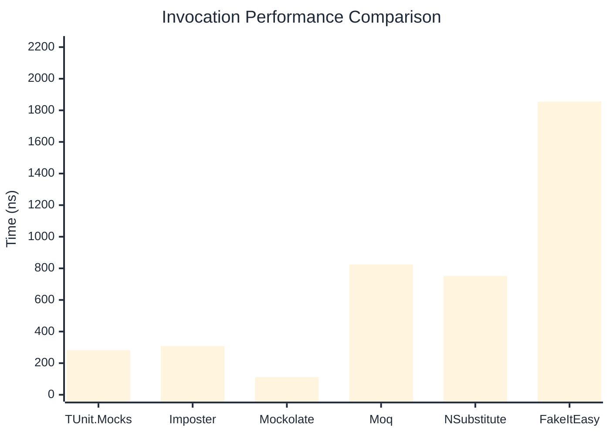
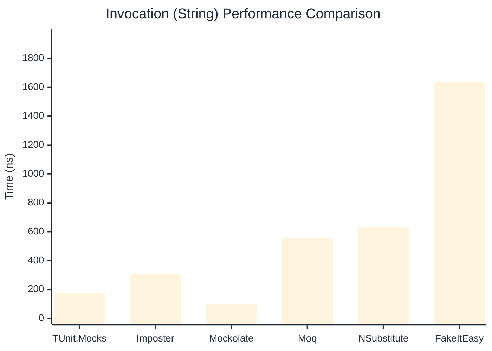
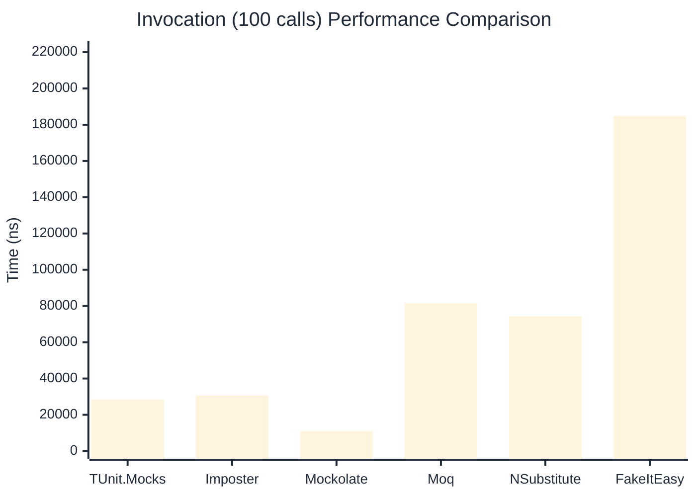

# Invocation Benchmark

> Calling methods on mock objects — comparing **TUnit.Mocks** (source-generated) against runtime proxy-based mocking libraries.

:::info Last Updated
This benchmark was automatically generated on **2026-10-11** from the latest CI run.

**Environment:** Ubuntu Latest • .NET SDK 10.0.401
:::

## 📊 Results

Calling methods on mock objects:

| Library | Mean | Error | StdDev | Allocated |
|---------|------|-------|--------|-----------|
| **TUnit.Mocks** | 281.83 ns | 75.53 ns | 4.140 ns | 128 B |
| Imposter | 307.95 ns | 100.45 ns | 5.506 ns | 168 B |
| Mockolate | 111.46 ns | 31.67 ns | 1.736 ns | 84 B |
| Moq | 825.03 ns | 106.02 ns | 5.811 ns | 376 B |
| NSubstitute | 752.19 ns | 211.22 ns | 11.578 ns | 304 B |
| FakeItEasy | 1,854.86 ns | 318.60 ns | 17.464 ns | 944 B |

---

### String

| Library | Mean | Error | StdDev | Allocated |
|---------|------|-------|--------|-----------|
| **TUnit.Mocks** | 174.79 ns | 59.78 ns | 3.277 ns | 96 B |
| Imposter | 306.81 ns | 98.26 ns | 5.386 ns | 168 B |
| Mockolate | 98.06 ns | 30.54 ns | 1.674 ns | 60 B |
| Moq | 558.28 ns | 135.77 ns | 7.442 ns | 296 B |
| NSubstitute | 632.93 ns | 190.22 ns | 10.426 ns | 272 B |
| FakeItEasy | 1,636.07 ns | 134.46 ns | 7.370 ns | 776 B |

---

### 100 calls

| Library | Mean | Error | StdDev | Allocated |
|---------|------|-------|--------|-----------|
| **TUnit.Mocks** | 28,386.83 ns | 8,563.62 ns | 469.401 ns | 12736 B |
| Imposter | 30,696.62 ns | 6,377.16 ns | 349.554 ns | 16800 B |
| Mockolate | 11,010.20 ns | 2,582.36 ns | 141.548 ns | 8400 B |
| Moq | 81,516.95 ns | 8,906.73 ns | 488.208 ns | 37600 B |
| NSubstitute | 74,277.06 ns | 11,856.75 ns | 649.908 ns | 30848 B |
| FakeItEasy | 184,742.60 ns | 50,928.56 ns | 2,791.566 ns | 94400 B |

## 🎯 Key Insights

This benchmark compares **TUnit.Mocks** (source-generated) against runtime proxy-based mocking libraries for calling methods on mock objects.

---

:::note Methodology
View the [mock benchmarks overview](/docs/benchmarks/mocks) for methodology details and environment information.
:::

*Last generated: 2026-10-11T02:43:35.245Z*
