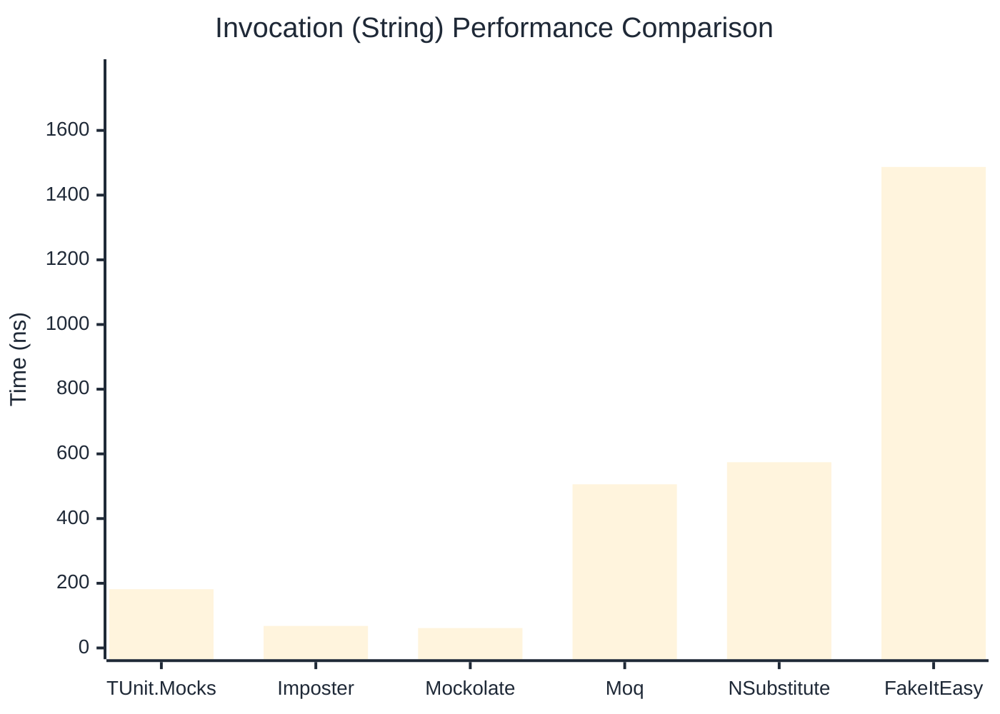
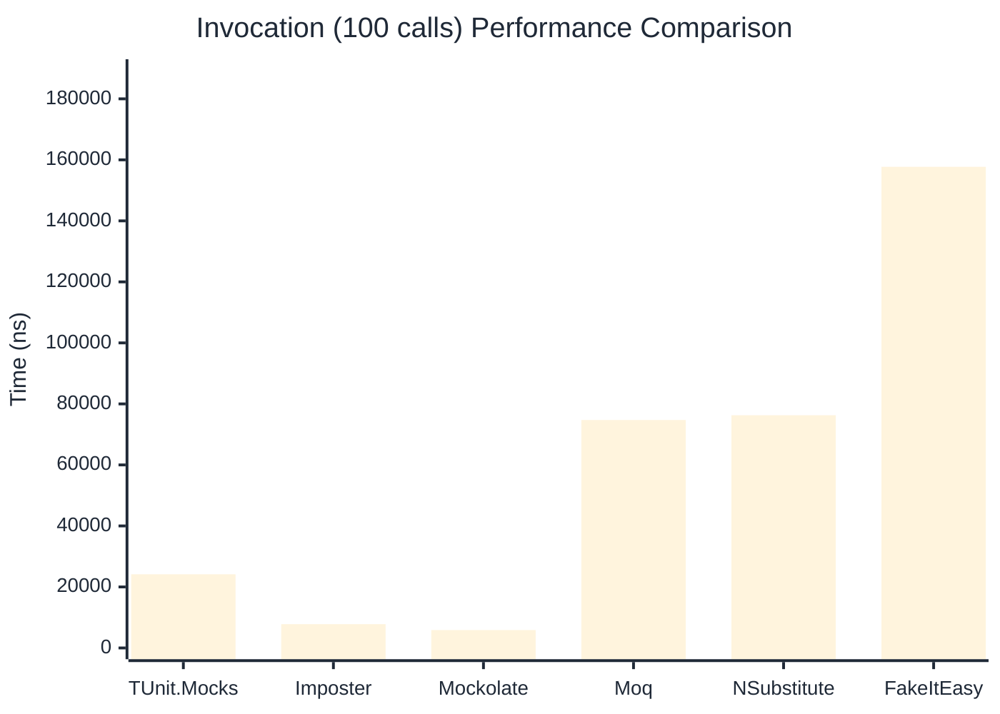

# Invocation Benchmark

> Calling methods on mock objects — comparing **TUnit.Mocks** (source-generated) against runtime proxy-based mocking libraries.

:::info Last Updated
This benchmark was automatically generated on **2026-11-18** from the latest CI run.

**Environment:** Ubuntu Latest • .NET SDK 11.0.100
:::

## 📊 Results

Calling methods on mock objects:

| Library | Mean | Error | StdDev | Allocated |
|---------|------|-------|--------|-----------|
| **TUnit.Mocks** | 244.88 ns | 215.70 ns | 11.823 ns | 128 B |
| Imposter | 70.27 ns | 126.01 ns | 6.907 ns | 48 B |
| Mockolate | 57.85 ns | 31.26 ns | 1.714 ns | 34 B |
| Moq | 718.75 ns | 1,117.76 ns | 61.268 ns | 376 B |
| NSubstitute | 617.48 ns | 363.17 ns | 19.907 ns | 304 B |
| FakeItEasy | 1,769.59 ns | 1,378.85 ns | 75.580 ns | 960 B |

---

### String

| Library | Mean | Error | StdDev | Allocated |
|---------|------|-------|--------|-----------|
| **TUnit.Mocks** | 181.61 ns | 181.30 ns | 9.937 ns | 96 B |
| Imposter | 68.20 ns | 43.38 ns | 2.378 ns | 48 B |
| Mockolate | 61.57 ns | 80.90 ns | 4.434 ns | 34 B |
| Moq | 505.97 ns | 566.67 ns | 31.061 ns | 296 B |
| NSubstitute | 574.21 ns | 145.45 ns | 7.972 ns | 328 B |
| FakeItEasy | 1,487.06 ns | 1,337.70 ns | 73.324 ns | 800 B |

---

### 100 calls

| Library | Mean | Error | StdDev | Allocated |
|---------|------|-------|--------|-----------|
| **TUnit.Mocks** | 24,152.53 ns | 31,530.04 ns | 1,728.268 ns | 12736 B |
| Imposter | 7,797.08 ns | 3,397.98 ns | 186.255 ns | 4800 B |
| Mockolate | 5,867.52 ns | 3,082.87 ns | 168.983 ns | 3350 B |
| Moq | 74,721.67 ns | 69,794.93 ns | 3,825.696 ns | 37600 B |
| NSubstitute | 76,283.63 ns | 25,417.86 ns | 1,393.239 ns | 36448 B |
| FakeItEasy | 157,716.12 ns | 1,705.86 ns | 93.504 ns | 96000 B |

## 🎯 Key Insights

This benchmark compares **TUnit.Mocks** (source-generated) against runtime proxy-based mocking libraries for calling methods on mock objects.

---

:::note Methodology
View the [mock benchmarks overview](/docs/benchmarks/mocks) for methodology details and environment information.
:::

*Last generated: 2026-11-18T02:25:26.946Z*
