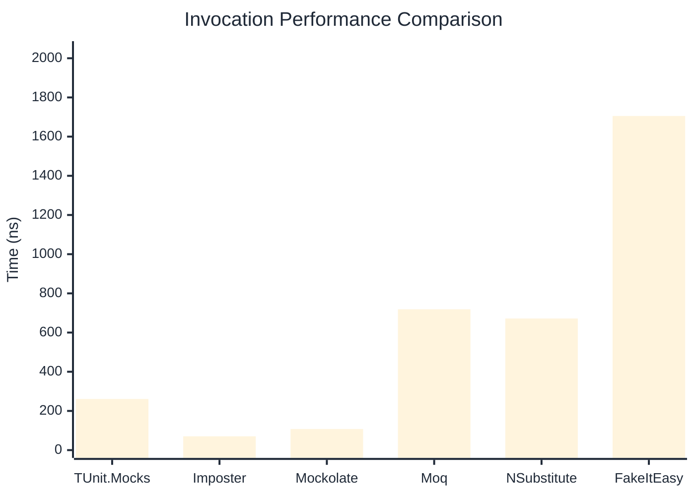

# Invocation Benchmark

> Calling methods on mock objects — comparing **TUnit.Mocks** (source-generated) against runtime proxy-based mocking libraries.

:::info Last Updated
This benchmark was automatically generated on **2026-11-14** from the latest CI run.

**Environment:** Ubuntu Latest • .NET SDK 11.0.100
:::

## 📊 Results

Calling methods on mock objects:

| Library | Mean | Error | StdDev | Allocated |
|---------|------|-------|--------|-----------|
| **TUnit.Mocks** | 261.08 ns | 180.860 ns | 9.914 ns | 128 B |
| Imposter | 70.51 ns | 2.617 ns | 0.143 ns | 48 B |
| Mockolate | 107.92 ns | 205.392 ns | 11.258 ns | 84 B |
| Moq | 718.82 ns | 392.572 ns | 21.518 ns | 376 B |
| NSubstitute | 671.70 ns | 166.606 ns | 9.132 ns | 304 B |
| FakeItEasy | 1,705.46 ns | 935.888 ns | 51.299 ns | 960 B |

---

### String

| Library | Mean | Error | StdDev | Allocated |
|---------|------|-------|--------|-----------|
| **TUnit.Mocks** | 164.90 ns | 245.031 ns | 13.431 ns | 96 B |
| Imposter | 72.28 ns | 47.439 ns | 2.600 ns | 48 B |
| Mockolate | 100.12 ns | 97.422 ns | 5.340 ns | 60 B |
| Moq | 503.01 ns | 358.043 ns | 19.626 ns | 296 B |
| NSubstitute | 545.92 ns | 343.693 ns | 18.839 ns | 272 B |
| FakeItEasy | 1,455.63 ns | 264.010 ns | 14.471 ns | 800 B |

---

### 100 calls

| Library | Mean | Error | StdDev | Allocated |
|---------|------|-------|--------|-----------|
| **TUnit.Mocks** | 24,935.19 ns | 18,245.990 ns | 1,000.124 ns | 12736 B |
| Imposter | 6,970.40 ns | 4,689.994 ns | 257.074 ns | 4800 B |
| Mockolate | 10,356.81 ns | 3,842.358 ns | 210.613 ns | 8400 B |
| Moq | 68,383.75 ns | 51,363.447 ns | 2,815.404 ns | 37600 B |
| NSubstitute | 65,068.40 ns | 18,354.426 ns | 1,006.068 ns | 30848 B |
| FakeItEasy | 164,604.71 ns | 118,997.905 ns | 6,522.677 ns | 96000 B |

## 🎯 Key Insights

This benchmark compares **TUnit.Mocks** (source-generated) against runtime proxy-based mocking libraries for calling methods on mock objects.

---

:::note Methodology
View the [mock benchmarks overview](/docs/benchmarks/mocks) for methodology details and environment information.
:::

*Last generated: 2026-11-14T02:21:36.343Z*
