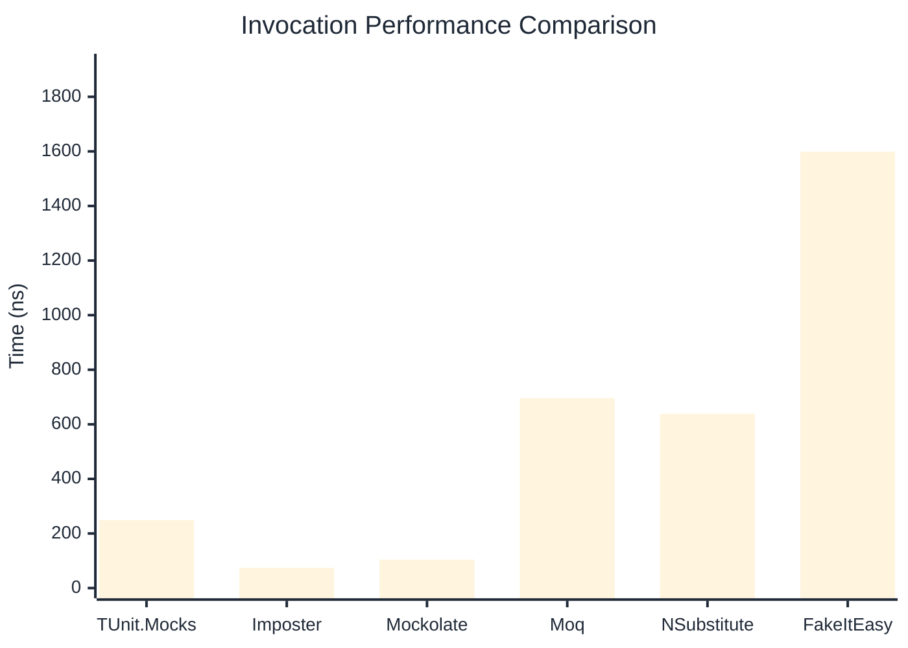

# Invocation Benchmark

> Calling methods on mock objects — comparing **TUnit.Mocks** (source-generated) against runtime proxy-based mocking libraries.

:::info Last Updated
This benchmark was automatically generated on **2026-11-08** from the latest CI run.

**Environment:** Ubuntu Latest • .NET SDK 10.0.403
:::

## 📊 Results

Calling methods on mock objects:

| Library | Mean | Error | StdDev | Allocated |
|---------|------|-------|--------|-----------|
| **TUnit.Mocks** | 249.08 ns | 240.634 ns | 13.190 ns | 128 B |
| Imposter | 73.77 ns | 2.135 ns | 0.117 ns | 48 B |
| Mockolate | 104.18 ns | 65.229 ns | 3.575 ns | 84 B |
| Moq | 696.03 ns | 132.738 ns | 7.276 ns | 376 B |
| NSubstitute | 638.20 ns | 283.743 ns | 15.553 ns | 304 B |
| FakeItEasy | 1,599.26 ns | 1,007.797 ns | 55.241 ns | 944 B |

---

### String

| Library | Mean | Error | StdDev | Allocated |
|---------|------|-------|--------|-----------|
| **TUnit.Mocks** | 155.57 ns | 285.729 ns | 15.662 ns | 96 B |
| Imposter | 71.78 ns | 6.046 ns | 0.331 ns | 48 B |
| Mockolate | 85.20 ns | 10.387 ns | 0.569 ns | 60 B |
| Moq | 468.71 ns | 159.009 ns | 8.716 ns | 296 B |
| NSubstitute | 518.22 ns | 201.775 ns | 11.060 ns | 272 B |
| FakeItEasy | 1,418.63 ns | 318.603 ns | 17.464 ns | 776 B |

---

### 100 calls

| Library | Mean | Error | StdDev | Allocated |
|---------|------|-------|--------|-----------|
| **TUnit.Mocks** | 23,699.28 ns | 21,381.117 ns | 1,171.971 ns | 12736 B |
| Imposter | 7,293.61 ns | 145.793 ns | 7.991 ns | 4800 B |
| Mockolate | 10,123.20 ns | 2,550.859 ns | 139.821 ns | 8400 B |
| Moq | 63,668.41 ns | 34,466.915 ns | 1,889.248 ns | 37600 B |
| NSubstitute | 62,313.22 ns | 40,439.912 ns | 2,216.648 ns | 30848 B |
| FakeItEasy | 155,866.82 ns | 130,049.272 ns | 7,128.439 ns | 94400 B |

## 🎯 Key Insights

This benchmark compares **TUnit.Mocks** (source-generated) against runtime proxy-based mocking libraries for calling methods on mock objects.

---

:::note Methodology
View the [mock benchmarks overview](/docs/benchmarks/mocks) for methodology details and environment information.
:::

*Last generated: 2026-11-08T02:26:36.812Z*
