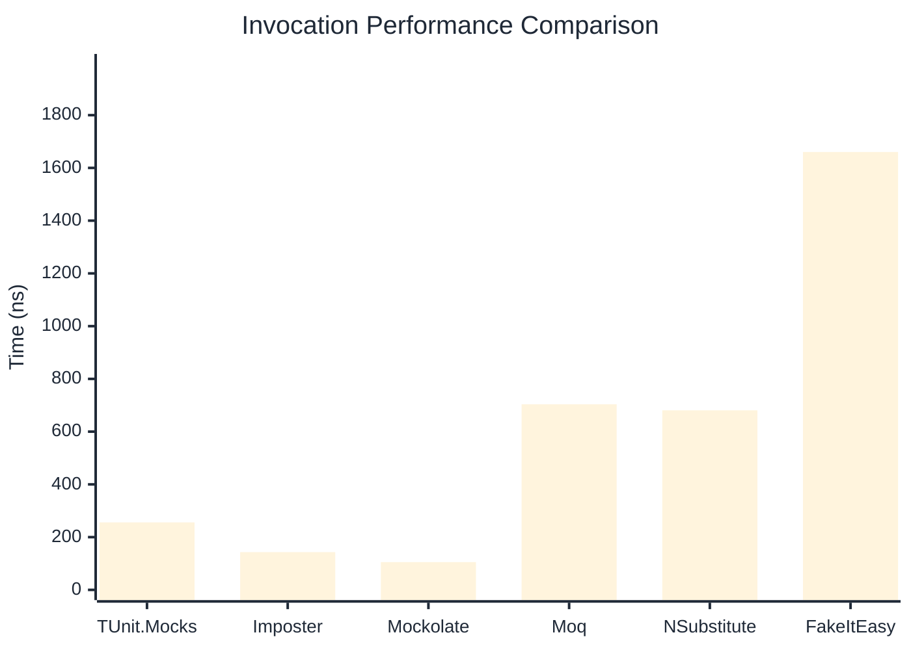
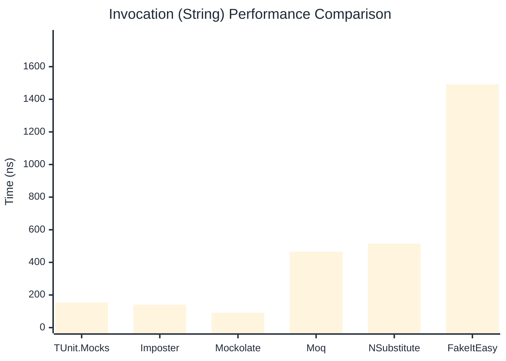
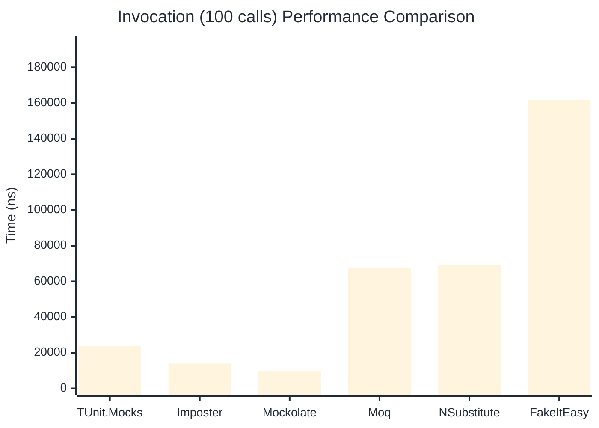

# Invocation Benchmark

> Calling methods on mock objects — comparing **TUnit.Mocks** (source-generated) against runtime proxy-based mocking libraries.

:::info Last Updated
This benchmark was automatically generated on **2026-11-01** from the latest CI run.

**Environment:** Ubuntu Latest • .NET SDK 10.0.403
:::

## 📊 Results

Calling methods on mock objects:

| Library | Mean | Error | StdDev | Allocated |
|---------|------|-------|--------|-----------|
| **TUnit.Mocks** | 255.93 ns | 295.651 ns | 16.206 ns | 128 B |
| Imposter | 143.12 ns | 13.287 ns | 0.728 ns | 96 B |
| Mockolate | 105.31 ns | 159.493 ns | 8.742 ns | 84 B |
| Moq | 703.70 ns | 326.904 ns | 17.919 ns | 376 B |
| NSubstitute | 680.81 ns | 898.767 ns | 49.264 ns | 304 B |
| FakeItEasy | 1,660.31 ns | 637.949 ns | 34.968 ns | 944 B |

---

### String

| Library | Mean | Error | StdDev | Allocated |
|---------|------|-------|--------|-----------|
| **TUnit.Mocks** | 153.48 ns | 279.476 ns | 15.319 ns | 96 B |
| Imposter | 140.88 ns | 2.956 ns | 0.162 ns | 96 B |
| Mockolate | 90.90 ns | 56.350 ns | 3.089 ns | 60 B |
| Moq | 465.34 ns | 384.795 ns | 21.092 ns | 296 B |
| NSubstitute | 514.45 ns | 69.778 ns | 3.825 ns | 272 B |
| FakeItEasy | 1,490.86 ns | 1,843.406 ns | 101.043 ns | 776 B |

---

### 100 calls

| Library | Mean | Error | StdDev | Allocated |
|---------|------|-------|--------|-----------|
| **TUnit.Mocks** | 23,908.41 ns | 23,434.277 ns | 1,284.512 ns | 12736 B |
| Imposter | 13,966.59 ns | 537.055 ns | 29.438 ns | 9600 B |
| Mockolate | 9,831.91 ns | 2,598.075 ns | 142.409 ns | 8400 B |
| Moq | 67,726.14 ns | 19,484.792 ns | 1,068.027 ns | 37600 B |
| NSubstitute | 69,037.21 ns | 14,209.770 ns | 778.885 ns | 36448 B |
| FakeItEasy | 161,688.92 ns | 48,832.565 ns | 2,676.678 ns | 94400 B |

## 🎯 Key Insights

This benchmark compares **TUnit.Mocks** (source-generated) against runtime proxy-based mocking libraries for calling methods on mock objects.

---

:::note Methodology
View the [mock benchmarks overview](/docs/benchmarks/mocks) for methodology details and environment information.
:::

*Last generated: 2026-11-01T02:27:32.250Z*
