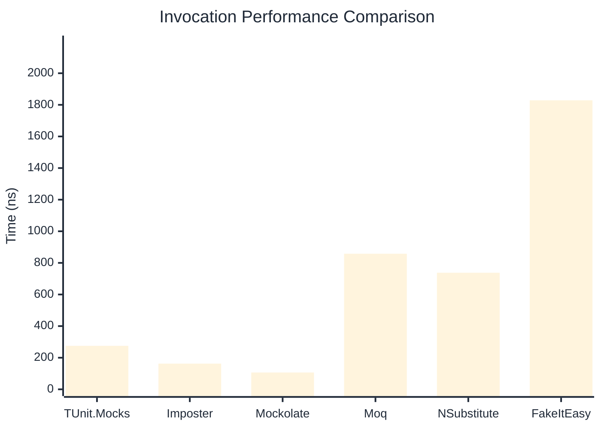
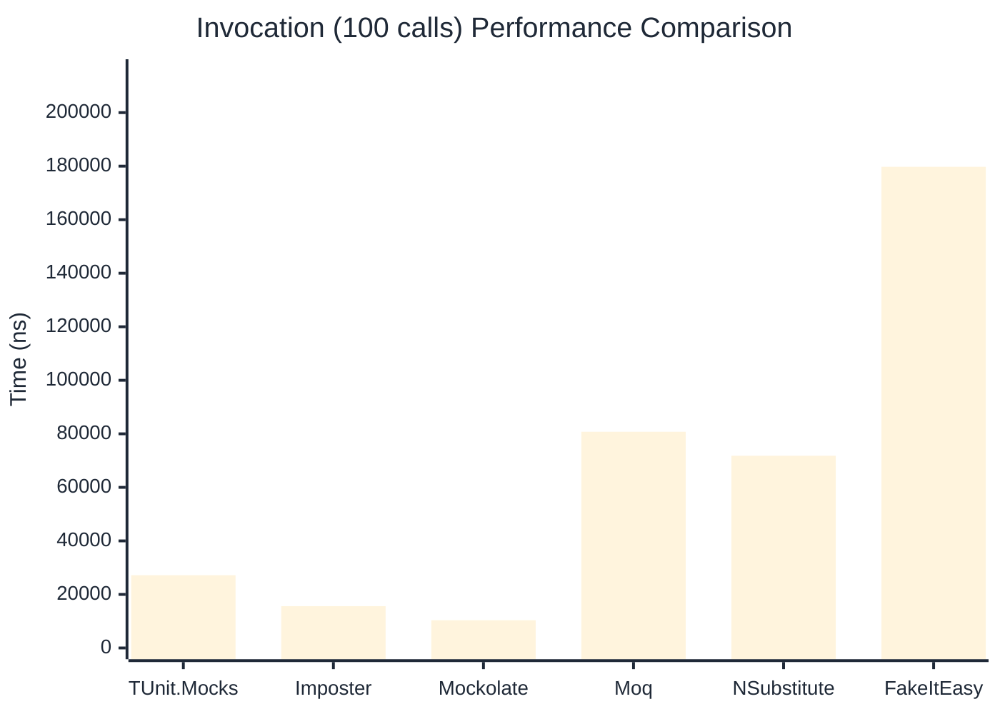

# Invocation Benchmark

> Calling methods on mock objects — comparing **TUnit.Mocks** (source-generated) against runtime proxy-based mocking libraries.

:::info Last Updated
This benchmark was automatically generated on **2026-10-22** from the latest CI run.

**Environment:** Ubuntu Latest • .NET SDK 10.0.402
:::

## 📊 Results

Calling methods on mock objects:

| Library | Mean | Error | StdDev | Allocated |
|---------|------|-------|--------|-----------|
| **TUnit.Mocks** | 275.33 ns | 71.845 ns | 3.938 ns | 128 B |
| Imposter | 162.65 ns | 54.850 ns | 3.007 ns | 96 B |
| Mockolate | 106.35 ns | 53.233 ns | 2.918 ns | 84 B |
| Moq | 857.95 ns | 703.462 ns | 38.559 ns | 376 B |
| NSubstitute | 737.66 ns | 475.999 ns | 26.091 ns | 304 B |
| FakeItEasy | 1,828.58 ns | 693.678 ns | 38.023 ns | 944 B |

---

### String

| Library | Mean | Error | StdDev | Allocated |
|---------|------|-------|--------|-----------|
| **TUnit.Mocks** | 166.44 ns | 64.446 ns | 3.533 ns | 96 B |
| Imposter | 174.40 ns | 3.492 ns | 0.191 ns | 96 B |
| Mockolate | 95.88 ns | 27.155 ns | 1.488 ns | 60 B |
| Moq | 534.98 ns | 72.402 ns | 3.969 ns | 296 B |
| NSubstitute | 621.58 ns | 235.100 ns | 12.887 ns | 272 B |
| FakeItEasy | 1,589.36 ns | 308.361 ns | 16.902 ns | 776 B |

---

### 100 calls

| Library | Mean | Error | StdDev | Allocated |
|---------|------|-------|--------|-----------|
| **TUnit.Mocks** | 27,178.86 ns | 9,473.300 ns | 519.264 ns | 12736 B |
| Imposter | 15,614.10 ns | 175.545 ns | 9.622 ns | 9600 B |
| Mockolate | 10,357.34 ns | 2,284.646 ns | 125.229 ns | 8400 B |
| Moq | 80,766.57 ns | 8,177.984 ns | 448.263 ns | 37600 B |
| NSubstitute | 71,815.65 ns | 19,743.362 ns | 1,082.200 ns | 30848 B |
| FakeItEasy | 179,750.77 ns | 80,017.069 ns | 4,386.006 ns | 94400 B |

## 🎯 Key Insights

This benchmark compares **TUnit.Mocks** (source-generated) against runtime proxy-based mocking libraries for calling methods on mock objects.

---

:::note Methodology
View the [mock benchmarks overview](/docs/benchmarks/mocks) for methodology details and environment information.
:::

*Last generated: 2026-10-22T02:34:37.393Z*
