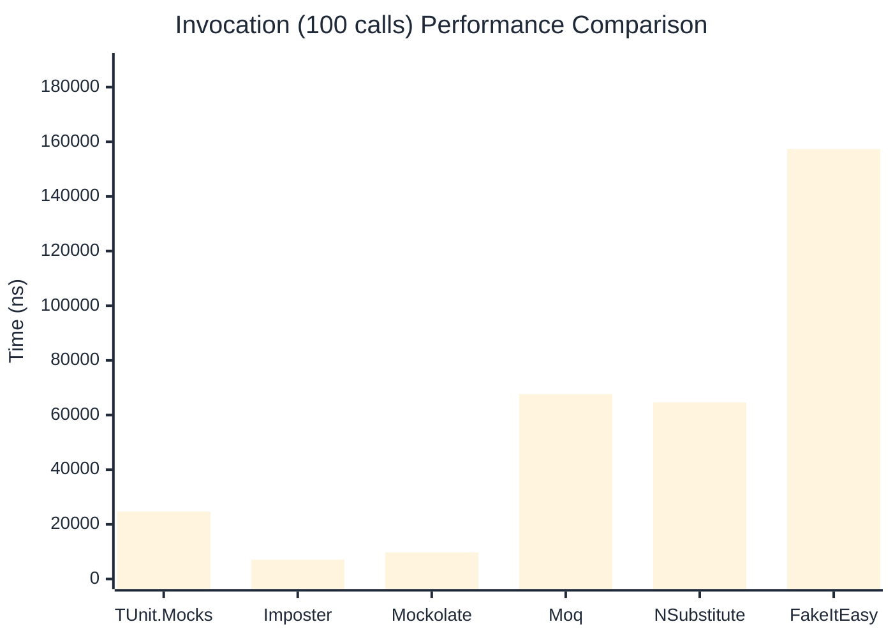

# Invocation Benchmark

> Calling methods on mock objects — comparing **TUnit.Mocks** (source-generated) against runtime proxy-based mocking libraries.

:::info Last Updated
This benchmark was automatically generated on **2026-11-11** from the latest CI run.

**Environment:** Ubuntu Latest • .NET SDK 11.0.100
:::

## 📊 Results

Calling methods on mock objects:

| Library | Mean | Error | StdDev | Allocated |
|---------|------|-------|--------|-----------|
| **TUnit.Mocks** | 259.08 ns | 180.21 ns | 9.878 ns | 128 B |
| Imposter | 72.04 ns | 47.10 ns | 2.582 ns | 48 B |
| Mockolate | 98.18 ns | 56.60 ns | 3.102 ns | 84 B |
| Moq | 709.61 ns | 506.38 ns | 27.756 ns | 376 B |
| NSubstitute | 636.83 ns | 116.64 ns | 6.393 ns | 304 B |
| FakeItEasy | 1,550.17 ns | 586.82 ns | 32.165 ns | 960 B |

---

### String

| Library | Mean | Error | StdDev | Allocated |
|---------|------|-------|--------|-----------|
| **TUnit.Mocks** | 164.15 ns | 248.10 ns | 13.599 ns | 96 B |
| Imposter | 73.66 ns | 49.00 ns | 2.686 ns | 48 B |
| Mockolate | 96.24 ns | 38.57 ns | 2.114 ns | 60 B |
| Moq | 494.00 ns | 171.28 ns | 9.388 ns | 296 B |
| NSubstitute | 540.84 ns | 91.98 ns | 5.042 ns | 272 B |
| FakeItEasy | 1,409.12 ns | 442.04 ns | 24.230 ns | 800 B |

---

### 100 calls

| Library | Mean | Error | StdDev | Allocated |
|---------|------|-------|--------|-----------|
| **TUnit.Mocks** | 24,693.95 ns | 26,094.16 ns | 1,430.309 ns | 12736 B |
| Imposter | 7,068.38 ns | 5,060.54 ns | 277.385 ns | 4800 B |
| Mockolate | 9,746.39 ns | 7,904.95 ns | 433.297 ns | 8400 B |
| Moq | 67,653.65 ns | 27,821.68 ns | 1,525.000 ns | 37600 B |
| NSubstitute | 64,620.39 ns | 14,665.66 ns | 803.874 ns | 30848 B |
| FakeItEasy | 157,336.89 ns | 135,566.77 ns | 7,430.872 ns | 96000 B |

## 🎯 Key Insights

This benchmark compares **TUnit.Mocks** (source-generated) against runtime proxy-based mocking libraries for calling methods on mock objects.

---

:::note Methodology
View the [mock benchmarks overview](/docs/benchmarks/mocks) for methodology details and environment information.
:::

*Last generated: 2026-11-11T02:20:11.802Z*
