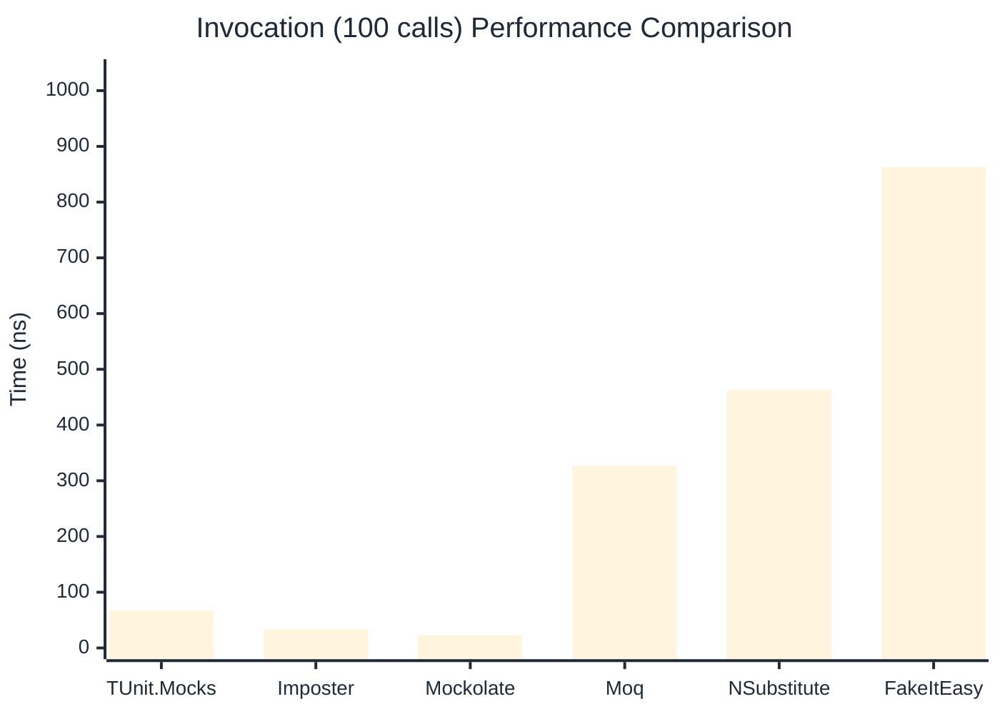
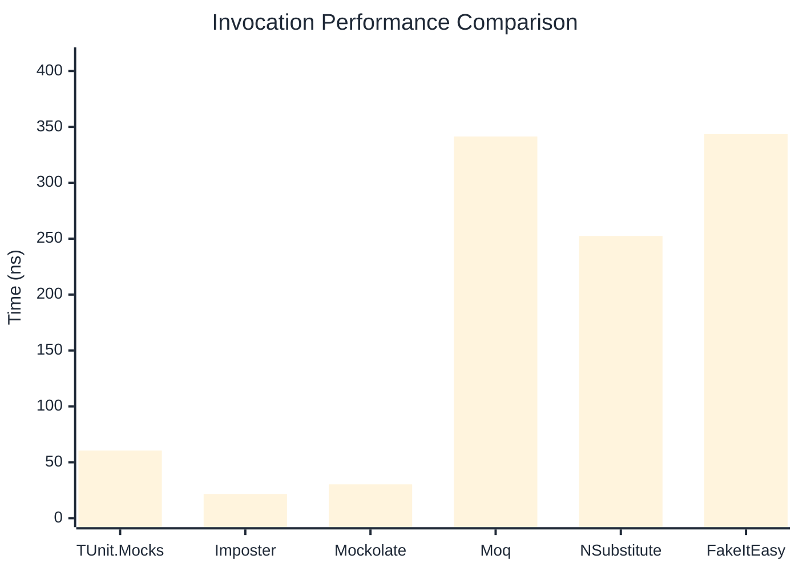
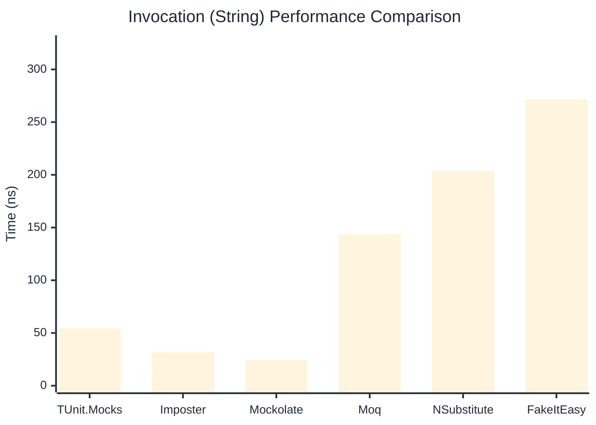

# Invocation Benchmark

> Calling methods on mock objects with bounded history; time and allocation are reported per call — comparing **TUnit.Mocks** (source-generated) against other source-generated and runtime proxy-based mocking libraries.

:::info Last Updated
This benchmark was automatically generated on **2026-11-26** from the latest CI run.

**Environment:** Ubuntu Latest • .NET SDK 11.0.100
:::

## 📊 Results

Calling methods on mock objects with bounded history; time and allocation are reported per call:

### 100 calls

| Library | Mean | Error | StdDev | Allocated |
|---------|------|-------|--------|-----------|
| **TUnit.Mocks** | 67.55 ns | 270.391 ns | 14.821 ns | 101 B |
| Imposter | 33.27 ns | 3.116 ns | 0.171 ns | 48 B |
| Mockolate | 22.67 ns | 11.476 ns | 0.629 ns | 56 B |
| Moq | 327.22 ns | 57.390 ns | 3.146 ns | 396 B |
| NSubstitute | 462.98 ns | 156.526 ns | 8.580 ns | 365 B |
| FakeItEasy | 862.89 ns | 445.902 ns | 24.441 ns | 981 B |

---

| Library | Mean | Error | StdDev | Allocated |
|---------|------|-------|--------|-----------|
| **TUnit.Mocks** | 60.51 ns | 16.283 ns | 0.893 ns | 108 B |
| Imposter | 21.58 ns | 1.030 ns | 0.056 ns | 48 B |
| Mockolate | 30.26 ns | 237.873 ns | 13.039 ns | 56 B |
| Moq | 341.35 ns | 70.273 ns | 3.852 ns | 392 B |
| NSubstitute | 252.46 ns | 28.073 ns | 1.539 ns | 320 B |
| FakeItEasy | 343.49 ns | 64.110 ns | 3.514 ns | 992 B |

---

### String

| Library | Mean | Error | StdDev | Allocated |
|---------|------|-------|--------|-----------|
| **TUnit.Mocks** | 54.48 ns | 7.769 ns | 0.426 ns | 98 B |
| Imposter | 31.80 ns | 9.301 ns | 0.510 ns | 48 B |
| Mockolate | 24.33 ns | 12.669 ns | 0.694 ns | 56 B |
| Moq | 143.75 ns | 71.784 ns | 3.935 ns | 312 B |
| NSubstitute | 203.61 ns | 32.957 ns | 1.806 ns | 288 B |
| FakeItEasy | 271.55 ns | 17.358 ns | 0.951 ns | 832 B |

## 🎯 Key Insights

This benchmark compares **TUnit.Mocks** (source-generated) against other source-generated and runtime proxy-based mocking libraries for calling methods on mock objects with bounded history; time and allocation are reported per call.

---

:::note Methodology
View the [mock benchmarks overview](/docs/benchmarks/mocks) for methodology details and environment information.
:::

*Last generated: 2026-11-26T02:21:09.958Z*
