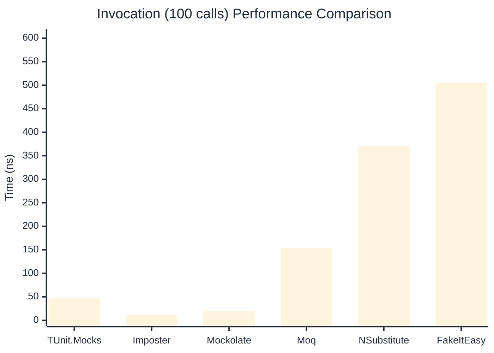
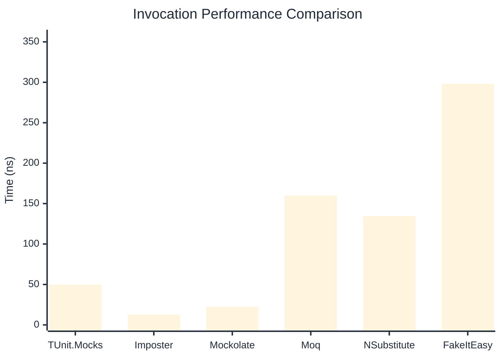
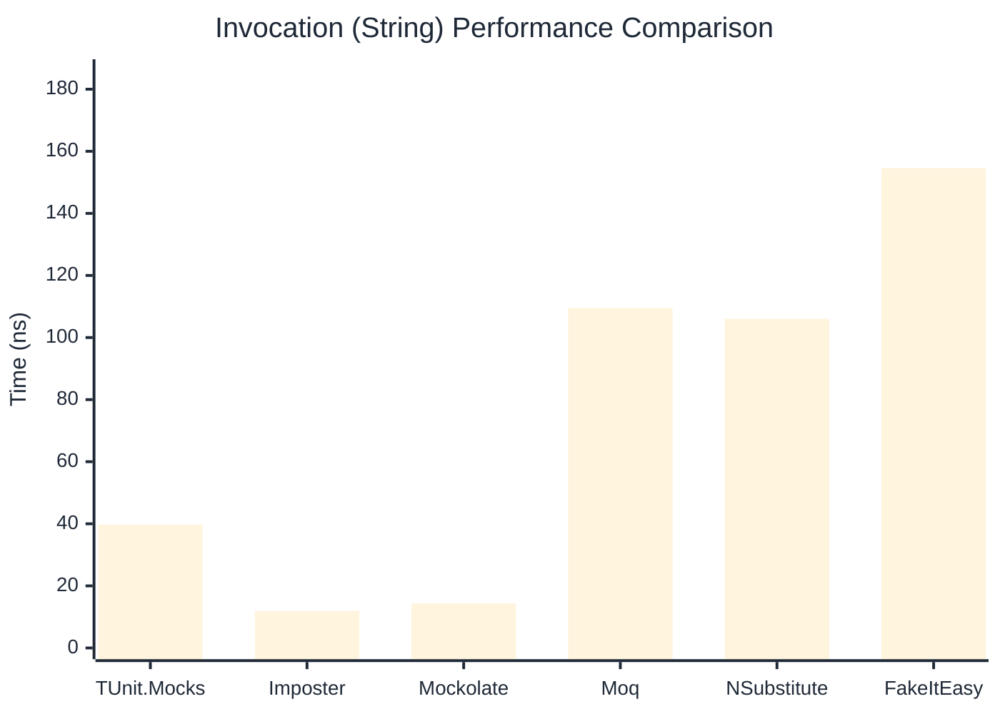

# Invocation Benchmark

> Calling methods on mock objects with bounded history; time and allocation are reported per call — comparing **TUnit.Mocks** (source-generated) against other source-generated and runtime proxy-based mocking libraries.

:::info Last Updated
This benchmark was automatically generated on **2026-11-24** from the latest CI run.

**Environment:** Ubuntu Latest • .NET SDK 11.0.100
:::

## 📊 Results

Calling methods on mock objects with bounded history; time and allocation are reported per call:

### 100 calls

| Library | Mean | Error | StdDev | Allocated |
|---------|------|-------|--------|-----------|
| **TUnit.Mocks** | 47.43 ns | 22.038 ns | 1.208 ns | 101 B |
| Imposter | 12.02 ns | 3.062 ns | 0.168 ns | 48 B |
| Mockolate | 20.20 ns | 13.744 ns | 0.753 ns | 56 B |
| Moq | 153.68 ns | 22.075 ns | 1.210 ns | 396 B |
| NSubstitute | 371.50 ns | 2,948.419 ns | 161.613 ns | 365 B |
| FakeItEasy | 505.36 ns | 39.123 ns | 2.144 ns | 981 B |

---

| Library | Mean | Error | StdDev | Allocated |
|---------|------|-------|--------|-----------|
| **TUnit.Mocks** | 49.81 ns | 5.317 ns | 0.291 ns | 108 B |
| Imposter | 12.65 ns | 10.406 ns | 0.570 ns | 48 B |
| Mockolate | 22.27 ns | 6.386 ns | 0.350 ns | 56 B |
| Moq | 160.02 ns | 58.479 ns | 3.205 ns | 392 B |
| NSubstitute | 134.60 ns | 14.260 ns | 0.782 ns | 320 B |
| FakeItEasy | 298.13 ns | 33.439 ns | 1.833 ns | 992 B |

---

### String

| Library | Mean | Error | StdDev | Allocated |
|---------|------|-------|--------|-----------|
| **TUnit.Mocks** | 39.74 ns | 15.897 ns | 0.871 ns | 98 B |
| Imposter | 11.92 ns | 8.960 ns | 0.491 ns | 48 B |
| Mockolate | 14.33 ns | 2.939 ns | 0.161 ns | 56 B |
| Moq | 109.49 ns | 26.840 ns | 1.471 ns | 312 B |
| NSubstitute | 106.02 ns | 25.460 ns | 1.396 ns | 288 B |
| FakeItEasy | 154.61 ns | 17.594 ns | 0.964 ns | 832 B |

## 🎯 Key Insights

This benchmark compares **TUnit.Mocks** (source-generated) against other source-generated and runtime proxy-based mocking libraries for calling methods on mock objects with bounded history; time and allocation are reported per call.

---

:::note Methodology
View the [mock benchmarks overview](/docs/benchmarks/mocks) for methodology details and environment information.
:::

*Last generated: 2026-11-24T02:20:52.556Z*
