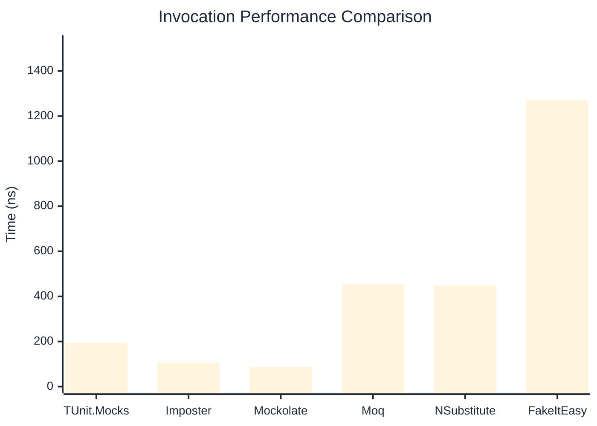
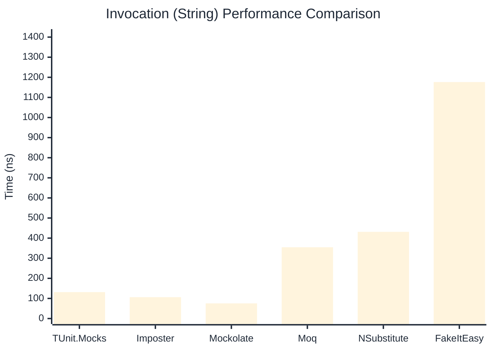
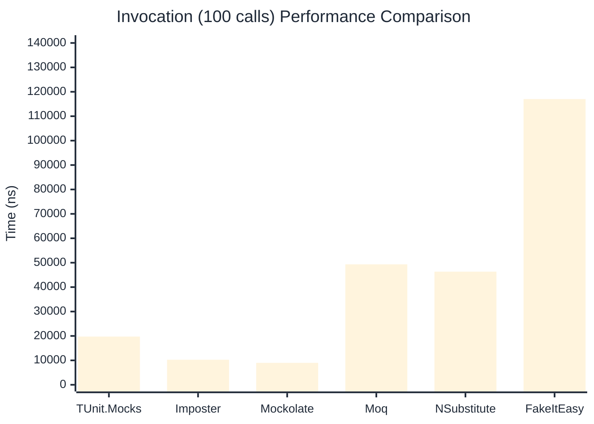

# Invocation Benchmark

> Calling methods on mock objects — comparing **TUnit.Mocks** (source-generated) against runtime proxy-based mocking libraries.

:::info Last Updated
This benchmark was automatically generated on **2026-10-16** from the latest CI run.

**Environment:** Ubuntu Latest • .NET SDK 10.0.402
:::

## 📊 Results

Calling methods on mock objects:

| Library | Mean | Error | StdDev | Allocated |
|---------|------|-------|--------|-----------|
| **TUnit.Mocks** | 194.53 ns | 180.94 ns | 9.918 ns | 128 B |
| Imposter | 106.20 ns | 17.34 ns | 0.950 ns | 96 B |
| Mockolate | 87.69 ns | 70.57 ns | 3.868 ns | 84 B |
| Moq | 454.11 ns | 230.72 ns | 12.647 ns | 376 B |
| NSubstitute | 448.31 ns | 180.56 ns | 9.897 ns | 304 B |
| FakeItEasy | 1,272.55 ns | 449.30 ns | 24.628 ns | 944 B |

---

### String

| Library | Mean | Error | StdDev | Allocated |
|---------|------|-------|--------|-----------|
| **TUnit.Mocks** | 131.47 ns | 114.15 ns | 6.257 ns | 96 B |
| Imposter | 106.28 ns | 33.29 ns | 1.825 ns | 96 B |
| Mockolate | 75.37 ns | 62.98 ns | 3.452 ns | 60 B |
| Moq | 354.56 ns | 224.64 ns | 12.313 ns | 296 B |
| NSubstitute | 431.30 ns | 133.97 ns | 7.343 ns | 328 B |
| FakeItEasy | 1,176.39 ns | 166.06 ns | 9.103 ns | 776 B |

---

### 100 calls

| Library | Mean | Error | StdDev | Allocated |
|---------|------|-------|--------|-----------|
| **TUnit.Mocks** | 19,754.04 ns | 17,482.39 ns | 958.269 ns | 12736 B |
| Imposter | 10,259.62 ns | 4,574.02 ns | 250.718 ns | 9600 B |
| Mockolate | 8,989.01 ns | 2,578.89 ns | 141.358 ns | 8400 B |
| Moq | 49,331.31 ns | 43,408.07 ns | 2,379.343 ns | 37600 B |
| NSubstitute | 46,336.55 ns | 5,032.94 ns | 275.873 ns | 30848 B |
| FakeItEasy | 117,025.79 ns | 61,036.18 ns | 3,345.599 ns | 94400 B |

## 🎯 Key Insights

This benchmark compares **TUnit.Mocks** (source-generated) against runtime proxy-based mocking libraries for calling methods on mock objects.

---

:::note Methodology
View the [mock benchmarks overview](/docs/benchmarks/mocks) for methodology details and environment information.
:::

*Last generated: 2026-10-16T03:11:30.127Z*
