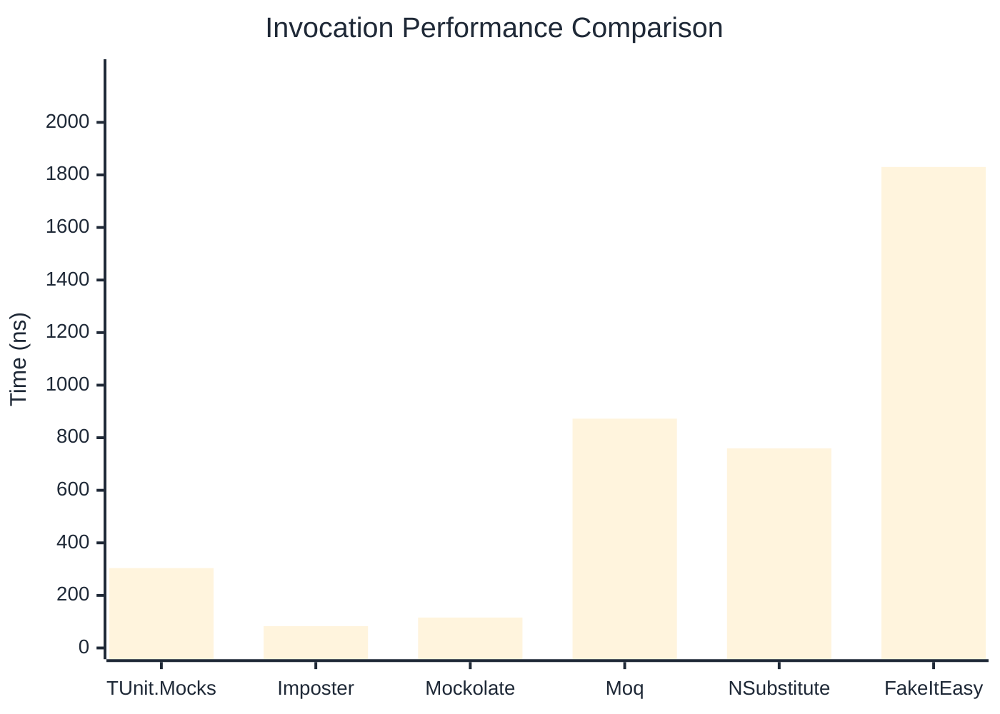

# Invocation Benchmark

> Calling methods on mock objects — comparing **TUnit.Mocks** (source-generated) against runtime proxy-based mocking libraries.

:::info Last Updated
This benchmark was automatically generated on **2026-11-06** from the latest CI run.

**Environment:** Ubuntu Latest • .NET SDK 10.0.403
:::

## 📊 Results

Calling methods on mock objects:

| Library | Mean | Error | StdDev | Allocated |
|---------|------|-------|--------|-----------|
| **TUnit.Mocks** | 303.80 ns | 364.546 ns | 19.982 ns | 128 B |
| Imposter | 83.24 ns | 9.438 ns | 0.517 ns | 48 B |
| Mockolate | 115.71 ns | 62.641 ns | 3.434 ns | 84 B |
| Moq | 872.52 ns | 274.811 ns | 15.063 ns | 376 B |
| NSubstitute | 759.33 ns | 193.205 ns | 10.590 ns | 304 B |
| FakeItEasy | 1,830.36 ns | 360.017 ns | 19.734 ns | 944 B |

---

### String

| Library | Mean | Error | StdDev | Allocated |
|---------|------|-------|--------|-----------|
| **TUnit.Mocks** | 185.68 ns | 335.560 ns | 18.393 ns | 96 B |
| Imposter | 85.24 ns | 8.090 ns | 0.443 ns | 48 B |
| Mockolate | 109.67 ns | 44.951 ns | 2.464 ns | 60 B |
| Moq | 573.34 ns | 265.007 ns | 14.526 ns | 296 B |
| NSubstitute | 636.49 ns | 49.226 ns | 2.698 ns | 272 B |
| FakeItEasy | 1,657.23 ns | 87.158 ns | 4.777 ns | 776 B |

---

### 100 calls

| Library | Mean | Error | StdDev | Allocated |
|---------|------|-------|--------|-----------|
| **TUnit.Mocks** | 29,700.60 ns | 28,063.757 ns | 1,538.269 ns | 12736 B |
| Imposter | 8,205.97 ns | 667.973 ns | 36.614 ns | 4800 B |
| Mockolate | 11,368.56 ns | 6,173.524 ns | 338.392 ns | 8400 B |
| Moq | 86,487.32 ns | 29,514.769 ns | 1,617.804 ns | 37600 B |
| NSubstitute | 75,380.17 ns | 29,419.822 ns | 1,612.600 ns | 30848 B |
| FakeItEasy | 189,431.03 ns | 64,286.539 ns | 3,523.762 ns | 94400 B |

## 🎯 Key Insights

This benchmark compares **TUnit.Mocks** (source-generated) against runtime proxy-based mocking libraries for calling methods on mock objects.

---

:::note Methodology
View the [mock benchmarks overview](/docs/benchmarks/mocks) for methodology details and environment information.
:::

*Last generated: 2026-11-06T02:27:23.366Z*
