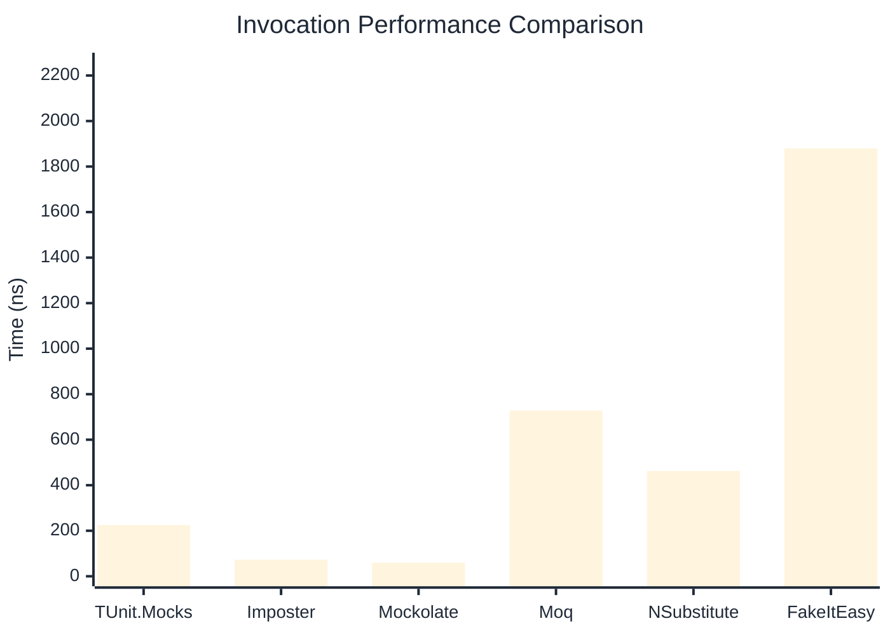
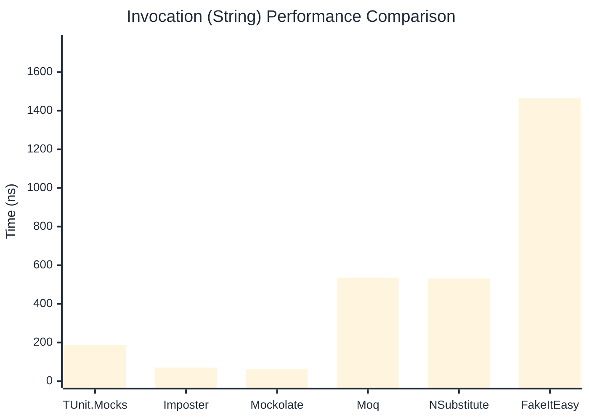
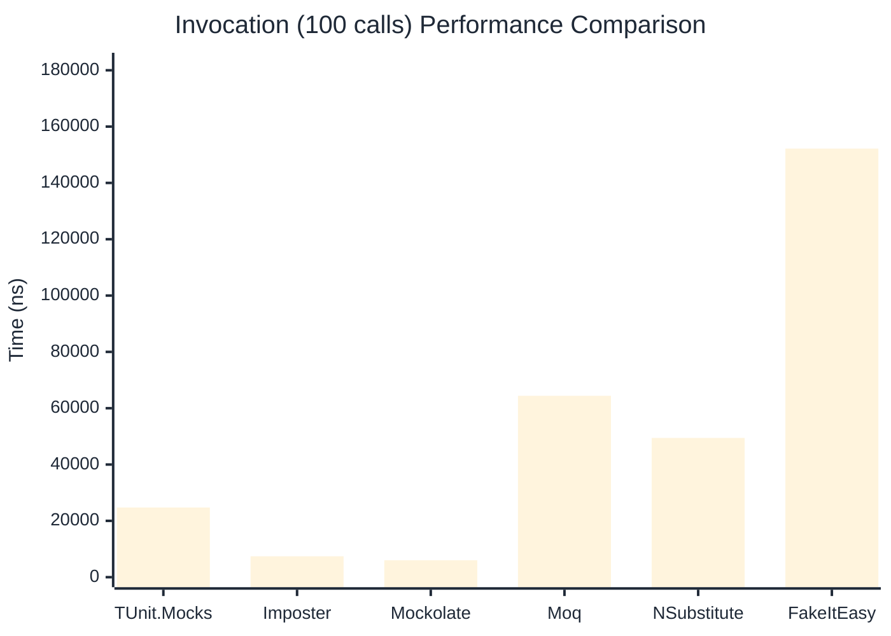

# Invocation Benchmark

> Calling methods on mock objects — comparing **TUnit.Mocks** (source-generated) against other source-generated and runtime proxy-based mocking libraries.

:::info Last Updated
This benchmark was automatically generated on **2026-11-19** from the latest CI run.

**Environment:** Ubuntu Latest • .NET SDK 11.0.100
:::

## 📊 Results

Calling methods on mock objects:

| Library | Mean | Error | StdDev | Allocated |
|---------|------|-------|--------|-----------|
| **TUnit.Mocks** | 224.81 ns | 17.82 ns | 0.977 ns | 128 B |
| Imposter | 72.51 ns | 37.04 ns | 2.030 ns | 48 B |
| Mockolate | 59.44 ns | 85.04 ns | 4.661 ns | 34 B |
| Moq | 727.57 ns | 802.67 ns | 43.997 ns | 376 B |
| NSubstitute | 462.52 ns | 258.53 ns | 14.171 ns | 304 B |
| FakeItEasy | 1,879.71 ns | 572.42 ns | 31.376 ns | 960 B |

---

### String

| Library | Mean | Error | StdDev | Allocated |
|---------|------|-------|--------|-----------|
| **TUnit.Mocks** | 187.12 ns | 146.67 ns | 8.040 ns | 96 B |
| Imposter | 70.05 ns | 67.01 ns | 3.673 ns | 48 B |
| Mockolate | 61.54 ns | 28.97 ns | 1.588 ns | 34 B |
| Moq | 535.89 ns | 421.18 ns | 23.086 ns | 296 B |
| NSubstitute | 531.44 ns | 402.05 ns | 22.038 ns | 272 B |
| FakeItEasy | 1,464.53 ns | 625.27 ns | 34.273 ns | 800 B |

---

### 100 calls

| Library | Mean | Error | StdDev | Allocated |
|---------|------|-------|--------|-----------|
| **TUnit.Mocks** | 24,743.02 ns | 29,522.03 ns | 1,618.202 ns | 12736 B |
| Imposter | 7,419.73 ns | 11,008.46 ns | 603.411 ns | 4800 B |
| Mockolate | 6,010.50 ns | 5,521.62 ns | 302.659 ns | 3350 B |
| Moq | 64,409.13 ns | 142,704.13 ns | 7,822.095 ns | 37600 B |
| NSubstitute | 49,446.31 ns | 91,037.10 ns | 4,990.050 ns | 30848 B |
| FakeItEasy | 152,191.69 ns | 30,124.60 ns | 1,651.231 ns | 96000 B |

## 🎯 Key Insights

This benchmark compares **TUnit.Mocks** (source-generated) against other source-generated and runtime proxy-based mocking libraries for calling methods on mock objects.

---

:::note Methodology
View the [mock benchmarks overview](/docs/benchmarks/mocks) for methodology details and environment information.
:::

*Last generated: 2026-11-19T02:23:19.275Z*
