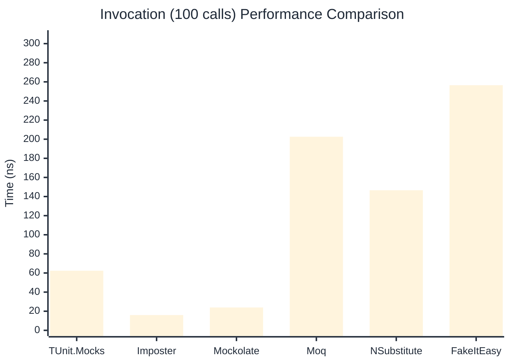
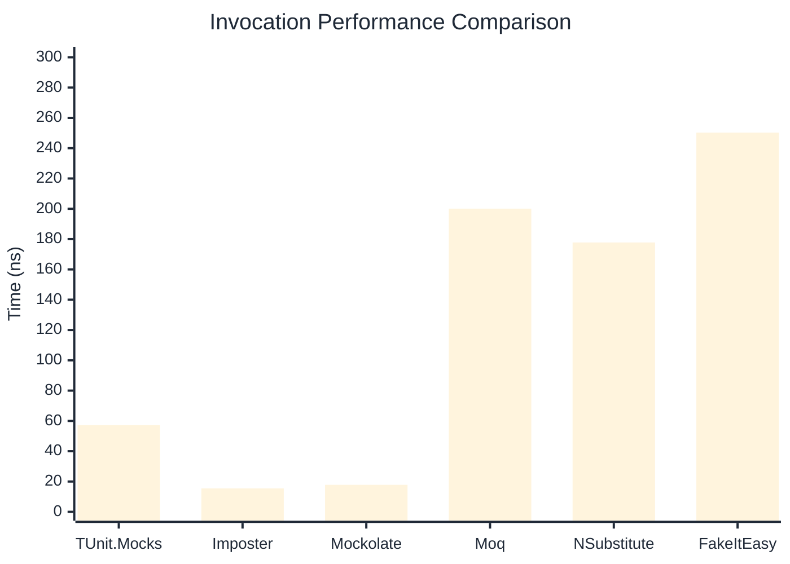
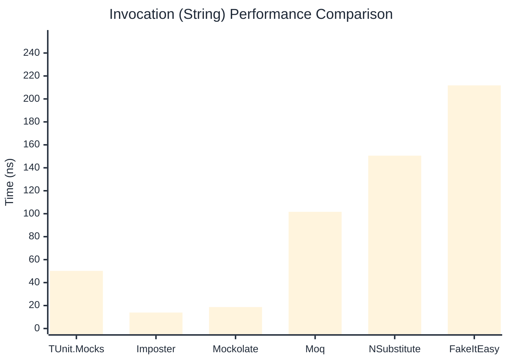

# Invocation Benchmark

> Calling methods on mock objects with bounded history; time and allocation are reported per call — comparing **TUnit.Mocks** (source-generated) against other source-generated and runtime proxy-based mocking libraries.

:::info Last Updated
This benchmark was automatically generated on **2026-11-23** from the latest CI run.

**Environment:** Ubuntu Latest • .NET SDK 11.0.100
:::

## 📊 Results

Calling methods on mock objects with bounded history; time and allocation are reported per call:

### 100 calls

| Library | Mean | Error | StdDev | Allocated |
|---------|------|-------|--------|-----------|
| **TUnit.Mocks** | 62.37 ns | 142.389 ns | 7.805 ns | 101 B |
| Imposter | 16.00 ns | 9.377 ns | 0.514 ns | 48 B |
| Mockolate | 23.92 ns | 4.097 ns | 0.225 ns | 56 B |
| Moq | 202.57 ns | 15.180 ns | 0.832 ns | 396 B |
| NSubstitute | 146.58 ns | 28.872 ns | 1.583 ns | 309 B |
| FakeItEasy | 256.47 ns | 39.428 ns | 2.161 ns | 981 B |

---

| Library | Mean | Error | StdDev | Allocated |
|---------|------|-------|--------|-----------|
| **TUnit.Mocks** | 57.23 ns | 2.900 ns | 0.159 ns | 108 B |
| Imposter | 15.47 ns | 8.484 ns | 0.465 ns | 48 B |
| Mockolate | 17.81 ns | 17.541 ns | 0.961 ns | 56 B |
| Moq | 200.10 ns | 13.981 ns | 0.766 ns | 392 B |
| NSubstitute | 177.77 ns | 75.407 ns | 4.133 ns | 376 B |
| FakeItEasy | 250.24 ns | 44.378 ns | 2.433 ns | 992 B |

---

### String

| Library | Mean | Error | StdDev | Allocated |
|---------|------|-------|--------|-----------|
| **TUnit.Mocks** | 50.21 ns | 0.807 ns | 0.044 ns | 98 B |
| Imposter | 13.91 ns | 1.331 ns | 0.073 ns | 48 B |
| Mockolate | 18.69 ns | 13.113 ns | 0.719 ns | 56 B |
| Moq | 101.66 ns | 39.392 ns | 2.159 ns | 312 B |
| NSubstitute | 150.60 ns | 11.454 ns | 0.628 ns | 344 B |
| FakeItEasy | 211.81 ns | 64.148 ns | 3.516 ns | 832 B |

## 🎯 Key Insights

This benchmark compares **TUnit.Mocks** (source-generated) against other source-generated and runtime proxy-based mocking libraries for calling methods on mock objects with bounded history; time and allocation are reported per call.

---

:::note Methodology
View the [mock benchmarks overview](/docs/benchmarks/mocks) for methodology details and environment information.
:::

*Last generated: 2026-11-23T02:22:45.286Z*
