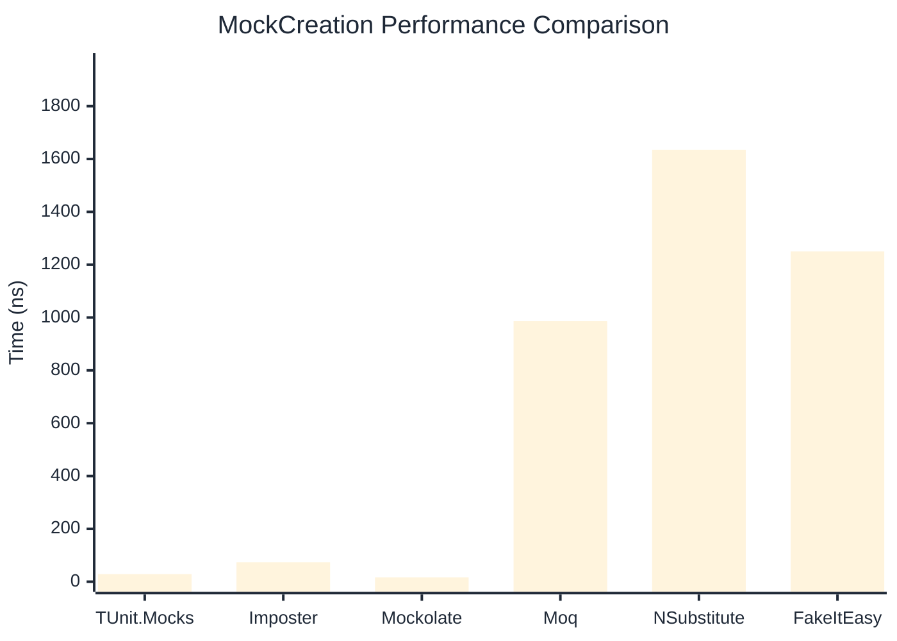
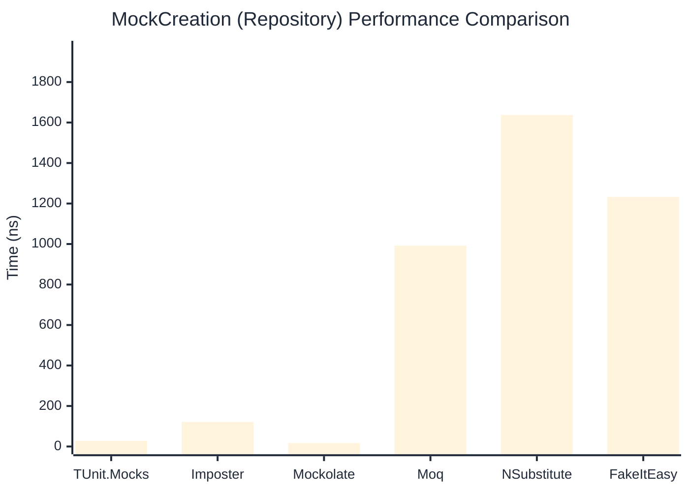

# MockCreation Benchmark

> Mock instance creation performance — comparing **TUnit.Mocks** (source-generated) against runtime proxy-based mocking libraries.

:::info Last Updated
This benchmark was automatically generated on **2026-11-08** from the latest CI run.

**Environment:** Ubuntu Latest • .NET SDK 10.0.403
:::

## 📊 Results

Mock instance creation performance:

| Library | Mean | Error | StdDev | Allocated |
|---------|------|-------|--------|-----------|
| **TUnit.Mocks** | 28.68 ns | 0.647 ns | 1.525 ns | 216 B |
| Imposter | 73.38 ns | 1.502 ns | 1.542 ns | 360 B |
| Mockolate | 16.66 ns | 0.317 ns | 0.281 ns | 160 B |
| Moq | 986.16 ns | 12.309 ns | 10.912 ns | 2048 B |
| NSubstitute | 1,634.60 ns | 23.022 ns | 21.535 ns | 5000 B |
| FakeItEasy | 1,250.09 ns | 13.412 ns | 11.889 ns | 2709 B |

---

### Repository

| Library | Mean | Error | StdDev | Allocated |
|---------|------|-------|--------|-----------|
| **TUnit.Mocks** | 28.28 ns | 0.642 ns | 0.999 ns | 216 B |
| Imposter | 121.16 ns | 2.504 ns | 4.514 ns | 568 B |
| Mockolate | 17.20 ns | 0.416 ns | 0.369 ns | 176 B |
| Moq | 992.12 ns | 10.383 ns | 9.204 ns | 1912 B |
| NSubstitute | 1,637.39 ns | 15.850 ns | 14.050 ns | 5000 B |
| FakeItEasy | 1,232.46 ns | 9.521 ns | 7.951 ns | 2709 B |

## 🎯 Key Insights

This benchmark compares **TUnit.Mocks** (source-generated) against runtime proxy-based mocking libraries for mock instance creation performance.

---

:::note Methodology
View the [mock benchmarks overview](/docs/benchmarks/mocks) for methodology details and environment information.
:::

*Last generated: 2026-11-08T02:26:36.812Z*
