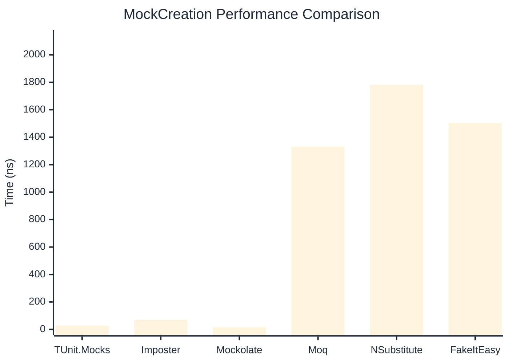

# MockCreation Benchmark

> Mock instance creation performance — comparing **TUnit.Mocks** (source-generated) against other source-generated and runtime proxy-based mocking libraries.

:::info Last Updated
This benchmark was automatically generated on **2026-11-23** from the latest CI run.

**Environment:** Ubuntu Latest • .NET SDK 11.0.100
:::

## 📊 Results

Mock instance creation performance:

| Library | Mean | Error | StdDev | Allocated |
|---------|------|-------|--------|-----------|
| **TUnit.Mocks** | 27.08 ns | 0.537 ns | 1.144 ns | 216 B |
| Imposter | 70.02 ns | 1.370 ns | 1.964 ns | 360 B |
| Mockolate | 15.56 ns | 0.309 ns | 0.380 ns | 136 B |
| Moq | 1,330.06 ns | 14.451 ns | 13.517 ns | 2040 B |
| NSubstitute | 1,781.00 ns | 26.925 ns | 25.186 ns | 4984 B |
| FakeItEasy | 1,502.68 ns | 25.228 ns | 23.598 ns | 2706 B |

---

### Repository

| Library | Mean | Error | StdDev | Allocated |
|---------|------|-------|--------|-----------|
| **TUnit.Mocks** | 26.46 ns | 0.488 ns | 0.600 ns | 216 B |
| Imposter | 109.07 ns | 1.405 ns | 1.246 ns | 568 B |
| Mockolate | 15.86 ns | 0.304 ns | 0.385 ns | 136 B |
| Moq | 1,225.93 ns | 7.908 ns | 7.397 ns | 1904 B |
| NSubstitute | 1,830.33 ns | 23.582 ns | 20.905 ns | 4984 B |
| FakeItEasy | 1,545.23 ns | 15.681 ns | 13.901 ns | 2706 B |

## 🎯 Key Insights

This benchmark compares **TUnit.Mocks** (source-generated) against other source-generated and runtime proxy-based mocking libraries for mock instance creation performance.

---

:::note Methodology
View the [mock benchmarks overview](/docs/benchmarks/mocks) for methodology details and environment information.
:::

*Last generated: 2026-11-23T02:22:45.286Z*
