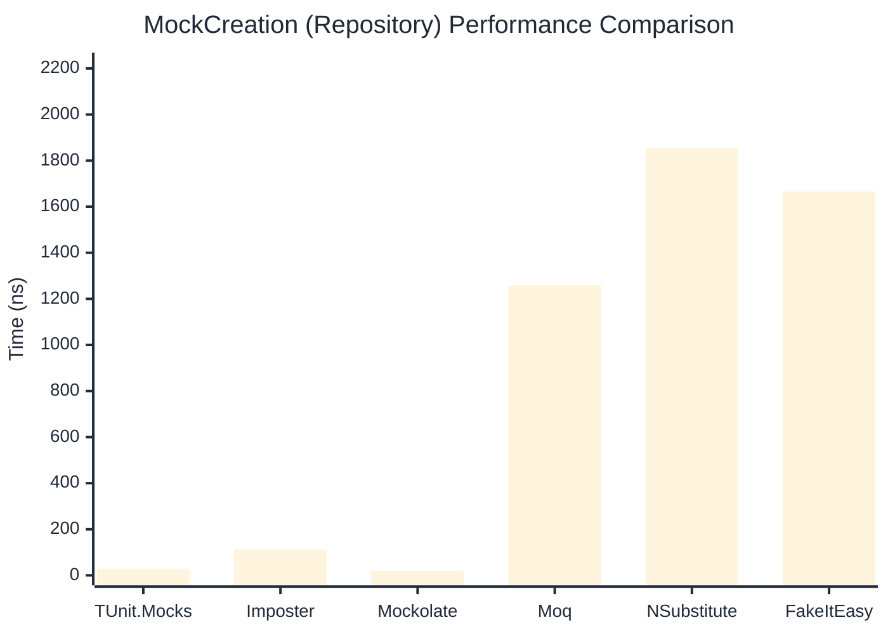

# MockCreation Benchmark

> Mock instance creation performance — comparing **TUnit.Mocks** (source-generated) against runtime proxy-based mocking libraries.

:::info Last Updated
This benchmark was automatically generated on **2026-11-18** from the latest CI run.

**Environment:** Ubuntu Latest • .NET SDK 11.0.100
:::

## 📊 Results

Mock instance creation performance:

| Library | Mean | Error | StdDev | Allocated |
|---------|------|-------|--------|-----------|
| **TUnit.Mocks** | 27.19 ns | 0.533 ns | 0.498 ns | 216 B |
| Imposter | 68.92 ns | 1.311 ns | 1.288 ns | 360 B |
| Mockolate | 16.11 ns | 0.322 ns | 0.269 ns | 160 B |
| Moq | 1,275.87 ns | 20.445 ns | 19.124 ns | 2040 B |
| NSubstitute | 1,885.19 ns | 22.987 ns | 20.377 ns | 4984 B |
| FakeItEasy | 1,479.99 ns | 14.314 ns | 11.953 ns | 2706 B |

---

### Repository

| Library | Mean | Error | StdDev | Allocated |
|---------|------|-------|--------|-----------|
| **TUnit.Mocks** | 26.87 ns | 0.530 ns | 0.611 ns | 216 B |
| Imposter | 111.92 ns | 2.233 ns | 4.139 ns | 568 B |
| Mockolate | 17.60 ns | 0.340 ns | 0.334 ns | 176 B |
| Moq | 1,259.36 ns | 15.689 ns | 14.676 ns | 1904 B |
| NSubstitute | 1,853.36 ns | 25.908 ns | 24.234 ns | 4984 B |
| FakeItEasy | 1,665.70 ns | 25.574 ns | 23.922 ns | 2706 B |

## 🎯 Key Insights

This benchmark compares **TUnit.Mocks** (source-generated) against runtime proxy-based mocking libraries for mock instance creation performance.

---

:::note Methodology
View the [mock benchmarks overview](/docs/benchmarks/mocks) for methodology details and environment information.
:::

*Last generated: 2026-11-18T02:25:26.946Z*
